# DP 优化方法：从转移结构到优化工具

> 先写出朴素转移，再找它重复计算的部分。优化方法不是模板名的匹配题：必须证明候选集合、决策顺序或函数形状满足对应条件。

## 目录

1. [常见技巧](#1-常见技巧)
   - [前缀和优化 DP](#11-前缀和优化-dp)
   - [SOS DP](#12-sos-dp子集和变换)
   - [单调队列优化 DP](#13-单调队列优化-dp)
   - [单调栈优化 DP](#14-单调栈优化-dp)
   - [线段树与树状数组优化 DP](#15-线段树与树状数组优化-dp)
   - [CDQ 分治优化 DP](#16-cdq-分治优化-dp)
   - [倍增优化 DP](#17-倍增优化-dp)
2. [利用问题结构](#2-利用问题结构)
   - [斜率优化 DP](#21-斜率优化-dp)
   - [分治优化与决策单调性](#22-分治优化与决策单调性)
   - [四边形不等式与 Knuth 优化](#23-四边形不等式与-knuth-优化)
   - [Slope Trick](#24-slope-trick)
   - [WQS 二分](#25-wqs-二分凸优化-dp)
3. [利用数学方法](#3-利用数学方法)
   - [矩阵快速幂优化 DP](#31-矩阵快速幂优化-dp)
   - [卷积与 FFT/NTT 优化 DP](#32-卷积与-fftntt-优化-dp)
   - [Lagrange 插值优化 DP](#33-lagrange-插值优化-dp)
4. [简化状态](#4-简化状态)
   - [DP 套 DP 与 DFA 最小化](#41-dp-套-dp-与-dfa-最小化)
   - [状态设计优化](#42-状态设计优化)
5. [优化组合与练习入口](#5-优化组合与练习入口)
6. [如何选方法](#6-如何选方法)

---

## 1. 常见技巧

这一组方法把每次 DP 转移看作查询和修改，或者把重复出现的区间/子集求和提取出来。重点是确认**哪些旧状态当前可用**，以及**当前状态应在什么时候写入数据结构**。

### 1.1 前缀和优化 DP

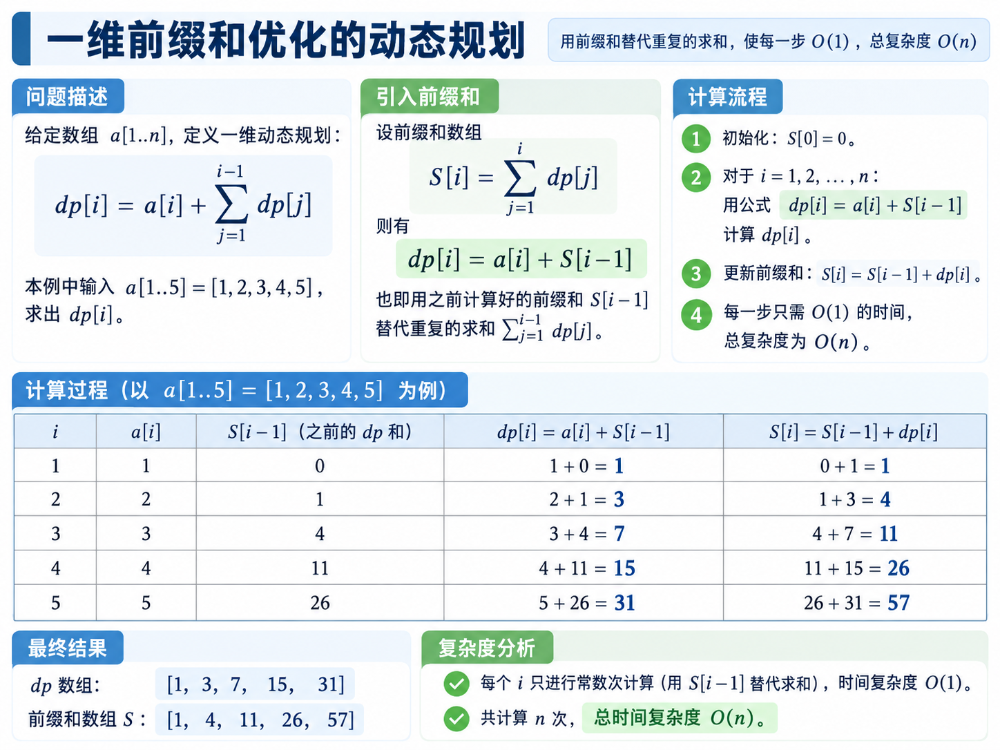

**朴素转移**常见为：

`dp[i] = a[i] + sum(dp[j]), 1 <= j < i`。

每个 `i` 都重新扫描此前所有状态，总时间是 `O(n^2)`。令 `sum[i] = sum(dp[1..i])`，转移就变成：

- `dp[i] = a[i] + sum[i - 1]`
- `sum[i] = sum[i - 1] + dp[i]`

每个状态只需 `O(1)`，总时间降为 `O(n)`。若求的是区间和，则用 `sum[r] - sum[l - 1]`。

**适用条件**：转移里反复出现连续下标的一段和，或者若干状态可以按下标排序后累计。前缀和只加速聚合，不会自动处理最值；区间最值一般需要单调队列、稀疏表或线段树。

**边界检查**：确认前缀下标与 DP 下标一致；计数题的加法通常要取模；负数或模数下不要把“前缀和”误当成“前缀最值”。

### 1.2 SOS DP（子集和变换）

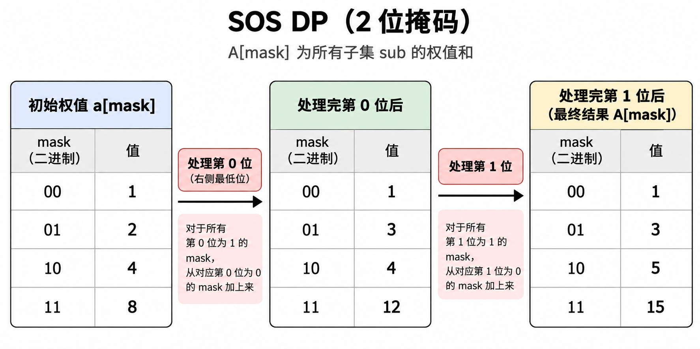

设 `a[mask]` 是一个集合状态的初始权值，希望对所有 `mask` 求：

`F[mask] = sum(a[sub])，其中 sub 是 mask 的子集`。

直接枚举所有 `mask` 的子集，复杂度可达 `O(3^k)`。SOS DP 按位逐层传播：处理第 `b` 位时，对该位为 `1` 的掩码，把去掉这一位的状态贡献并入当前状态。每一位只做一轮，因此复杂度是 `O(k * 2^k)`。

**它和普通前缀和的关系**：普通前缀和沿一个有序维度累计；SOS DP 是在每个二进制维度上做子集/超集聚合。它是高维前缀和的常用实现。

**适用场景**：状态本身是集合掩码，转移要聚合所有子集、超集，或所有满足位包含关系的状态。若需要超集和，把传播方向改成从少位到多位的相反方向；先写出目标集合再推传播方向，不能背错方向。

**复杂度与边界**：`k` 位需要 `2^k` 个状态；通常要 `O(k2^k)` 时间和 `O(2^k)` 空间。先估算状态数组是否放得下。求和变换可直接逐位累加；若换成 `min/max` 等运算，要重新确认该运算下的传播和去重是否正确。

### 1.3 单调队列优化 DP

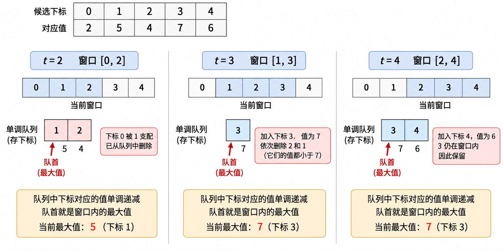

**朴素转移**：

`dp[i] = base[i] + max(dp[j])，j 属于一个随 i 移动的窗口`。

窗口每次只向右移动少量位置，若每一步都扫描整个窗口，可能是 `O(nW)`。单调队列保存窗口中仍可能成为最值的候选下标，并维持对应值单调：

1. 新候选进入时，从队尾删除被新候选支配的旧候选。
2. 窗口左端右移时，从队首删除已过期下标。
3. 队首就是当前窗口最值。

每个下标最多进入、离开队列一次，总时间 `O(n)`。

**两条正确性条件**：

- **队尾淘汰**：被删候选在未来有效期内，始终不优于新候选。
- **队首过期**：候选的有效区间左端随查询单调右移；否则过期元素不一定只会出现在队首。

常见例子是有界背包。固定容量对物品重量取模后，转移可变成滑动窗口最值；每个余数类单独维护一个队列。

**不要混淆**：有界背包的二进制拆分把件数变成若干个 0/1 物品；单调队列则改写转移并维护滑动窗口最大/最小值。二者依据不同，复杂度也不同。

### 1.4 单调栈优化 DP

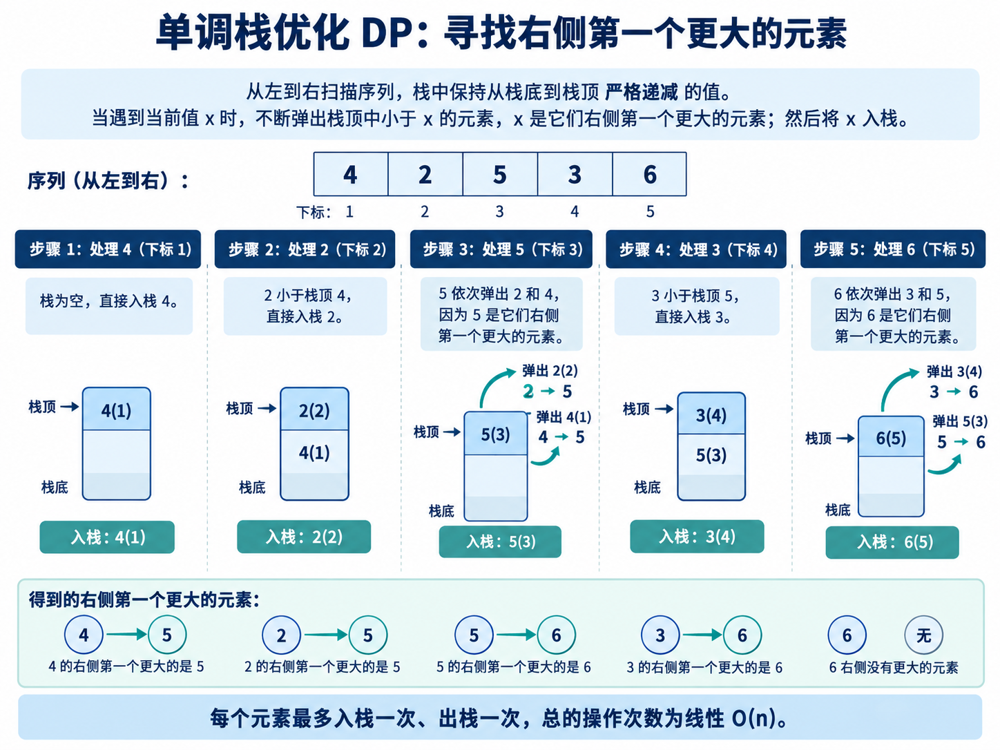

单调栈常用于 DP 转移中“最近一个满足大小关系的前驱/后继”或一段候选的支配关系。扫描新元素 `x` 时，若它使栈顶候选永久失效，就弹出栈顶；每个元素最多入栈、出栈一次，过程为 `O(n)`。

**典型用法**：找左/右侧第一个更大或更小元素；按最近边界确定区间；把可被当前候选支配的旧状态弹掉。例如某些区间 DP、最大矩形、最优分段题，会先用栈找出每个状态的有效区间，再转移或计算贡献。

**与单调队列的区别**：队列维护一个随时间滑动的窗口最值，既要处理过期，也要处理新候选；栈主要维护最近边界或候选支配关系，通常没有“窗口左端过期”这一步。看到“单调”还不够，必须说明被弹出的候选为什么以后再也不可能成为答案。

**重复值**：找“严格大于”还是“大于等于”决定弹栈比较符号。相等元素若处理错，会造成边界重叠或漏算。

### 1.5 线段树与树状数组优化 DP

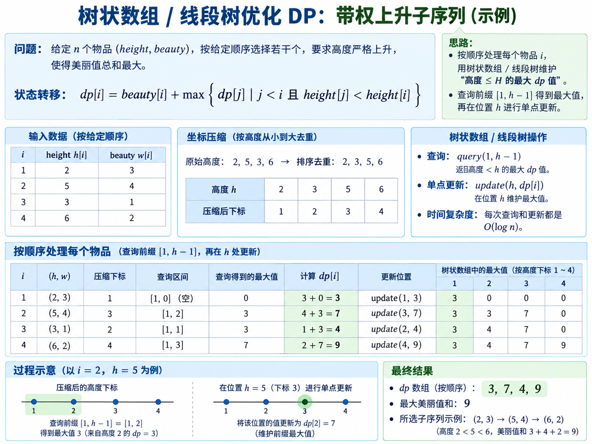

若每个状态依赖于此前状态在某个值域区间内的聚合，可以把已经算出的 DP 值放进数据结构。

以带权上升子序列为例，按输入顺序处理物品 `(h[i], w[i])`：

`dp[i] = w[i] + max(dp[j])，j < i 且 h[j] < h[i]`。

查询高度区间 `[1, h[i)-1]` 的最大 DP 值，再把 `dp[i]` 更新到高度 `h[i]`。若高度很大，先离散化。每次查询、更新 `O(log n)`，总计 `O(n log n)`。

**顺序不能颠倒**：先查询，再更新当前状态，否则当前状态可能被自己使用。若条件是 `h[j] <= h[i]`，查询端点要包含当前高度；若必须严格上升，则不包含。

- **树状数组**：代码短，适合前缀和、前缀最值等简单查询。若维护最大值，通常只支持单调变大的点更新，不能像求和那样随意做区间差分或撤销。
- **线段树**：可以处理任意区间查询、区间更新，以及更复杂的合并信息；代价是常数和实现复杂度更高。

**值域与时间维度**：需要先决定数据结构下标代表什么（高度、权值、结束时间等），并确保查询只看合法前驱。

### 1.6 CDQ 分治优化 DP

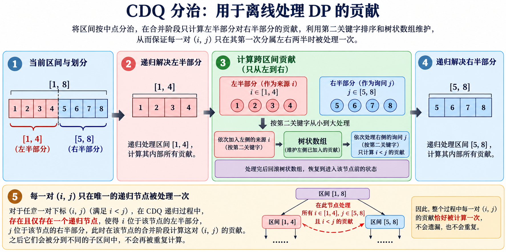

CDQ 适用于依赖关系可以按一个维度排序，并且可离线处理的转移。典型模型是：状态 `i` 接收所有满足 `j < i` 且其他坐标也满足限制的状态 `j` 的贡献。

对时间/下标区间分治：

1. 递归算左半，保证左侧 DP 值已知。
2. 计算左半状态对右半状态的贡献。按第二维排序，并用树状数组/线段树维护第三维等信息。
3. 回滚本层修改，再递归算右半。

每一对合法的前驱—后继只会在它们第一次分到左右两半的那层被处理。若每层合并要做 `O(n log n)` 查询，整体常见复杂度为 `O(n log^2 n)`；具体复杂度取决于每层的排序和数据结构操作。

**先检查**：依赖图是否能按第一维排成拓扑顺序；跨半贡献能否拆成查询/修改；本层更新能否撤销或清空。CDQ 不能把任意在线 DP 直接变成离线 DP，也不能漏掉同一半内部的递归贡献。

### 1.7 倍增优化 DP

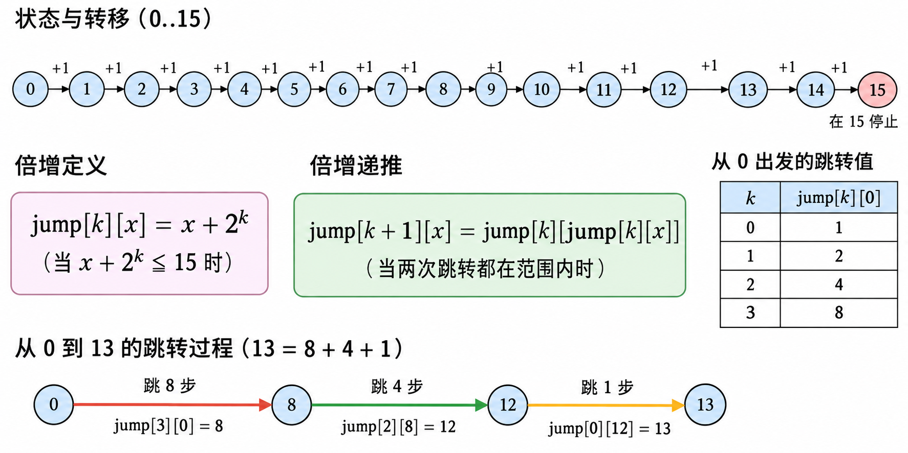

若一个状态能重复应用同一个转移 `K` 次，直接走 `K` 步太慢，可以预处理：

`jump[k][x] = 从状态 x 出发，走 2^k 步后的状态`。

于是：

`jump[k+1][x] = jump[k][jump[k][x]]`。

把 `K` 写成二进制，逐位应用对应跳跃，就能在 `O(log K)` 次组合中完成查询；预处理 `N` 个状态需要 `O(N log K)` 时间和空间。

**不只可以维护终点**：若转移路径还要统计经过点数、权值和、最大值等信息，可以在每个 `jump[k][x]` 同时保存这段路径的摘要，再按相同的区间拼接规则合并。合并信息必须满足结合律，且两个半段的边界不能重复计数。

**适用范围**：转移通常要固定，或至少能表示为可重复组合的函数。若每一步的转移依赖外部变化，普通倍增表就不能直接复用。

---

## 2. 利用问题结构

这一组方法不是先挑数据结构，而是先证明 DP 代价、决策位置或状态函数具有凸性/单调性，再利用该性质减少候选决策。

### 2.1 斜率优化 DP

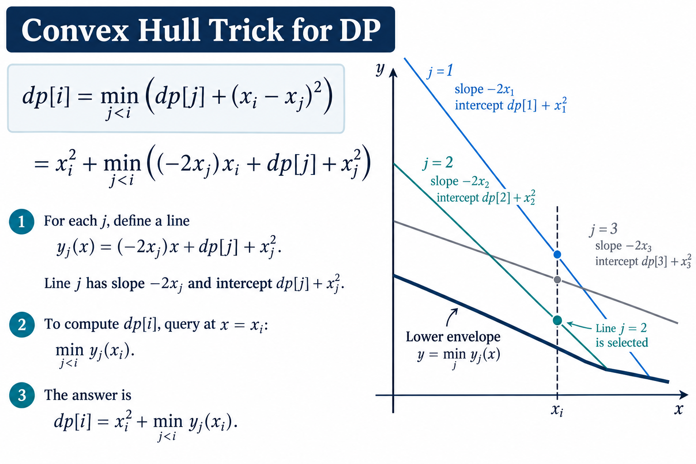

当转移可以整理成“枚举旧状态的一次函数”时，每个旧状态对应一条直线，新状态只需查询这些直线在 `x[i]` 处的最小值或最大值。

例如：

`dp[i] = min_j (dp[j] + (x[i] - x[j])^2)`。

展开平方并把只与 `i` 有关的项提出：

`dp[i] = x[i]^2 + min_j((-2x[j]) * x[i] + dp[j] + x[j]^2)`。

旧状态 `j` 生成斜率 `-2x[j]`、截距 `dp[j]+x[j]^2` 的直线。问题于是变成动态维护直线集合，并在 `x[i]` 处求最值。

- 斜率和查询横坐标都单调：可用单调队列/单调凸包，常见总复杂度 `O(n)`。
- 查询顺序或斜率不单调：可用 Li Chao 树，常见每次 `O(log C)`；坐标有限时也可离散化后维护凸包。

**关键不是“式子有平方”**，而是能否把候选 `j` 的贡献拆成 `m_j*x_i+b_j`。还要检查每条线何时加入、斜率/查询的顺序、求最小还是最大、相同斜率的处理及交叉乘法溢出。

### 2.2 分治优化与决策单调性

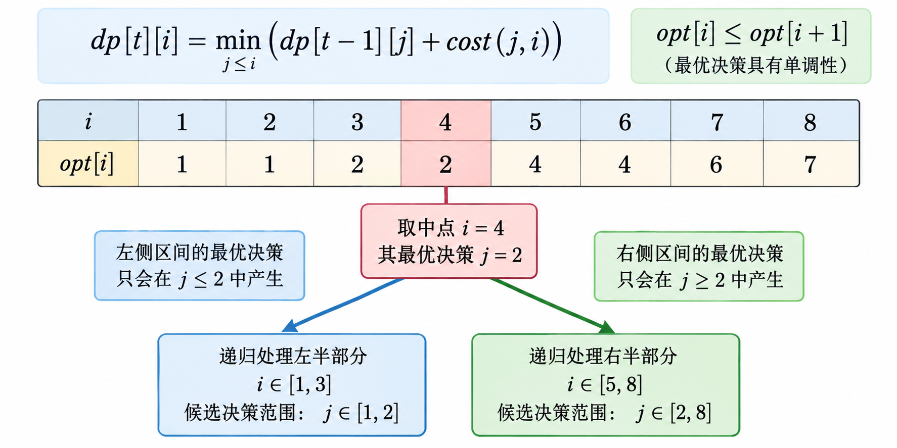

常见分层转移：

`dp[t][i] = min_{j <= i}(dp[t-1][j] + cost(j,i))`。

令 `opt[i]` 为第 `i` 个状态取到最优值时的决策位置。如果能证明 `opt[i] <= opt[i+1]`，就不必对每个 `i` 从头枚举所有 `j`：先算中点 `mid` 的最优决策，再把左半区的候选决策限制在 `optL..opt[mid]`，右半限制在 `opt[mid]..optR`，递归处理。

若每层计算 `O(n log n)` 个状态、每次代价为 `O(1)`，则单层复杂度为 `O(n log n)`；有 `T` 层时总复杂度为 `O(T n log n)`。若代价计算很贵，还需乘上单次代价的复杂度。

**必须证明的性质**是最优决策单调，而不是 DP 值单调。证明时要固定取最左或最右最优解，保证并列决策时的 `opt` 定义一致。四边形不等式是推出单调性的常见充分条件，但不是分治优化的必要条件。

### 2.3 四边形不等式与 Knuth 优化

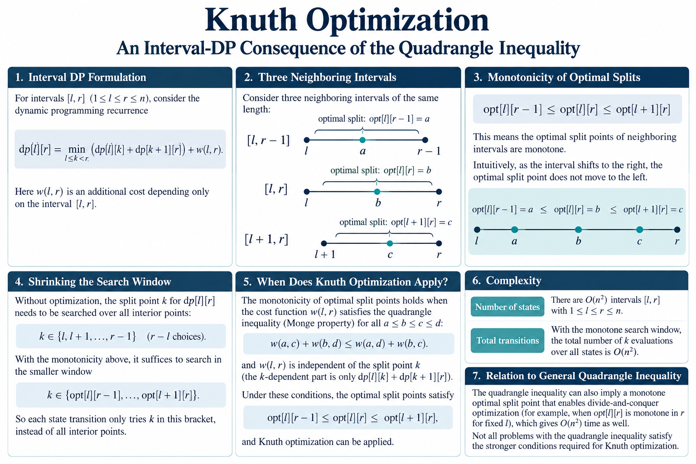

四边形不等式描述区间代价 `w` 的交叉关系。它常用于证明决策单调性，但**仅看到一个四边形不等式并不能直接套优化**：还要匹配转移结构、最小化/最大化方向及代价的附加条件。

**一维决策单调性**：若状态形如 `dp[i]=min_j(dpPrev[j]+w(j,i))`，在适当条件下可得 `opt[i] <= opt[i+1]`，然后使用上一节的分治优化。

**Knuth 优化**：典型区间 DP 为：

`dp[l][r] = min_{l <= k < r}(dp[l][k] + dp[k+1][r]) + w(l,r)`。

在代价满足相应的区间单调性与四边形不等式等条件时，可推出：

`opt[l][r-1] <= opt[l][r] <= opt[l+1][r]`。

因此只枚举左右两个相邻区间最优点夹住的 `k`，总复杂度通常从 `O(n^3)` 降为 `O(n^2)`。

**关系**：Knuth 是更强、更具体的区间 DP 优化；一般四边形不等式可能只够推出某个方向的决策单调性，适合分治优化，却不一定满足 Knuth 的双侧夹逼。写证明时要把使用的每个条件列出来。

### 2.4 Slope Trick

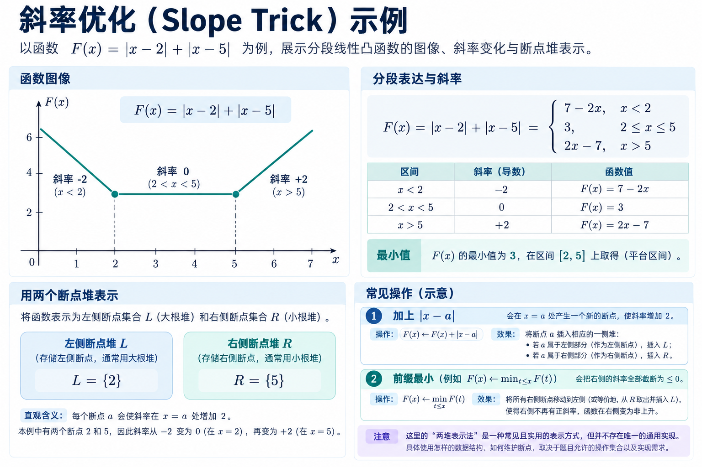

有些 DP 状态不是一个数，而是关于变量 `x` 的函数 `f[i][x]`。若对每个 `i`，这个函数保持凸，那么直接存所有 `x` 的值可能太大；可以改为维护函数的斜率变化点（离散情形也可理解为差分变化点）。

以 `|x-a|` 为例，函数在 `a` 处斜率增加 `2`。若 DP 反复加入绝对值代价、取前缀最小、平移变量等，函数的拐点往往只需用两个堆维护，避免保存整张函数表。

**先列出转移对应的函数操作**：增加 `|x-a|`、整体平移、取 `min_{y<=x}` 等操作各自如何改变斜率或拐点。不能只因为代价含绝对值就直接套“两堆模板”。

**适用条件**：转移后的函数仍凸，且函数表示法能支持题目实际需要的操作。非凸操作通常会破坏斜率序列结构。

**与斜率优化的区别**：斜率优化把“旧状态的候选代价”变成直线集合，查询直线包络；Slope Trick 把“整个 DP 状态函数”看作凸函数，维护其斜率变化。名字相近，但维护的对象不同。

### 2.5 WQS 二分（凸优化 DP）

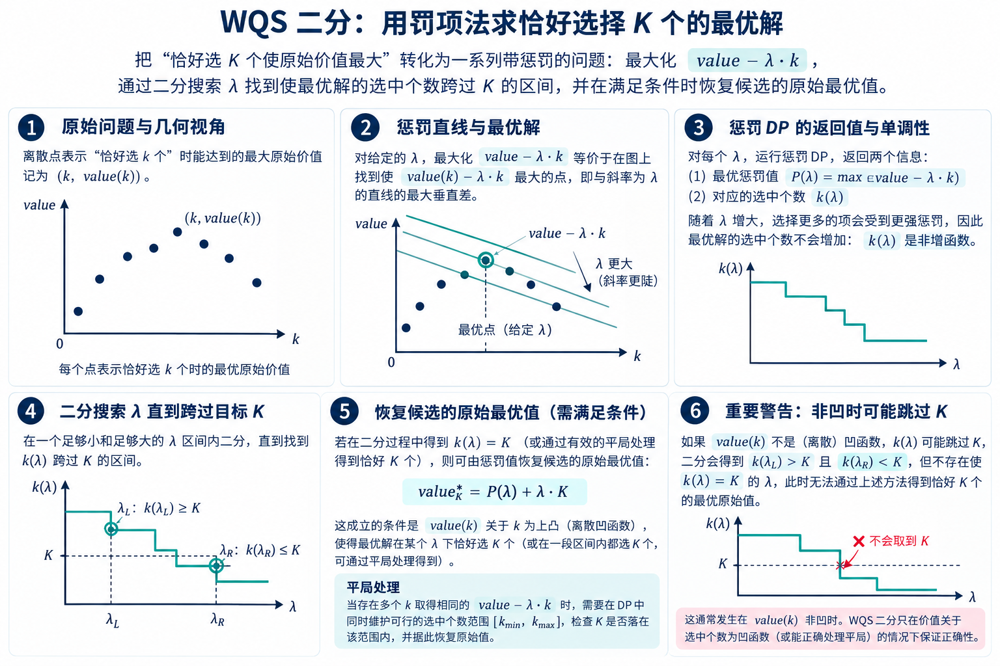

原题要求恰好选 `K` 个对象/分 `K` 段，而二维 DP 中“数量”这一维太大。考虑给每个选择加惩罚 `λ`，先求不限制数量时的最优解，并同时记录它实际选了多少个。

以最大化为例：

`P(λ) = max(value - λ * count)`。

`λ` 增大时，选择更多对象受到更重惩罚，因此最优解的数量不增。二分 `λ`，寻找最优数量跨过 `K` 的位置。若恰好能选到 `K`，可用 `P(λ)+λK` 恢复原问题的值；最小化版要按原目标重新确定惩罚符号。

**成立条件**：关于数量 `k` 的最优价值要有适当的离散凸/凹性，使 `K` 能被某个惩罚参数支撑。若最优数量会从 `K+1` 跳到 `K-1`，且并列处理不能补到 `K`，就不能直接恢复“恰好 `K`”的答案。

**实现要点**：DP 返回“惩罚后最优值 + 对应数量”；并列最优时按二分方向选择数量较大或较小的一侧。整数答案通常二分差分/边际值，确认终止位置及 `λK` 的符号。

---

## 3. 利用数学方法

当转移反复应用同一个线性变换、卷积，或状态关于某个参数具有低次多项式结构时，可以借助代数工具减少步数或计算量。

### 3.1 矩阵快速幂优化 DP

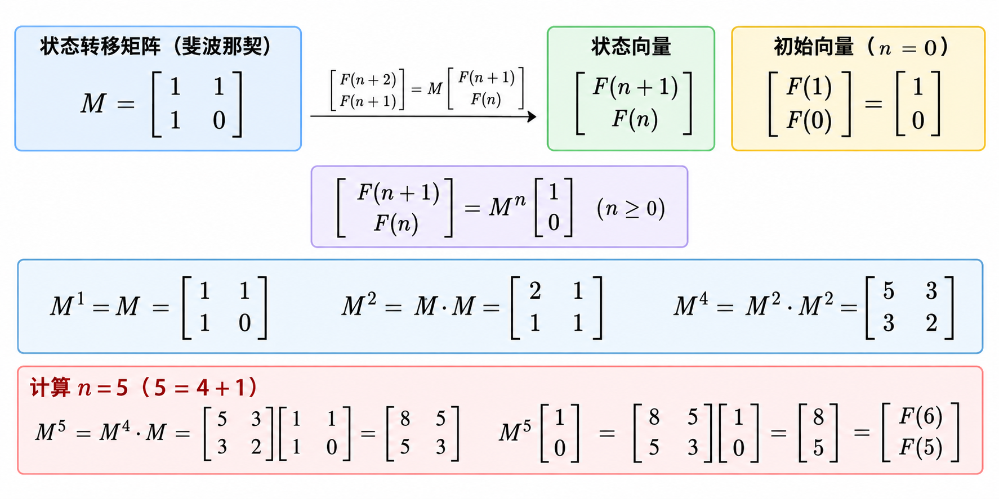

若 DP 可以写成固定的线性递推：

`state[i+1] = A * state[i]`，

则 `state[n] = A^n * state[0]`。用快速幂计算 `A^n`，把 `n` 次转移压成 `O(log n)` 次矩阵乘法。`d` 维稠密矩阵每次乘法为 `O(d^3)`，总复杂度 `O(d^3 log n)`。

斐波那契数列可取 `state[i]=[F(i+1), F(i)]^T`，转移矩阵为 `[[1,1],[1,0]]`。图中用 `n=5=4+1` 展示二进制合并。

**适用条件**：状态转移对每一步相同，且能表示为固定维度的线性变换。若矩阵稀疏、特殊结构或维度很小，可以进一步优化乘法；若转移依赖 `i` 或输入，可能要分段矩阵、块变换或无法直接快速幂。

**扩展理解**：不一定非得是数值矩阵。只要转移对象的合并满足结合律，就可以对转移做二进制幂；但必须正确设计合并对象与初始状态。

### 3.2 卷积与 FFT/NTT 优化 DP

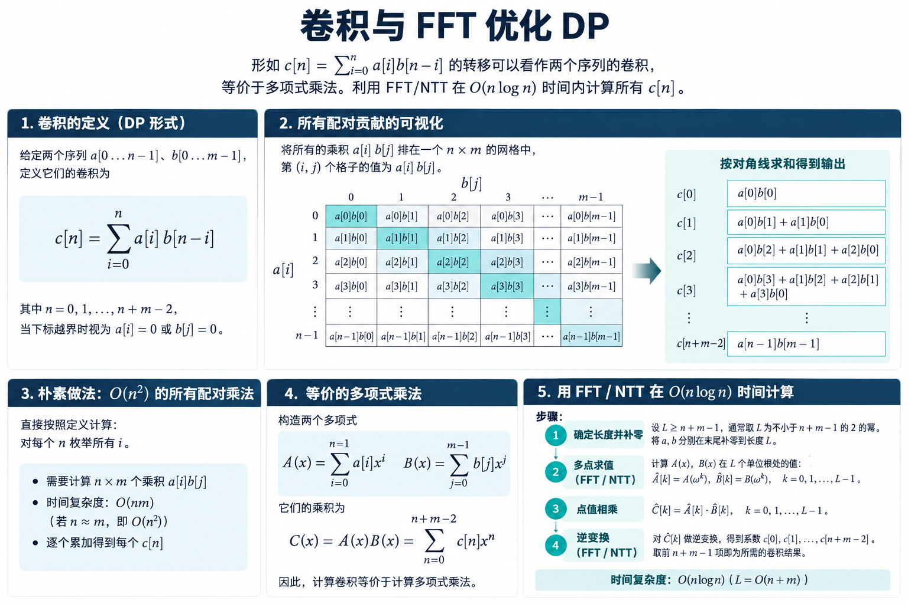

若转移形如：

`c[n] = sum(a[i] * b[n-i])`，

每个输出都枚举所有拆分，朴素总复杂度 `O(n^2)`。把 `a`、`b` 看成多项式系数，所有 `c[n]` 正好是乘积 `A(x)B(x)` 的系数。FFT/NTT 可以在 `O(n log n)` 左右完成整次卷积。

**DP 中的典型来源**：把若干独立子问题的方案数按总权值合并；转移核只依赖下标差；分治合并两个“和”的分布。识别方法是检查 `(i,j)` 对答案下标是否只通过 `i+j` 进入。

**实现边界**：

- 变换长度至少覆盖 `len(a)+len(b)-1`，否则会发生循环卷积混叠。
- 模数下使用 NTT 时，模数和原根必须支持所需长度；多模数还要做 CRT。
- FFT 浮点误差要估算，不能默认四舍五入总正确。
- 若转移不是卷积形，或只需极少几个系数，FFT 可能没有优势。

### 3.3 Lagrange 插值优化 DP

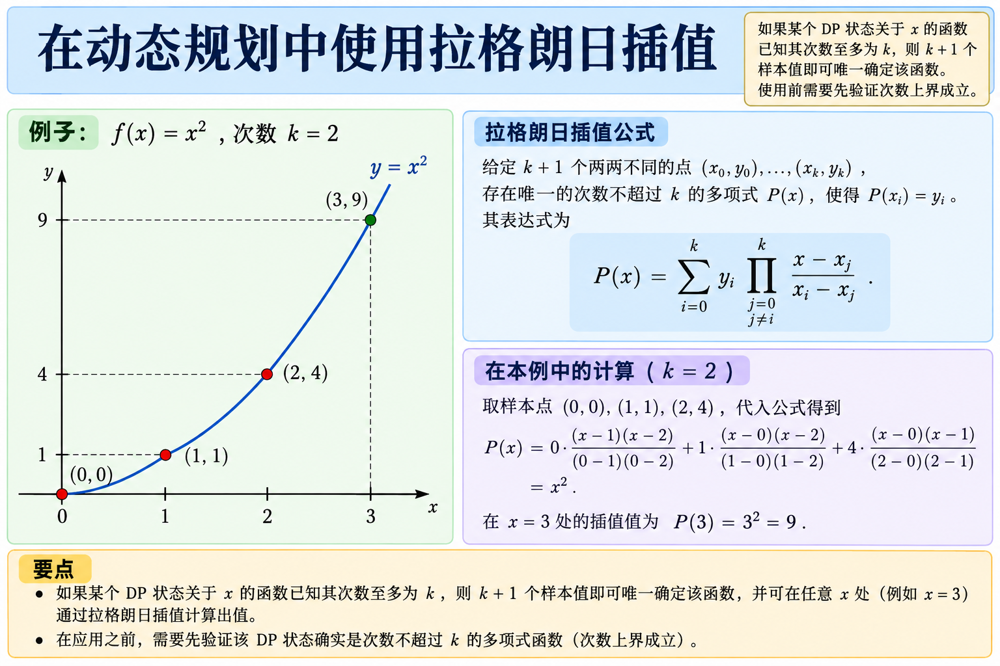

若某一层 DP 的状态 `f(i,x)` 已能证明关于 `x` 是次数不超过 `k` 的多项式，那么只算 `k+1` 个不同点，就能唯一确定整条函数，并据此计算其他位置或直接推导答案。

图中用 `f(x)=x^2` 演示：二次多项式由 `x=0,1,2` 的三个值确定，再求 `x=3` 的值。真正的优化题通常是 `x` 很大，但多项式次数较小。

**核心不是会套插值公式，而是证明次数上界**。需要从初始状态和转移递推证明：每层的次数如何增长、是否受输入参数影响、插值点是否足够。

**数域条件**：模意义下通常要求采样点互不相同，且分母 `x_i-x_j` 在模数下可逆；常见做法是取质数模并保证采样点数量小于模数。浮点实数插值还要考虑数值稳定性。

**复杂度**：只有 `k+1` 个点时可直接计算；对许多查询点可预处理前后缀乘积、阶乘与逆元，把单点求值降到 `O(k)`。先确认 `k` 相对目标规模确实小。

---

## 4. 简化状态

有些题的瓶颈不在“怎么转移”，而在状态本身太多。此时要问：哪些历史信息会影响未来？能否只保留足够的信息，或合并未来行为完全等价的状态？

### 4.1 DP 套 DP 与 DFA 最小化

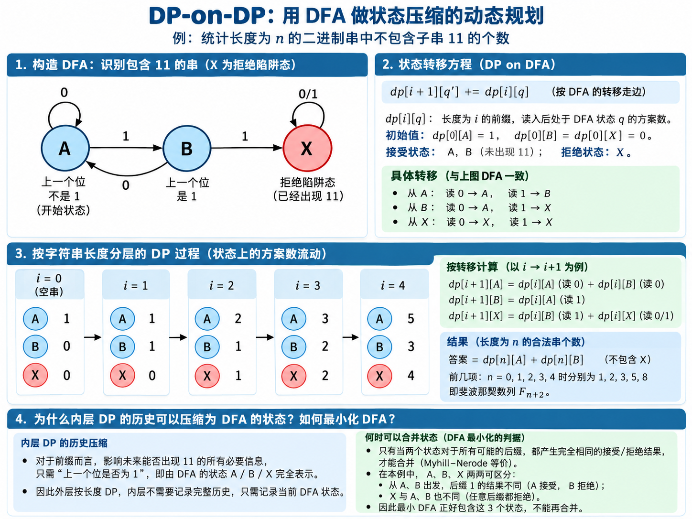

典型问题是：要统计所有长度为 `n` 的字符串，但每个字符串是否合法需要一个动态规划来判断。逐个枚举字符串不可行；对每个候选字符串重新跑内层 DP 也太慢。

做法是把“读到当前前缀后，内层 DP 还需要记住的全部信息”作为自动机状态。字符输入就是自动机转移，外层 DP 再统计到达每个自动机状态的前缀数。

图中统计不含子串 `11` 的二进制串：状态只需记住“上一个字符是否为 `1`”，再加一个已经违规的拒绝状态。外层按字符串长度推进，答案累加在合法状态上。

**DFA 最小化**：两个状态只有在所有可能后缀下都产生完全相同的接受/拒绝行为时，才能合并。对于带权或带数值输出的内层 DP，还必须保证合并后对所有后续输入的数值转移与最终贡献也一致；普通 DFA 的接受状态等价不能替代这项证明。

**适用场景**：数位 DP、字符串计数、限制串结构的计数/概率问题；内层过程可以被有限状态完全描述，并且压缩后状态数可控。

### 4.2 状态设计优化

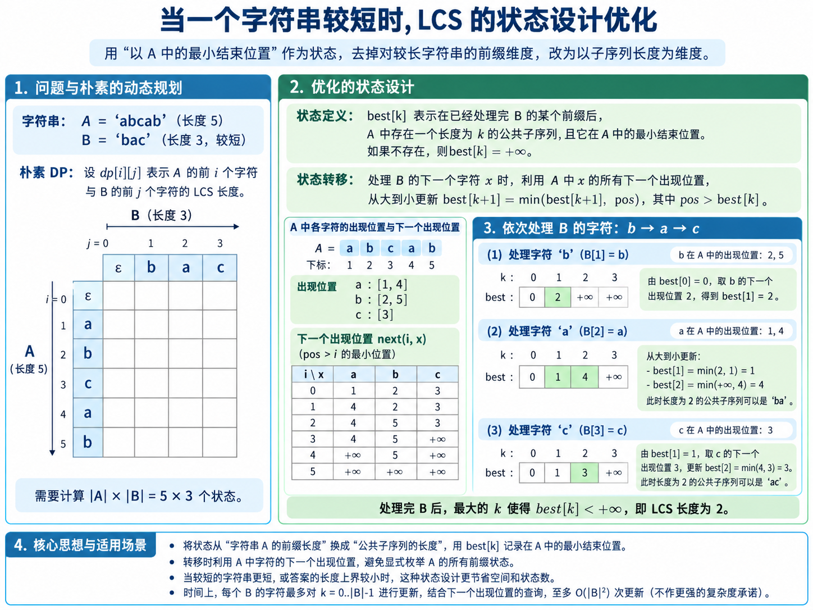

状态设计优化不是一套固定模板，而是重新选择“记录什么”，让状态数从大维度降到小维度。常见思路：

- 交换“已处理的位置”和“当前答案长度”这两个维度。
- 用同一类状态中最小/最大的边界值代表全部被支配状态。
- 利用答案上界、值域上界或机器字长压缩状态。

图中以一个字符串较短的 LCS 为例。朴素 DP 记录两个前缀，状态数为 `|A||B|`。改为 `best[k]`：处理完短串的某个前缀后，`best[k]` 记录在长串中形成长度为 `k` 的公共子序列所需的最小结束位置。结束得更早的状态支配结束得更晚的状态，因为它给未来留下更多选择。通过预处理长串中各字符的下一个出现位置，可用短串字符更新这些状态。

若短串长度为 `m`、长串长度为 `n`、字符集大小为 `\sigma`，预处理长串每个位置之后各字符的下一次出现位置需要 `O(n\sigma)` 时间和空间；随后更新所有 `k` 需要 `O(m^2)` 次状态尝试，总复杂度为 `O(n\sigma+m^2)`。字符集固定时可视为 `O(n+m^2)`，只有在此总成本优于 `O(nm)` 时才有收益。逐个短串字符更新 `k` 时要避免同一个字符被重复使用；通常倒序更新或采用等价的快照转移。

**检查支配关系**：被丢弃的状态必须在所有未来选择下都不可能优于保留状态。若只凭样例看起来可压缩，可能会丢失最优解。

---

## 5. 优化组合与练习入口

单题可能同时有多个可利用结构。先明确每个方法负责消掉哪一层复杂度，再组合，避免把两个方法的前提混成一个。

### 常见组合

| 组合 | 各自处理什么 | 典型模型 |
|---|---|---|
| CDQ + 树状数组/线段树 | CDQ 处理有序时间维的左右贡献；树状数组或线段树处理值域上的查询 | 三维偏序 DP：按第一维分治，按第二维排序，第三维做前缀查询 |
| 斜率优化 + Li Chao 树 | 直线化转移；Li Chao 维护不单调斜率/询问顺序下的直线最值 | 旧状态生成直线，新状态按任意 `x` 询问 |
| DFA DP + 矩阵快速幂 | DFA 压缩需要记住的前缀信息；矩阵快速幂压缩重复的长度转移 | 自动机状态数较小，要求长度极大的字符串计数 |
| WQS + 原有 DP 优化 | WQS 去掉“恰好选 K 个”这一维；队列、凸包等继续优化惩罚后的 DP | 带数量限制的分段/选取问题，惩罚版转移仍可加速 |
| 前缀和 + 单调队列 | 前缀和处理可加区间项；单调队列维护另一个移动区间最值 | 转移同时包含区间和与窗口最值 |

组合后仍要分别证明每一层的前提。例如“DFA 状态数小”不代表转移矩阵稀疏；“CDQ 离线”也不代表跨区间贡献可以直接用树状数组表示。

### OI Wiki 练习入口

下列题目来自 OI Wiki 的 DP 优化简介页，可用于把抽象转移对应到具体题型。先独立推导朴素 DP，再判断题目满足哪条优化条件。

| 练习方向 | 题目 | 练习时重点观察 |
|---|---|---|
| 前缀和优化 DP | Luogu P2513；AtCoder DP M - Candies | 每个状态是否反复求前一段方案数之和 |
| 树状数组/线段树优化 DP | AtCoder DP Q - Flowers；AtCoder DP W - Intervals | 转移是否是已处理状态上的值域前缀/区间查询 |
| 倍增优化 DP | Luogu P1081；Luogu P1613；Luogu P4739 | 多步转移能否拆成 `2^k` 步的可合并摘要 |
| 矩阵快速幂优化 DP | Luogu P1397；Luogu P3176；Luogu P6772 | 是否存在固定维度、每一步相同的线性变换 |
| FFT 优化 DP | Codeforces 553E；Codeforces 1784D | 转移求和是否能整理成卷积 |
| Lagrange 插值优化 DP | Luogu P5223；Luogu P4463；Luogu P5469 | 状态关于参数的次数上界如何证明 |

完整题目列表与相关专题见 [OI Wiki：DP 优化简介](https://oi-wiki.org/dp/opt/dp-opt/)。

## 6. 如何选方法

从朴素转移出发，按下面顺序判断：

1. **重复区间和？** 先看前缀和；集合掩码上的子集/超集聚合看 SOS DP。
2. **移动窗口最值？** 候选单调过期时看单调队列；最近更大/更小边界或候选支配时看单调栈。
3. **按已算状态做值域查询？** 前缀聚合看树状数组；任意区间或复杂合并看线段树。
4. **离线的多维偏序贡献？** 看 CDQ；重复执行同一转移很多次看倍增。
5. **决策代价能展开为直线？** 看斜率优化；最优决策下标单调看分治优化；区间 DP 满足更强夹逼时看 Knuth。
6. **状态函数关于变量凸？** 看 Slope Trick；带数量限制且价值关于数量有凸性时看 WQS。
7. **固定线性递推、卷积、多项式状态？** 分别看矩阵快速幂、FFT/NTT、Lagrange 插值。
8. **状态数量本身过大？** 看 DP 套 DP/DFA 压缩，或重新设计状态与支配关系。

### 最后检查

- **状态含义**：是否包含影响未来的全部信息？初值、不可达值和答案位置是否清晰？
- **顺序**：查询与更新的先后会不会允许状态重复使用？当前物品是 0/1、完全还是有界？
- **条件**：优化依赖的单调性、凸性、四边形不等式、次数上界是否已经证明？
- **边界**：严格/非严格、相同斜率、重复决策、并列最优和区间端点是否一致？
- **复杂度**：不只估算渐近时间，还要估算状态数、数据结构常数、矩阵维度和变换长度。

## 相关

- [OI Wiki：DP 优化简介](https://oi-wiki.org/dp/opt/dp-opt/)
- [OI Wiki：四边形不等式优化](https://oi-wiki.org/dp/opt/quadrangle/)
- [OI Wiki：Slope Trick](https://oi-wiki.org/dp/opt/slope-trick/)
- [OI Wiki：WQS 二分](https://oi-wiki.org/dp/opt/wqs-binary-search/)
- ACMT：`chapters/03_dp.typ`（背包、区间 DP、树形 DP、DP 优化）。
- 线段树维护转移矩阵见 [总结-线段树用法](./总结-线段树用法)。

