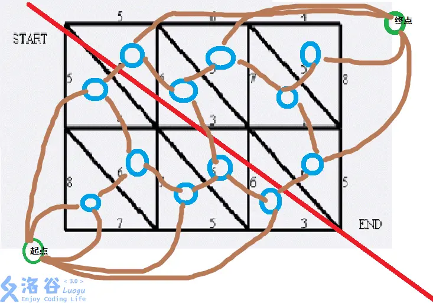

### Tarjan 与连通性

- **SCC 缩点**：有向图缩点后为 DAG。若按 Tarjan 弹栈完成分量的顺序递增编号，编号是逆拓扑序；其他编号方式需按具体实现判断。
- **割点**：`low[v] >= dfn[u]`（根节点需子树数 $\ge 2$）。
- **桥**：`low[v] > dfn[u]`。
- **E-DCC**：删除所有桥后的连通块，缩点后为森林；原图连通时才是一棵树。
- **V-DCC**：点双连通分量（block），是极大点双连通子图；桥也单独构成含两个端点的点双。圆方树：每个原图顶点建圆点，每个 V-DCC 建方点，并连接该分量中所有顶点与对应方点。

---

### 二分图与匹配

- **Kőnig 定理**：最大匹配 = 最小点覆盖。
- **最大独立集**：总点数 - 最小点覆盖。
- **DAG 最小路径覆盖**：拆点建二分图，原图点数 - 最大匹配。
- **霍尔定理**：二分图存在覆盖左部 $U$ 的匹配 $\iff$ 对于左部任意子集 $S$，有 $|N(S)| \ge |S|$。若还要求完美匹配，需另有 $|U|=|V|$。
  - $N(S)$ 是点集 $S$ 的邻居集合

---

### 网络流建模

- 最大流最小割定理
  - 最大流 = 最小割。
- 最大权闭合子图
  - 源点连正权点（容量为权值），负权点连汇点（容量为权值绝对值），依赖边容量 INF。答案 = 正权点权值和 - 最小割。
- 有源汇上下界可行流
  - 对边 $u\to v$，容量改为 $r-l$，并设 `bal[u] -= l, bal[v] += l`，即 `bal = 下界流入 - 下界流出`。
  - 若 `bal[v] > 0`，连超级源 $SS\to v$，容量 `bal[v]`；若 `bal[v] < 0`，连 $v\to TT$，容量 `-bal[v]`。从 $SS$ 到 $TT$ 的最大流送满所有超级源边，当且仅当存在满足下界的可行流。
  - 求 $s-t$ 可行流时先加 $t\to s$ 的 INF 边。若还要求最大 $s-t$ 流，记录该辅助边上的初始流量，移除所有辅助边后在原残量网络上继续跑 $s\to t$ 最大流，并把增广量加到初始流量上。


---

### 欧拉图

- **无向图欧拉回路**：所有非零度顶点度数为偶数，且这些顶点连通（孤立点不影响边遍历）。
- **有向图欧拉回路**：所有顶点入度等于出度，且所有非零度顶点在忽略方向后连通；等价地，它们在有向图中强连通。孤立点不影响边遍历。
- **Hierholzer 算法**：DFS 回溯时记录边，复杂度 $O(n+m)$。

---

### 矩阵树定理

#### 第一步：建基尔霍夫矩阵
- 定义度数矩阵 $D$：$D[i][i] = \text{点 } i \text{ 的度数}$。
- 定义邻接矩阵 $A$：$A[i][j] = \text{点 } i \text{ 和 } j \text{ 之间的边数（或边权）}$。
- 基尔霍夫矩阵 $L = D - A$。
- 对于 $i \ne j$：$L[i][j] = -A[i][j]$。
- 对于 $i = j$：$L[i][i] = \sum_{j \ne i} A[i][j]$（即度数或带权度数和）。

#### 第二步：删行删列
- 任选一个点 $r$（通常选点 $n$），删去 $L$ 的第 $r$ 行和第 $r$ 列。
- 得到一个 $(n-1) \times (n-1)$ 的矩阵 $L'$。

#### 第三步：求行列式
- 对 $L'$ 做高斯消元，求对角线乘积。
- 如果是模意义下，用乘法逆元消元。
- **答案** = 行列式的值。

#### 代码模板（模数为质数，最常用）

```cpp
#include <bits/stdc++.h>
using namespace std;
const int N = 305;
const int MOD = 1e9 + 7;

long long qpow(long long a, long long b) {
    long long res = 1;
    while (b) {
        if (b & 1) res = res * a % MOD;
        a = a * a % MOD;
        b >>= 1;
    }
    return res;
}
int n, m;
long long a[N][N]; // 基尔霍夫矩阵

// 高斯消元求行列式（模质数）
long long det(int n) {
    long long res = 1;
    for (int i = 0; i < n; i++) {
        // 找主元
        int p = -1;
        for (int j = i; j < n; j++) {
            if (a[j][i]) { p = j; break; }
        }
        if (p == -1) return 0; // 行列式为 0
        if (p != i) { swap(a[p], a[i]); res = -res; } // 交换行，行列式变号
        res = (res * a[i][i]) % MOD;
        long long inv = qpow(a[i][i], MOD - 2); // 逆元
        for (int j = i + 1; j < n; j++) {
            long long t = a[j][i] * inv % MOD;
            for (int k = i; k < n; k++) {
                a[j][k] = (a[j][k] - t * a[i][k]) % MOD;
                a[j][k] = (a[j][k] + MOD) % MOD;
            }
        }
    }
    return (res + MOD) % MOD;
}

int main() {
    cin >> n >> m;
    for (int i = 0; i < m; i++) {
        int u, v;
        cin >> u >> v;
        u--, v--;
        a[u][u]++; a[v][v]++;  // 度数 +1
        a[u][v]--; a[v][u]--;  // 邻接矩阵 -1
    }
    for (int i = 0; i < n; ++i)
        for (int j = 0; j < n; ++j)
            a[i][j] = (a[i][j] % MOD + MOD) % MOD;
    // 删去最后一行一列；det(n - 1) 读取左上角主子式
    cout << det(n - 1) << "\n";
    return 0;
}
```

#### 无向图生成树计数

- 边权为 1。直接套模板。

#### 带权生成树（边权乘积之和）

- 题目要求：求 $\sum_{T} \prod_{e \in T} w_e$。
- **做法**：
  - $D[i][i] = \sum_{j} w_{i,j}$（所有连边的权值和）。
  - $A[i][j] = w_{i,j}$（边权）。
  - 其他不变，求行列式。

#### 有向图生成树（内向树 / 外向树）

- **内向树**（所有边指向根）：
  - 用**出度**矩阵（$D_{out}$）和邻接矩阵构造 $L$。
  - 删去根节点的行和列，求行列式。
- **外向树**（所有边从根指出）：
  - 用**入度**矩阵（$D_{in}$）和邻接矩阵构造 $L$。
  - 删去根节点的行和列，求行列式。
- **注意**：有向图的 $A[i][j]$ 表示 $i \to j$ 的边数，不要把方向搞反。


---

### BEST 定理

#### 前提条件（缺一不可）

- 每个点的 **入度 = 出度**。若不满足，欧拉回路数为 0。
- 图是**弱连通**的（忽略孤立点后连通）。若不连通，欧拉回路数为 0。
- 自环不进入根向生成树的 Laplace 矩阵，但计入各点出度及 BEST 阶乘；不要再额外乘自环数的阶乘。若题目要求回路从指定顶点出发且起始边任意，在通常公式上再乘该点出度。

#### 公式

- 按循环移位视为同一个回路时，欧拉回路个数为 $t_w \times \prod_{v} (\deg(v)-1)!$。若区分固定起点的出边序列，还需乘起点出度。
- 其中：
  - $t_w$：以任意点 $w$ 为根的**内向生成树**个数（所有边指向根）。
  - $\deg(v)$：点 $v$ 的出度（等于入度）。
  - $w$ 可以任选，结果相同。

#### 计算 $t_w$（用矩阵树定理）

- 建矩阵 $L$：
  - 无自环时 $L[i][i] = \text{点 } i \text{ 的出度}$；有自环时应从出度中减去自环数（等价于 $D_{out}-A$ 中对角邻接项抵消）。
  - $L[i][j] = -\text{从 } i \text{ 到 } j \text{ 的边数}$（$i \ne j$）
- 删去 $w$ 的行和列，得到 $(n-1) \times (n-1)$ 矩阵。
- 求该矩阵的行列式，即为 $t_w$。

#### 计算阶乘
- 预处理阶乘，对每个点 $v$，计算 $(\deg(v)-1)!$ 并相乘。

#### 答案
- `ans = t_w * ∏ (deg(v)-1)! % MOD`。

#### 代码模板（模数为质数）

```cpp
#include <bits/stdc++.h>
using namespace std;

const int N = 305;
const int MOD = 1e9 + 7;
long long a[N][N];

long long qpow(long long x, long long k) {
    long long res = 1;
    while (k) {
        if (k & 1) res = res * x % MOD;
        x = x * x % MOD;
        k >>= 1;
    }
    return res;
}

long long det(int n) {
    long long res = 1;
    for (int i = 0; i < n; ++i) {
        int p = i;
        while (p < n && a[p][i] == 0) ++p;
        if (p == n) return 0;
        if (p != i) {
            swap(a[p], a[i]);
            res = (MOD - res) % MOD;
        }
        long long pivot = a[i][i];
        res = res * pivot % MOD;
        long long inv = qpow(pivot, MOD - 2);
        for (int j = i + 1; j < n; ++j) {
            long long mul = a[j][i] * inv % MOD;
            for (int k = i; k < n; ++k)
                a[j][k] = (a[j][k] - mul * a[i][k] % MOD + MOD) % MOD;
        }
    }
    return res;
}

struct DSU {
    int fa[N];
    DSU() { iota(fa, fa + N, 0); }
    int find(int x) { return fa[x] == x ? x : fa[x] = find(fa[x]); }
    void unite(int x, int y) { fa[find(x)] = find(y); }
};

int main() {
    ios::sync_with_stdio(false);
    cin.tie(nullptr);

    int n, m;
    cin >> n >> m;
    vector<int> in(n), out(n);
    long long lap[N][N] = {};
    DSU dsu;
    for (int i = 0; i < m; ++i) {
        int u, v;
        cin >> u >> v;
        --u; --v;
        ++out[u]; ++in[v];
        --lap[u][v]; // 暂存 -A；自环之后会与出度抵消
        dsu.unite(u, v);
    }

    if (m == 0) {
        cout << 1 << '\n'; // 空边集按一个空回路计
        return 0;
    }

    vector<int> active;
    for (int u = 0; u < n; ++u) {
        if (in[u] != out[u]) {
            cout << 0 << '\n';
            return 0;
        }
        if (in[u] + out[u] > 0) active.push_back(u);
    }
    for (int u : active) {
        if (dsu.find(u) != dsu.find(active[0])) {
            cout << 0 << '\n'; // 非零度顶点不连通
            return 0;
        }
    }

    // 出度 Laplace 对角元 = 非自环出度；自环不进入生成树矩阵。
    for (int u : active) lap[u][u] += out[u];

    int root = active[0];
    int sz = (int)active.size();
    int row = 0;
    for (int i = 0; i < sz; ++i) {
        if (active[i] == root) continue;
        int col = 0;
        for (int j = 0; j < sz; ++j) {
            if (active[j] == root) continue;
            a[row][col++] = (lap[active[i]][active[j]] % MOD + MOD) % MOD;
        }
        ++row;
    }

    long long ways = det(sz - 1); // 内向生成树数 × 各点 (出度 - 1)!；回路按循环移位视为相同
    int maxDeg = *max_element(out.begin(), out.end());
    vector<long long> fac(maxDeg + 1, 1);
    for (int i = 1; i <= maxDeg; ++i) fac[i] = fac[i - 1] * i % MOD;
    for (int u : active) ways = ways * fac[out[u] - 1] % MOD;

    // 若题目把“从指定顶点出发、首边任意”的边序列分别计数，乘该点出度。
    cout << ways << '\n';
}
```

> - 自环计入出度及 BEST 公式中的阶乘，但不计入生成树 Laplace 矩阵；无需额外乘自环阶乘。
>
> - 定理中 $w$ 任选，$t_w$ 相同。代码先去掉零度点，再任选一个非零度点作为根。
> 
> - 无解情况：
>   - 入度 ≠ 出度 → 0。
>   - 不连通 → 0。

---

### 全奇度生成子图

#### 核心结论

- **一张图存在一个生成子图，使得原图所有点的度数均为奇数，当且仅当该图的每一个连通块的大小均为偶数。**

#### 证明

- **必要性**：每个点的度数都是奇数。奇数个奇数相加（连通块大小为奇数）为奇数。但图的总度数为所有边贡献 2 之和，必定是偶数。矛盾。所以连通块大小必须为偶数。
- **充分性**：对于任意偶数大小的连通块，先任取一棵生成树。从叶子往上处理，记录当前点已选中的儿子边数的奇偶性：若为偶数，就选中它与父亲的边；若为奇数，就不选这条父边。这样每个非根点最终度数为奇数。根的度数也为奇数：所有点的度数和必须为偶数，而非根点共有奇数个且度数均为奇数，因此根度数为奇数。

---

### 最大密度子图（01分数规划 + 最小割）

> 哦？没见过，还是网络流？

- **问题**：选一个子图，最大化 $\frac{|E|}{|V|}$。
- **二分答案** $g$：判断是否存在子图使得 $|E| - g|V| \ge 0$。
- **建图**：
  - 源点连每个原图边点（容量 1），边点连两个端点（容量大于所有可能有限割的上界，如 $m+1$），每个原图点连汇点（容量 $g$）。
  - 判定值：给定二分值 $g$ 时，最大闭合子图权值为 $m-\mathrm{mincut}$；若该值 $>0$，则存在子图满足 $|E|-g|V|>0$，即最大密度大于 $g$。对 $g$ 二分后才得到最大密度。空子图权值为 0，所以不能用“最大闭合权值 $\ge0$”判定。
- **经典题**：[POJ 3155 Hard Life](http://poj.org/problem?id=3155) 是最大密度子图题；[洛谷 P1730《最小密度路径》](https://www.luogu.com.cn/problem/P1730) 是 DAG 上的多询问最小平均边权路径，与本节问题不同。

---

### 全局最小割（Stoer-Wagner）

> 陌生了

- **问题**：求无向图的全局最小割（不指定源汇）。
- **复杂度**：稠密矩阵实现为 $O(n^3)$；用堆优化每阶段最大邻接点选择时，常见界为 $O(nm+n^2\log n)$。
- **本质**：每次合并两个最近的点，更新答案，直到只剩一个点。
- **经典**：P5632 【模板】Stoer-Wagner。

---

### 支配树（Dominator Tree）

> 陌生了

- **定义**：在有向图中，$u$ 支配 $v$ 当且仅当所有从起点到 $v$ 的路径都经过 $u$。
- **结论**：支配关系形成一棵树（支配树），$u$ 支配 $v$ 当且仅当 $u$ 是 $v$ 在支配树上的祖先。
- **求法**：Lengauer-Tarjan 算法，$O(m \log n)$ 或 $O(m \alpha(n))$。
- **应用**：编译器优化、程序分析。
- **经典**：P2597 [ZJOI2012] 灾难。

---

### 二分图最大权匹配（KM 算法）

> 我还有吗？有的！

- **问题**：二分图中，每条边有权值，求最大权完美匹配。
- **算法**：KM 算法（匈牙利算法的带权版本），$O(n^3)$。
- **前提**：左右部点数相同，且原图存在完美匹配。若题目允许部分匹配，可添加虚点表达“未匹配”的选择；稀疏图中不能把不存在的边随意补成权值 0，否则会改变问题。
- **经典**：P6577 【模板】二分图最大权完美匹配。

---

### 平面图与对偶图

> 哦？对偶图！！！牛逼！
>
> 确实啊，因为平面图确实，它的最小割是最直观的，所以可以用最短路求解
>
> 但是代码怎么写啊？？？？
>
> 我懂了，只能祈求出题人出的好点
> 否则，只能跑 网络流

- **欧拉公式**：$V - E + F = 2$（连通平面图）。
- **对偶图**：平面图中的每个面作为对偶图的点，原图的每条边对应一条连接两个面的对偶边。
- **应用**：平面图的割在对偶图中对应回路；当源点、汇点位于同一面的边界等条件满足时，相关最小割可转成两个对偶顶点间的最短路。一般的平面图最小割不能不加条件地等同于任意两面间的最短路。
- **经典**：P4001 [ICPC-Beijing 2006] 狼抓兔子。



---

### 拓扑排序计数

> 确实，多写写

- **结论**：DAG 的拓扑序数量 = 用状压 DP 求，$O(2^n n)$。
- **树上拓扑序计数**：$\frac{n!}{\prod_{u=1}^n sz[u]}$（父先于子）。


---

### 图的 DFS 树性质

> 没啥用

- **无向图 DFS 树**：只有树边和回边（无横叉边）。
- **有向图 DFS 树**：有树边、前向边、后向边、横叉边。
- **强连通分量**：Tarjan 中，SCC 编号为逆拓扑序，可用于 DAG 上的 DP。

---

### 费用流（MCMF）

- **模型**：每条边有容量和费用，求最大流下的最小费用。
- **算法**：SPFA 逐次找最短增广路的常见上界为 $O(FVE)$，其中 $F$ 为总流量（单位整数增广的上界）；势能 + Dijkstra 常见为 $O(FE\log V)$，还需处理初始负费用边并保证没有未处理的可达负环。
- **经典**：P3381 【模板】最小费用最大流。

---

### 二分图最大权独立集

> 居然从来没有收录过！！！

- **问题**：二分图中，每个点有权值，选一个独立集使权值和最大。
- **建图**：源点连左部（容量权值），右部连汇点（容量权值），原图边连 INF。
- **前提**：点权非负。负权点可视作不选，或先按题意调整。
- **答案**：总权值 - 最小割。
- **经典**：P2774 方格取数问题。

---

### 二分图最小权点覆盖

> 居然从来没有收录过！！！+1

- **问题**：二分图中，每个点有权值，选一个点覆盖使权值和最小。
- **前提与建图**：点权非负。源点连左部点、右部点连汇点，容量分别为对应点权；二分图边从左连向右，容量取大于所有有限割上界的值。
- **答案**：最小割。
- **经典**：P2774 方格取数问题（转化为最小权点覆盖）。

---

### 最大流最小割建模：项目选择

> 神秘新 项目收益 依赖

- **问题**：有 $n$ 个项目，每个项目有收益 $p_i$，有 $m$ 个依赖关系（做 $a$ 必须先做 $b$）。
- **建图**：源点连正收益项目，负收益项目连汇点，依赖边连 INF。
- **答案**：正收益之和 - 最小割。

--- 

> 还有一大堆

---

### 二分图最大匹配的必须边 / 可行边

先求一个最大匹配 $M$，再建交错有向图：未匹配边从左部指向右部，匹配边从右部指向左部。记 `freeL`、`freeR` 为当前未匹配的左右点。

- 当前匹配中的边一定是可行边，因为它已经出现在这个最大匹配中。
- 未匹配边 $u\to v$ 可出现在某个最大匹配中，当且仅当：`u` 和 `v` 在同一 SCC，或 `u` 能从某个 `freeL` 到达，或 `v` 能到达某个 `freeR`。三种情况分别对应交错环、从自由左点开始的等大小交错路、到自由右点结束的等大小交错路。
- 匹配边 $v\to u$ 是必须边，当且仅当 `u` 不能从 `freeL` 到达、`v` 不能到达 `freeR`，且 `u,v` 不在同一 SCC；否则存在保持匹配大小的交错环或交错路，可以换掉该边。

这里的 SCC 关系属于交错图；不能把“最大流残量网络中的端点 SCC”那条判据直接套到二分图匹配边上。具体边判定应按交错图方向实现。

---

### 最小割的必须边 / 可行边

在一次最大流后的残量图中，最小割源侧必须包含 $s$、不包含 $t$，并且对每条残量边都满足“若 $u$ 在源侧，则 $v$ 也在源侧”。因此可用残量可达性分析，而不能只看端点是否同属一个 SCC。

对正容量原边 $u\to v$：

- **属于每一个最小割**：当且仅当残量图中 $s$ 能到达 $u$，且 $v$ 能到达 $t$。此时该边必为饱和边，并且每个最小割都把 $u,v$ 分在两侧。
- **属于至少一个最小割**：当且仅当该边已饱和、残量图中 $s$ 不能到达 $v$、$u$ 不能到达 $t$，且 $u$ 不能到达 $v$。这些条件保证可以选出一个对残量边闭合的源侧集合，使 $u$ 在源侧而 $v$ 在汇侧。

若只需要最小割本身，直接从 $s$ 在残量图可达的点构造一个最小割即可；边的“某个/所有最小割”分类需按上述闭合条件处理。

### 竞赛图（Tournament）

- **定义**：任意两点之间恰好有一条有向边的有向图。
- **结论**：
  - 竞赛图必有哈密顿路径。
  - 竞赛图强连通 $\iff$ 存在哈密顿回路。
  - 竞赛图的 SCC 缩点后是一条链（全序）。
- **求法**：SCC 缩点后按拓扑序排列即为全序。


---

### 偏序集与 Dilworth 定理

- **Dilworth 定理**：偏序集的最小链覆盖 = 最大反链大小。
- **对偶形式（Mirsky 定理）**：偏序集的最小反链覆盖 = 最长链长度。
- **在图论中的体现**：
  - 偏序集的最小链覆盖 = 最大反链。若偏序由 DAG 的可达关系定义，链覆盖可表示为允许跳过中间点的路径覆盖。
  - 一般 DAG 的最小路径覆盖要求每一步都沿原图边走，数量为“原图顶点数减去二分图最大匹配数”；它不等于最大独立集。
  - 最小点覆盖 = 最大匹配（Kőnig 定理，二分图版本）。
- **经典**：P1020 导弹拦截（最长不上升子序列 = 最少不上升子序列覆盖）。

---

### 二分图博弈

这里指无向二分图上的 Vertex Geography：棋子从指定起点出发，两人轮流沿边移动，不能重访顶点；无合法移动者输。

- 先求一个最大匹配。先手必胜，当且仅当起点在**每一个**最大匹配中都被匹配。
- 若起点当前未匹配，先手必败。若起点已匹配，判断它能否在另一组最大匹配中变成未匹配：建交错有向图（未匹配边左到右、匹配边右到左）；左侧起点若能从某个未匹配左点到达，则可通过交错路换匹配而变成未匹配；右侧起点若能到达某个未匹配右点，也同理。能变成未匹配则先手必败，否则先手必胜。
- “从起点出发存在增广路”不是准确判据：最大匹配本身不存在增广路；这里检查的是保持匹配大小不变的交错路。

### 有向图最小环

- **求法**：若边权非负，对每个起点 $s$ 在反图上跑 Dijkstra，得到从各点到 $s$ 的最短距离；枚举原图入边 $(v,s,w)$，用 `dist[v] + w` 更新答案。若只在原图从 $s$ 跑 Dijkstra，则应枚举能回到 $s$ 的边并使用相反方向的距离，不能把 `s` 的出边权加到从 $s$ 出发的距离上。
- **Floyd 做法**：先求全源最短路，再对每条边 $j\to i$ 用 `dis[i][j] + w[j][i]` 更新；实现时需避免路径重复使用该边。
- **复杂度**：逐个起点跑 Dijkstra 为 $O(nm\log n)$；Floyd 为 $O(n^3)$。

---

### 无向图最小环

- **求法**：枚举每条边 $(u,v)$，暂时删去它，再求 $u$ 到 $v$ 的最短路，用 `dist + w` 更新答案。无权图用 BFS；非负权图用 Dijkstra。
- **复杂度**：无权图为 $O(m(n+m))$；非负权图用 Dijkstra 时约为 $O(m(m+n\log n))$。负权无向边会形成负环，不能按通常最短路处理。

---

### 连通度与 Menger 定理

#### 一、核心定义
- **点连通度 $\kappa(G)$**：使图不连通（或只剩一个点）所需删去的最少点数。
- **边连通度 $\lambda(G)$**：使图不连通所需删去的最少边数。
- **局部连通度**：$\kappa(u,v)$ 是内部点互不相交的 $u-v$ 路径最大数量；$\lambda(u,v)$ 是边互不相交的 $u-v$ 路径最大数量。

#### 二、Menger 定理（本质：最大流最小割在路径连通性上的体现）
- **点形式**：当 $u,v$ 不相邻时，内部点互不相交的 $u-v$ 路径最大数量，等于删去最少多少个非端点可以使 $u,v$ 不连通。若 $u,v$ 相邻，直接边无法通过删除内部点阻断；拆点建模时先单独计入这条直接边，再从图中删去它并计算其余路径。
- **边形式**：从 $u$ 到 $v$ 的**边不相交**路径的最大数量 = 分离 $u,v$ 所需删去的最少边数 $\lambda(u,v)$。
- **全局形式**：图的点连通度 $\kappa(G) = \min_{u \ne v} \kappa(u,v)$；边连通度 $\lambda(G) = \min_{u \ne v} \lambda(u,v)$。

#### 三、竞赛求法：拆点 + 最大流

**求边不相交路径数（简单）**：
- 每条无向边按两个方向建容量为 1 的弧。
- 源点 $S=u$，汇点 $T=v$，跑最大流。
- 最大流 = 边不相交路径数 = 最小边割。

**求点不相交路径数（核心，必须拆点）**：
- 给定端点 $s,t$。每个点 $i$ 拆成入点 $i_{in}$ 和出点 $i_{out}$。
- 连边 $i_{in} \to i_{out}$，容量为 1（若是 $s$ 或 $t$，容量设为 INF；若只判断是否至少有 $k$ 条路径，也可设为 $k$）。
- 对于原图的每条边 $(x, y)$，连边 $x_{out} \to y_{in}$，容量为 INF；无向边按两个方向各连一条。这里的路径只要求内部点不相交，边本身不限制容量。
- 简单图中若 $s,t$ 直接相邻，这条边本身是一条内部点为空的路径，先计入答案 1，再从流网络中删去这条直接边；否则最大流会把它当作可重复通过的无限容量通道。
- 在拆点网络中跑 $s_{out} \to t_{in}$ 的最大流。
- 最大流 = 点不相交路径数 = 最小点割。

**求全局点/边连通度**：
- 枚举所有点对 $(u, v)$，分别跑最大流取最小值。复杂度极高，竞赛中一般只考 $u,v$ 给定的局部连通度。

#### 四、复杂度
- 单对点使用一般 Dinic 时，按所建网络和其通用复杂度估算；拆点网络含容量大于 1 的边，不能直接套用单位容量网络的 $O(E\sqrt V)$ 界。
- 枚举所有点对时，还需乘以 $O(n^2)$；局部连通度只需处理题目给定的一对端点。

#### 五、经典例题
- **P1345 [USACO5.4] 奶牛的电信**：两端点不相邻，求删除最少内部顶点使其不连通；拆点后跑最大流。
---

### 一般图最大匹配（带花树）

- **已在树论笔记中收录**，此处仅作索引。

---

### 二分图最大匹配的 Hall 定理

#### 定理本身
- **Hall 定理**：二分图 $G = (U, V, E)$ 存在覆盖 $U$ 中所有顶点的匹配（即匹配覆盖左部 $U$），当且仅当对于 $U$ 的任意子集 $S$，都有 $|N(S)| \ge |S|$。
- $N(S)$ = $S$ 中所有顶点在 $V$ 中的邻居并集。

#### 推论
- 若 $|U| = |V|$，则覆盖 $U$ 的匹配就是完美匹配。
- 逆否命题：若存在 $S$ 使得 $|N(S)| < |S|$，则不存在覆盖 $U$ 的匹配。

#### 区间分配模型（最常考）
- **问题**：$n$ 个人，第 $i$ 个人只能选区间 $[l_i, r_i]$ 内的任务。每个任务只能分配给一个人。问能否全部匹配。
- **Hall 条件化简**：只需检查所有 $[L, R]$ 区间，满足：
  $$
  \#\{i \mid l_i \ge L \text{ 且 } r_i \le R\} \le \#\{\text{任务 } j \mid L \le pos_j \le R\}
  $$
  即：完全落在 $[L, R]$ 内的人数 $\le$ $[L, R]$ 内的任务数。
- **为什么只需检查区间**：因为 $N(S)$ 是若干区间的并，若存在反例，必存在一个区间 $[L, R]$ 使得其中人数超过任务数。

#### 竞赛实战
- 遇到“每人只能选一段连续的任务”时，优先想 Hall 定理。
- 若任务是 $1, 2, \dots, m$ 每个位置一个，条件变成：对任意 $[L, R]$，完全包含在其中的区间数 $\le R - L + 1$。
- 判定方法：枚举 $R$，用线段树/BIT 维护每个 $L$ 对应的“完全落在 $[L, R]$ 内的区间数”，判断是否 $\le R - L + 1$。
- **例题**：P1129 [ZJOI2007] 矩阵游戏可用二分图完美匹配建模。
