# 字符串数据结构：自动机与后缀树结构

> 组织原则：先问数据结构保存了什么、静态和在线版本分别支持什么；再把问题写成“Patterns × Texts × Substr 范围 × 答案函数”。算法名只是实现手段，决定选型的是信息模型。

## 目录

1. [总览](#1-统一符号与自动机总览)
   - [自动机类型与结构对照](#11-先区分三种自动机)
   - [静态、在线与动态](#13-静态在线与动态不是同义词)
   - [变量名](#15-本文变量名约定)
2. [SeqAM](#2-seqam子序列自动机)
   - [SeqAM 状态 与 Fail 定义](#21-seqam-状态-与-fail-定义)
   - [SeqAM 自动机 性质](#22-seqam-自动机-性质)
   - [SeqAM Fail 树 性质](#23-seqam-fail-树-性质)
   - [SeqAM 静态](#24-seqam-静态)
   - [SeqAM 动态](#25-seqam-动态)
   - [SeqAM 应用清单](#26-seqam-应用清单)
3. [KMPAM](#3-kmpam)
   - [KMPAM 状态 与 Fail 定义](#31-kmpam-状态-与-fail-定义)
   - [KMPAM 自动机 性质](#32-kmpam-自动机-性质)
   - [KMPAM Fail 树 性质](#33-kmpam-fail-树-性质)
   - [KMPAM 静态](#34-kmpam-静态)
   - [KMPAM 动态](#35-kmpam-动态)
   - [KMPAM 应用清单](#36-kmpam-应用清单)
4. [ACAM](#4-acamtrie-自动机与-fail-树)
   - [ACAM 状态 与 Fail 定义](#41-acam-状态-与-fail-定义)
   - [ACAM 自动机 性质](#42-acam-自动机-性质)
   - [ACAM Fail 树 性质](#43-acam-fail-树-性质)
   - [ACAM 静态](#44-acam-静态)
   - [ACAM 动态](#45-acam-动态)
   - [ACAM 应用清单](#46-acam-应用清单)
5. [SAM](#5-sam子串自动机与后缀链接树)
   - [SAM 状态 与 Link 定义](#51-sam-状态-与-link-定义)
   - [SAM Fail 树 性质](#52-sam-fail-树-性质)
   - [SAM 静态](#53-sam-静态)
   - [SAM 动态](#54-sam-动态)
   - [SAM 应用清单](#55-sam-应用清单)
6. [GSAM](#6-gsam多串子串自动机)
   - [GSAM 状态 与 Link 定义](#61-gsam-状态-与-link-定义)
   - [GSAM 自动机 性质](#62-gsam-自动机-性质)
   - [GSAM Link 树 性质](#63-gsam-link-树-性质)
   - [GSAM 静态](#64-gsam-静态)
   - [GSAM 动态](#65-gsam-动态)
   - [GSAM 应用清单](#66-gsam-应用清单)
7. [PAM](#7-pam回文自动机与回文-fail-树)
   - [PAM 状态 与 Fail 定义](#71-pam-状态-与-fail-定义)
   - [PAM 自动机 性质](#72-pam-自动机-性质)
   - [PAM Fail 树 性质](#73-pam-fail-树-性质)
   - [PAM 静态](#74-pam-静态)
   - [PAM 动态](#75-pam-动态)
   - [PAM 应用清单](#76-pam-应用清单)
8. [GAM：一般自动机如何建模](#8-gam一般自动机如何建模)
   - [GAM → AM：状态建模](#81-gam--am先定义状态不先写转移)
   - [GAM → Fail：失配关系建模](#82-gam--fail什么时候可以定义-fail)
   - [KMPAM：一般 Fail 思想的例子](#83-kmp-自动机一般-fail-思想的最小模型)
   - [自动机与倍增](#84-自动机--倍增link-链与转移函数)
9. [SufTree：后缀树](#9-suftree后缀树)
   - [后缀树 定义与结构](#91-后缀树-定义与结构)
   - [后缀树 性质](#92-后缀树-性质)
   - [后缀树 静态构造](#93-后缀树-静态构造)
   - [后缀树 动态与多串](#94-后缀树-动态与多串)
   - [后缀树 应用清单](#95-后缀树-应用清单)
10. [SufBalanceTree：后缀平衡树](#10-sufbalancetree后缀平衡树)
   - [后缀平衡树 定义](#101-后缀平衡树-定义)
   - [后缀平衡树 静态](#102-后缀平衡树-静态)
   - [后缀平衡树 动态](#103-后缀平衡树-动态)
   - [后缀平衡树 应用清单](#104-后缀平衡树-应用清单)
---

## 1. 统一符号与自动机总览

令字母表为 `Σ`，Text 记作 `T`，Pattern 记作 `P`。`Substr` 表示 Text 上的连续子串 `T[l..r]`；本文计算时区间默认从 `0` 开始、左闭右开 `[l,r)`。出现位置指 Pattern 最后一个字符所在的位置；若公式使用前缀长度表示端点，会特别说明。

### 1.1 先区分三种自动机

**识别连续子串的自动机**：读入字符时只能连续转移。KMP、ACAM、SAM、后缀树都属于这一类，但它们识别的语言不同。

**识别子序列的自动机**：允许跳过 Text 字符。SeqAM 的状态是 Text 位置，转移是“下一个字符出现处”。它没有失配回退边。

**带输出的自动机**：状态不仅表示“读到这里”，还附带匹配 Pattern、出现次数、代价、禁止状态、颜色集合等输出。DP 常把自动机状态当作一维状态。

### 1.2 结构对照表

| 结构 | 状态含义 | 自动机边 | Fail / Link 的语义 | 常用答案 |
|---|---|---|---|---|
| SeqAM | 固定 Text 中的位置 | 跳到下一次出现字符 | 没有 Fail | 子序列判定、贪心匹配、子序列 DP |
| KMPAM | Pattern 的前缀长度 `0..m` | 读字符后的最长匹配前缀 | 失配后可保留的最长 Border | 单 Pattern 匹配、Pattern 约束 DP |
| ACAM | Trie 中的 Pattern 前缀 | 字符转移，缺失边可补为 Fail 转移 | 最长真后缀且仍为 Trie 前缀 | 多 Pattern 匹配、出现统计、约束 DP |
| SAM | 出现位置相同的一组子串 | 子串右侧可接字符 | 最长真后缀对应的状态 | 不同子串、出现次数、公共子串 |
| GSAM | 多个 Texts 的子串等价类 | Trie 扩展/自动机转移 | SAM 类后缀链接 | 多串公共子串、跨串出现统计 |
| PAM | 不同回文子串 | 两侧加同一字符后的回文 | 最长真回文后缀 | 回文种数、次数、回文后缀 DP |

### 1.3 静态、在线与动态不是同义词

- **静态**：数据结构建好后，Text/Patterns 集合不变，只做查询。
- **在线构造**：逐字符读入时可以维护结构（SAM、PAM）。这只保证构造支持追加，不代表所有历史查询都能 `O(log n)` 完成。
- **动态查询**：构造期间还要回答查询；要单独分析状态统计和后缀链接树变化是否可维护。
- **动态编辑**：任意位置插入、删除、替换。普通 SAM/PAM/SA 不直接支持，通常需要平衡序列树、分块、局部重建或专门动态字符串结构。
- **动态 Patterns 集合**：ACAM 的 Patterns 集合变化。新 Pattern 会改变 Trie 和 Fail 关系，不能把静态 ACAM 当成可增量插入结构。

### 1.4 “Fail 树”这个名字要谨慎

ACAM 的失配边叫 Fail；SAM 的 `link` 常称后缀链接；PAM 的 `link` 是最长真回文后缀；GSAM 继承 SAM 的 link 语义。它们都形成以根为根的树，但树上祖先判定各自代表不同含义。SeqAM 没有 Fail/后缀链接树。

### 1.5 本文变量名约定

KMPAM 按 ACMT 自动机模板的 **1-base 前缀长度**编号：节点 `u` 表示 `P[1..u]`，`ne[u]` 是该前缀的最长真 Border 长度，Fail 父亲为 `fa[u]=ne[u]`（根为 `0`）。C++ 字符串仍从 `P[0]` 开始访问，因此 Pattern 的第 `u` 个字符写作 `P[u-1]`。树上倍增表写作 `f[k][u]`。自动机字符转移写作 `tr[u][c]`，Fail 边写作 `fail[u]`，后缀边写作 `link[u]`，`len[u]` 表示代表串最大长度，`last[r]` 表示前缀结束于 `r` 时的状态，`cnt[u]` 表示出现次数，`state[r]` 表示读到位置 `r` 后所在的状态，`str[u]` 表示节点对应字符串，`isEnd[u]` 表示 Pattern 是否在此结束，`endCnt[u]` 表示在此结束的 Pattern 数，`matchCnt[u]` 表示状态匹配的 Pattern 总数，`pos[u]` 表示出现位置集合。

我在仓库里能对照到的 ACMT 字符串模板使用 `ne`；ACAM、SAM、PAM 没找到对应代码模板，所以这些部分首次出现时会说明变量含义。

## 2. SeqAM：子序列自动机

SeqAM（Subsequence Automaton）固定 Text `T`，回答 Pattern `P` 是否能通过删除 `T` 中若干字符得到。它处理非连续匹配。

### 2.1 SeqAM 状态 与 Fail 定义

Text 位置按 **1-base** 编号。状态 `i` 表示上一次匹配到 Text 的位置 `i`；初始状态 `0` 表示还没有匹配字符。`next[i][c]` 表示 `i` 之后，字符 `c` 第一次出现的位置：

`next[i][c] = min { j | j > i 且 T[j] = c }`。若不存在这样的 `j`，转移失败（可用 `|T|+1` 作为哨兵）。匹配成功后，转移到位置 `j`，也就是新状态 `j`。

例如 `T = abacb`、`P = bab`。Text 的字符位置是 `1..5`，逐字符查询：

| Pattern 字符 | 当前状态 `i` | 转移 | 匹配位置 | 新状态 |
|---|---:|---|---:|---:|
| `P[1] = b` | 0 | `next[0][b] = 2` | 2 | 2 |
| `P[2] = a` | 2 | `next[2][a] = 3` | 3 | 3 |
| `P[3] = b` | 3 | `next[3][b] = 5` | 5 | 5 |

三个转移都成功，因此 `P` 是 `T` 的子序列，匹配位置为 `2, 3, 5`，状态路径为 `0 → 2 → 3 → 5`。

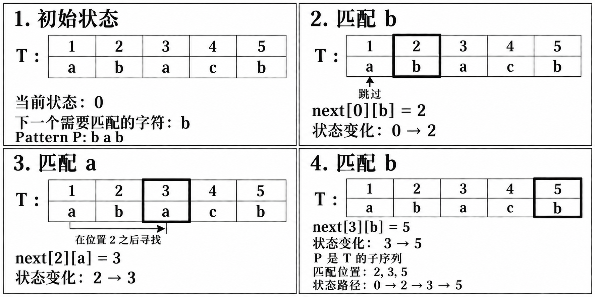

SeqAM 的状态不是已匹配 Pattern 前缀，而是 Text 位置；字符转移向右跳到下一次出现位置。它没有 Fail 指针。

### 2.2 SeqAM 自动机 性质

贪心选最早匹配位置是正确的：若可行匹配把当前字符放在 `matchPos`，而自动机选更早的 `earliestPos<=matchPos`，后续可用 Text 只会更多。

- 稠密表预处理时间/空间 `O(|T|σ)`，每个 Pattern 查询 `O(|P|)`。
- 稀疏表为每字符保存出现位置，查询每字符二分，时间 `O(|P| log |T|)`，空间 `O(|T|)`。
- 字符不存在时转到失败哨兵状态。
- 可用于子序列判定、最早匹配位置、子序列 DP，以及在位置 DAG 上统计带权子序列。

### 2.3 SeqAM Fail 树 性质

SeqAM 没有 Fail 指针，也没有 Fail 树。它没有“失配后复用已匹配串后缀”的结构；状态按 Text 位置递增，形成 DAG/位置链，不能套用 ACAM、SAM 的 Fail 树祖先含义。

### 2.4 SeqAM 静态

静态 Text 可预处理 `next` 表，适合大量 Patterns 查询；也可按每字符位置数组存储以节省空间。本文 SeqAM 位置按 1-base 编号；若限制在闭区间 `Substr=[L,R]`，初始状态必须设为 `L-1`，每次转移得到位置 `j` 后检查 `j<=R`。从状态 `L` 开始会漏掉区间首字符。

### 2.5 SeqAM 动态

- 尾部追加 Text：可把新位置追加到对应字符的有序出现位置表；查询时对每个 Pattern 字符二分查找当前状态之后的下一次出现，单次查询为 `O(|P| log |T|)`。完整稠密 `next[i][c]` 表不是只维护每字符最近位置就能常数更新：追加一个字符可能改变大量旧位置对应的 `next` 值，直接维护最坏需 `O(|T|)` 更新，或使用能支持相应区间批量赋值的数据结构。
- 修改中间字符：会影响其左侧多个位置的 `next` 信息，普通表可能需要 `O(nσ)` 更新。
- 动态 Substr 范围：可分块保存块内字符跳转函数并复合；查询跳过整块、边界逐字符处理，适用于修改少、查询多的场景。

### 2.6 SeqAM 应用清单

- 一个 Pattern 是否为子序列、最早结束位置：逐字符查 `next`。
- 多个 Patterns 查询同一 Text：共享 `next` 表；Patterns 有共同前缀时可用 Trie 共享查询。
- 统计所有子序列或带权子序列：在 Text 位置 DAG 上做 DP。
- 限制 Substr 范围：从区间左端状态出发，检查转移是否越过右端。
- 动态 Text：尾增可增量维护，任意位置编辑通常用分块结构。

---

## 3. KMPAM

### 3.1 KMPAM 状态 与 Fail 定义

KMPAM 固定一个 Pattern `P[1..m]`。状态 `j` 表示当前 Text 的最长后缀，恰好等于 Pattern 前缀 `P[1..j]`，`0<=j<=m`。状态编号是已匹配的 Pattern 长度；状态 `0` 表示空前缀。

按 ACMT KMPAM 的 1-base 约定，`ne[i]` 表示前缀 `P[1..i]` 的最长真 Border 长度。节点 `i` 的 Fail 父亲直接是 `ne[i]`，即 `fa[i]=ne[i]`；节点按前缀长度编号，Fail 边反向连成 Border 树。若用 C++ `string P` 存 Pattern，第 `i` 个字符仍访问 `P[i-1]`。

### 3.2 KMPAM 自动机 性质

读入字符 `c` 时，若当前已完整匹配（`j=m`），先回到 `ne[m]`，再处理 `c`。随后当 `j>0` 且 `c!=P[j+1]` 时，沿 Fail 链令 `j=ne[j]`；若 `c=P[j+1]`，状态变为 `j+1`，若回到 `j=0` 后仍不匹配则保持 0。ACMT 的完整自动机转移表会把回退后的转移预先填好。

- 扫描 Text 时不回退 Text 指针，匹配复杂度 `O(n+m)`。
- 按需沿 Fail 回退时额外空间 `O(m)`；小字母表下可预计算所有字符转移，得到完整 DFA，空间 `O(m|Σ|)`。
- 可将状态加入字符串 DP；例如统计不含 Pattern 的字符串时，避开完整匹配状态 `m`。
- 多个 Patterns 共用前缀时使用 ACAM；KMPAM 面向单个固定 Pattern。

### 3.3 KMPAM Fail 树 性质

节点 `u` 表示 Pattern 前缀 `P[1..u]`，根节点 `0` 表示空前缀。对每个 `u>0`，树上父亲直接为 `fa[u]=ne[u]`；`ne[u]` 与树节点都按前缀长度 1-base 编号，因此不需要额外减一。由于 `ne[u]<u`，沿 Fail 父亲长度严格下降，所有节点构成一棵以 `0` 为根的树。

- `x` 是 `y` 的祖先，当且仅当长度 `x` 的前缀是长度 `y` 前缀的 Border；真 Border 查询使用严格祖先，排除 `x=y`。
- `y` 的祖先链依次给出所有真 Border 长度，直到 0。
- `subtree(x)` 含节点 `x` 本身；要统计长度 `x` 前缀作为**真 Border**被使用的次数或权值，应只取严格子孙，即 `subtree(x)` 去掉 `x`。空 Border `0` 是否计入按题意约定。
- `lca(i,j)` 是两个前缀共同 Border 中最长的 Border。
- Border 树深度是 Border 链边数；它不等于节点编号或字符串长度。

用 `P = ababaca` 展开整棵树。节点 `u` 对应前缀 `P[1..u]`，`ne` 数组按 ACMT 的 1-base 前缀长度存储：

| `u` | 1 | 2 | 3 | 4 | 5 | 6 | 7 |
|---|---:|---:|---:|---:|---:|---:|---:|
| `P[1..u]` | `a` | `ab` | `aba` | `abab` | `ababa` | `ababac` | `ababaca` |
| `ne[u]` / `fa[u]` | 0 | 0 | 1 | 2 | 3 | 0 | 1 |

因此边为 `0→1, 0→2, 0→6, 1→3, 1→7, 2→4, 3→5`。例如节点 `5` 的 Fail 链是 `5→3→1→0`，对应 `ababa` 的真 Border 长度 `3,1`。

再看一次失配后的回退：Text 前缀 `ababab` 先读完 `ababa`，状态为 `5`；此时应匹配 `P[6]=c`，但读到的是 `b`。沿树回到 `ne[5]=3`，保留后缀 `aba`；接着比较 `P[4]=b`，当前 `b` 可以接上，状态成为 `4`。Text 指针没有回退。

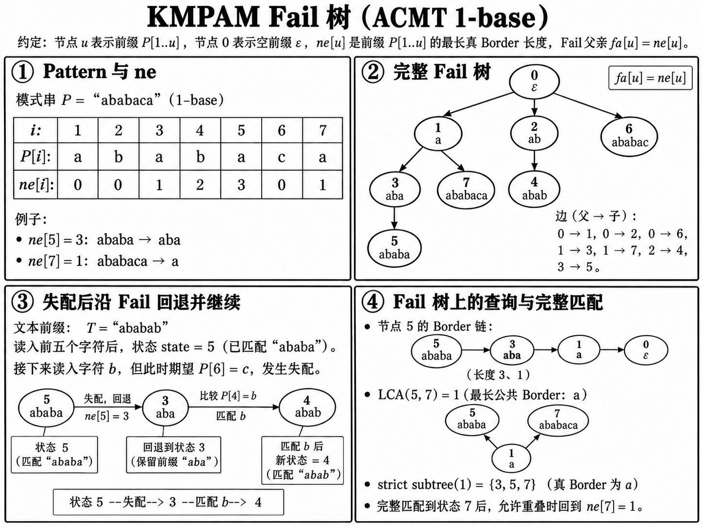

### 3.4 KMPAM 静态

固定 Pattern 后，Border 树是静态树，可预处理倍增表、Euler 序、LCA、路径和及 HLD。`f[0][u]=fa[u]`、`f[k][u]=f[k-1][f[k-1][u]]` 用于第 `k` 个 Border 和长度限制下的最长 Border。Euler 序把子树统计转成区间点权和、最值或颜色查询；大量静态 LCA 可用 Euler 序 + RMQ。

### 3.5 KMPAM 动态

- 尾部追加 Text 时，当前 KMP 状态可继续转移，不必重扫旧 Text。
- 修改 Pattern 会改变 `ne` 和 Border 树，通常需要重建。
- 任意位置编辑 Text 不由 KMPAM 直接支持；可按题目使用分块或专门动态字符串结构。
- 普通 KMP 没有在线插删 Pattern 前缀并维护整棵 Border 树的通用做法。

### 3.6 KMPAM 应用清单

| 题目问法 | Fail 树对象 | 操作 |
|---|---|---|
| 一个前缀的第 k 长 Border | 前缀节点 `i` | Fail 祖先倍增 |
| 两个前缀最长公共 Border | `i,j` | `lca(i,j)` |
| 每种 Border 被多少前缀使用 | 前缀节点点权 | Border 节点查子树和 |
| 长度限制下最长 Border | 父链上单调递减的前缀长度 | 倍增找最长合法祖先 |
| 周期/重复节 | Border 长度 `b`，候选周期 `i-b` | 枚举 Border 并检查整除、覆盖条件 |

给每个前缀状态 `i` 加权 `w[i]`，做 Border 树子树和，`sum[x]` 就是长度 `x` 的前缀作为 Border 被使用的总权值。周期不等于任意 `i-border` 都有效；整周期通常还需检查 `i%(i-border)==0`。根是否计作空 Border 要按题意约定。

---

## 4. ACAM：Trie 自动机与 Fail 树

ACAM = Aho–Corasick Automaton。输入是一组固定 Pattern，先建 Trie，再加入 Fail 转移。可把它理解成“多个 KMP 的共享前缀版本”。

### 4.1 ACAM 状态 与 Fail 定义

#### 4.1.1 Trie 状态与 Pattern 结束信息

Trie 节点 `v` 代表从根到 `v` 的字符串 `str[v]`，终止节点对应一个或多个 Patterns。下面统一用 10 个 Patterns：`he, she, his, hers, her, e, s, sh, ers, is`，共 15 个状态（含根）；图中 `*` 表示 Pattern 在该节点结束。节点编号固定为 `0: ε, 1: h, 2: he, 3: s, 4: sh, 5: she, 6: hi, 7: his, 8: her, 9: hers, 10: e, 11: er, 12: ers, 13: i, 14: is`。

Trie 边 `tr[v][c]` 表示继续匹配字符 `c`。每个输入字符最多创建一个新节点；节点总数 `V <= 1 + Σ|p_i|`。

终止信息不要只存一个布尔值：

- `isEnd[v]`：是否有 Pattern 在此结束。
- `ids[v]`：此处结束的 Pattern 编号列表，处理重复 Pattern 时需要。
- `endCnt[v]`：有多少个 Pattern（含重复输入）在此结束。
- 业务输出可另存权值、类别、Pattern 长度等。

#### 4.1.2 Fail 定义与构造

`fail[v]` 指向 `str[v]` 的最长真后缀，且这个后缀也必须是 Trie 中某个节点的前缀。根的 fail 指向根。

以 `she` 为例：它的真后缀有 `he`、`e`、空串；若 `he` 是 Trie 前缀，Fail 就指向 `he` 节点。

```text
Trie 深度： root → s → sh → she
Fail：      root   root  h   he
                           ↑ Trie 中的后缀前缀
```

BFS 构造保证父节点的 Fail 已知：

1. 根孩子的 Fail 为根。
2. 若 Trie 边 `v --c--> u`，则从 `fail[v]` 开始找第一个存在字符 `c` 转移的 Fail 祖先；其 `c` 转移就是 `fail[u]`。若找不到，取根。
3. 直到所有 Trie 节点处理完。

构造后常把缺失转移补全：`tr[v][c]` 等于 Trie 转移；若不存在，则等于 `tr[fail[v]][c]`。这样匹配时每个字符一次表查。稠密表时间/空间通常是 `O(Vσ)`；稀疏边降低空间，但转移查找和构建复杂度依赖实现。

### 4.2 ACAM 自动机 性质

状态表示当前 Text 的后缀中，最长的“Trie 前缀”。读入字符 `c` 后沿 `tr[state][c]` 转移。

- **一段 Text 匹配所有 Pattern**：扫描一次 Text，状态数 `O(|T|)`；若逐个沿 Fail 链输出所有终止 Pattern，时间还要加输出匹配总数 `Z`，总计 `O(|T|+Z)`（加上构建成本）。
- **是否出现任一 Pattern**：状态维护 `hasMatch[v]=isEnd[v] || hasMatch[fail[v]]`；扫描时检查 `hasMatch[state]`。
- **禁止 Pattern 的 DP**：把 `hasMatch[v]=true` 的状态设为非法，在自动机上 DP 统计不包含这些 Pattern 的字符串。
- **Pattern 后继计数**：状态压缩/权重可以挂在终止节点，也可把 Fail 祖先的输出聚合进状态；若 Pattern 数很大，不要把整条输出列表复制到每个状态。
- **多 Text、多 Patterns 集合固定**：一次建树，多段 Texts 分别从根开始扫描；计数数组可按 Text 清零或用时间戳。

### 4.3 ACAM Fail 树 性质

#### 4.3.1 Fail 树性质与匹配统计

把每个节点 `v` 连到 `fail[v]`，得到 Fail 树。`u` 是 `v` 的祖先，当且仅当 `str[u]` 是 `str[v]` 的后缀（且是 Trie 前缀）。

这是 ACAM 最关键的“从匹配状态反查 Pattern”结构：

> 扫描 Text 到位置 `r` 的自动机状态是 `v`，Pattern 终止节点 `u` 在当前端点匹配，当且仅当 `u` 是 `v` 的 Fail 祖先。

等价地，若把终止节点 `u` 看成 Fail 树上的子树，则所有状态 `v` 中，`u` 是祖先的状态恰好是 `subtree(u)`。

**统计一个 Pattern 的出现次数**：扫描 Text 时对每个端点状态 `state[r]` 加一。全部扫描后，按 Fail 树自底向上累加 `cnt[fail[v]] += cnt[v]`。Pattern 结束节点 `u` 的 `cnt[u]` 就是对应 Pattern 的出现次数。

**反过来统计每个端点匹配多少 Pattern**：预处理每状态 `matchCnt[v]=endCnt[v]+matchCnt[fail[v]]`；每个 Text 端点直接加 `matchCnt[state[r]]`。

#### 4.3.2 完整例子：Trie 转移、Fail 树与多模式输出

下图把两种树关系放在同一组 ACAM 状态上：左图实线箭头是 Trie 字符转移 `tr[v][c]`，虚线箭头是状态指向 `fail[v]`；右图把同一组 Fail 指针改画成树边 `fail[v] → v`。因此两图的箭头方向相反，表达的是同一关系。

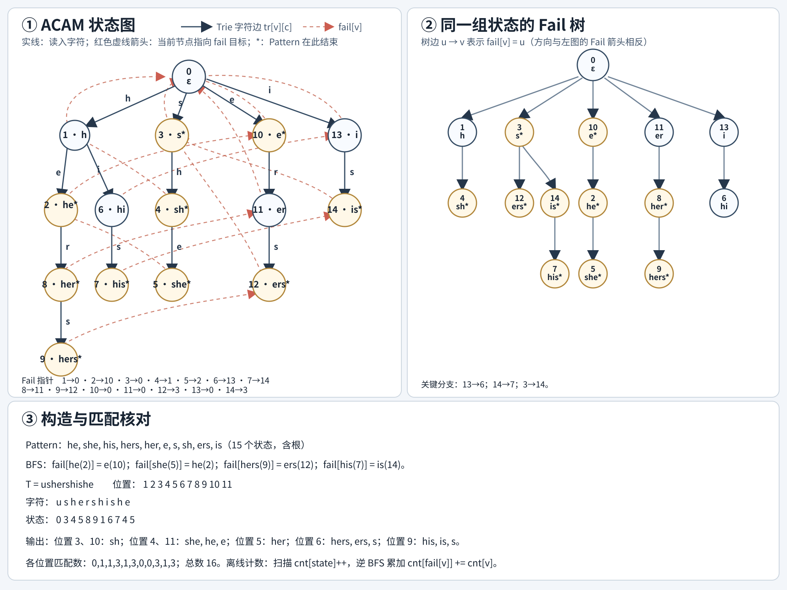

图中的几条 Fail 关系可以逐步核对：`fail[he=2]=e=10`；`fail[she=5]=he=2`；`fail[hers=9]=ers=12`；`fail[his=7]=is=14`。例如构造 `fail[she]` 时，先取 `fail[sh]=h`，再从 `h` 沿字符 `e` 到 `he`，所以 `fail[5]=2`。

取 Text `T=ushershishe`，从左到右扫描得到端点状态：`0, 3, 4, 5, 8, 9, 1, 6, 7, 4, 5`。位置 6 状态为 `hers=9`，沿 Fail 链输出 `hers, ers, s`；位置 4 和 11 状态为 `she=5`，沿 `5 → 2 → 10` 输出 `she, he, e`；位置 9 状态为 `his=7`，沿 `7 → 14 → 3` 输出 `his, is, s`。位置 3 和 10 的状态为 `sh=4`，Fail 到非终止状态 `h=1`，因此只输出 `sh`；位置 7 的状态为 `h=1`，没有 Pattern 输出。整段 Text 共匹配 16 次，分位置数量（位置 1 到 11）为 `0,1,1,3,1,3,0,0,3,1,3`。

若只需统计每个 Pattern 的总出现次数，不必逐位置枚举 Fail 链：扫描时做 `cnt[state]++`，再按 BFS 逆序做 `cnt[fail[v]] += cnt[v]`。本例得到 `cnt[e=10]=2`、`cnt[he=2]=2`、`cnt[s=3]=3`、`cnt[sh=4]=2`、`cnt[she=5]=2`、`cnt[hers=9]=1`、`cnt[ers=12]=1`、`cnt[is=14]=1`。

```text
Fail 树：             扫描端点状态的次数
       root                 state x 出现 4 次
       /  \                 state y 出现 2 次
      a    b
     / \                  Pattern 节点 a 的次数 = 子树 a 中状态计数之和
    x   y                  因为 a 是这些状态的 Fail 祖先
```

**树上化查询**：Fail 树 DFS 得 `tin/tout` 后，`u` 的子树变成区间。给每个 Text 端点 `r` 放一个点 `(tin[state[r]], r)`：

- 询问 Pattern `u` 在 Text 端点区间 `[L,R]` 出现几次：二维矩形计数 `tin[state[r]] ∈ [tin[u],tout[u]]` 且 `r∈[L,R]`。
- 询问某 Pattern 在某源 Text 的前缀/区间出现函数：按 Text 版本或位置维度做持久化线段树、波列树、离线 CDQ、Fenwick 套结构。
- 若只做全串统计，不用建二维结构；一次扫描 + Fail 树汇总即可。

### 4.4 ACAM 静态

固定 Patterns 集合下，Trie、Fail 指针和补全转移建好后都不再变化。可重复扫描多段 Texts；需要 Pattern 次数时使用 Fail 树汇总，需要 Substr 范围查询时再建立 Euler 序和二维结构。

### 4.5 ACAM 动态

#### 4.5.1 动态 Patterns 集合

静态 Fail 指针依赖完整 Trie。插入新 Pattern 可能改变许多已有节点的 Fail 指针/补全转移，因此“给 Trie 加一条路径”不等于动态 ACAM。

**常见动态方案：二进制分组（logarithmic method）**

- 将 Pattern 按插入批次分到若干大小为 `1,2,4,...` 的桶；每桶单独建静态 ACAM。
- 插入新 Pattern 时合并同大小桶并重建，类似二进制进位。
- 查询 Text 时在所有非空桶各扫一遍；桶数 `O(log M)`。
- 总构建量摊还 `O(Σ|Patterns| log M)`，查询约为 `O(|Text| log M + matches)`。
- 删除可用“活跃集/删除集”两套结构做答案相减，或周期性重建；不能直接从 ACAM 删除 Trie 节点。

**适用**：Pattern 更新在线、Text 查询批量、允许 `log M` 因子。若更新和查询都很多，要按总 Text 长度估算重复扫描成本。

#### 4.5.2 动态 Fail 树

动态 Pattern 桶方案中，每个桶的 Fail 树是静态树；桶重建时整棵替换。对单棵 ACAM 的原地动态插入，Fail 树子树可能整体变化，依赖 Euler 序的静态区间不能直接沿用。

- 只做完整 Text 匹配：分桶扫每个 ACAM，不需要动态维护 Fail 树。
- 需要端点状态统计 Pattern：每个桶分别做静态 Fail 树/离线统计，再按桶合并答案。
- 需要动态 Pattern 插删 + 任意 Text 位置矩形查询：先看是否能离线重排更新与查询；否则常常需要重建/分块，不能把二维静态结构硬套。

### 4.6 ACAM 应用清单

#### 4.6.1 树的节点、父边与不变量

节点仍是 Trie 节点，`str[v]` 是根到节点的 Pattern 前缀；树边为 `fail[v] -> v`。Fail 指针本身指向最长的真后缀 Trie 前缀。Trie 树和 Fail 树是两棵不同的树：Trie 父亲删去末字符，Fail 父亲保留最长可复用后缀。

#### 4.6.2 祖先、后代与 LCA

- `u` 是 `v` 的 Fail 祖先，当且仅当 `str[u]` 是 `str[v]` 的后缀，并且 `u` 在 Trie 中存在。
- 扫描 Text 到端点状态 `v` 时，`u` 是 Fail 祖先，当且仅当 `str[u]` 在该端点结束一次。因此对 Pattern 结束节点 `u`，其出现端点集合就是所有落在 `subtree_fail(u)` 的扫描状态。
- `lca(u,v)` 是 `str[u]` 与 `str[v]` 的最长公共后缀，且这个公共后缀必须是 Trie 节点。它不是 Trie 树的 LCA，也不一定是任意字符串的最长公共后缀（若公共后缀不在 Trie，ACAM 没有对应节点）。
- Fail 树深度是反复取最长 Trie 后缀的次数，不是字符串长度；字符串长度仍用 `depth_trie` 或显式 `len[v]`。

#### 4.6.3 静态树上怎么维护

1. 建完 ACAM 后由 `fail[v]` 反向连孩子，DFS 得 `tin/tout`、树深度和倍增表。
2. 扫描每个 Text 端点，得到状态 `state[r]`；将出现次数或端点属性标在 `state[r]`。
3. 终止 Pattern 节点 `u` 的匹配端点等价于 `state[r] ∈ subtree(u)`，转成 Euler 子树区间查询。
4. 如果还限制 Text 位置 `[L,R]`，点带二维坐标 `(tin[state[r]],r)`，做矩形计数/报告。
5. 如果是每个位置统计输出，沿 Fail 链逐个枚举可能输出 `Z` 个 Pattern；用 `matchCnt` 只求数量，用 `nextEnd` 跳过没有 Pattern 结束的节点，避免多余扫描。

**倍增的边界**：在 Fail 链上找“长度不超过 B 的最长终止 Pattern”时，长度沿祖先严格递减，但终止属性不单调。先用 `nextEnd` 压成终止节点链，再按长度倍增；如果同时有任意权值阈值且权值不单调，倍增不能保证正确。

#### 4.6.4 维护量与应用场景清单

| 题目问法 | 放到树上的量 | 查询/汇总 |
|---|---|---|
| 每个 Pattern 出现多少次 | Text 端点状态频次 `cnt[state[r]]++` | 逆 Fail BFS 汇总到父亲，读 `isEnd` 节点 |
| 每个端点匹配几个 Pattern | 每个状态预存 Fail 祖先链上的终止 Pattern 数 | 扫描后读 `matchCnt[state[r]]` |
| Pattern 在 Substr 范围出现几次 | 每个端点点 `(tin[state[r]],r)` | `isEnd` 节点子树 × 位置区间二维计数 |
| Pattern 在哪些文档出现 | 端点状态附 document id | 子树颜色去重/不同文档数 |
| 当前状态最长可输出 Pattern | 终止节点形成的 nextEnd 链 | 找最近终止祖先；有长度上限再倍增 |
| Pattern 权值总和/最大值 | `isEnd` 节点权值向 Fail 祖先聚合 | 点查每个状态的输出聚合，或子树/路径查询 |
| 禁止出现任一 Pattern | 状态标记 `bad[v]=isEnd[v]||bad[fail[v]]` | 自动机 DP 排除 bad 状态 |
| 两个状态共同的最长 Pattern 后缀 | 两个状态在 Fail 树的路径 | LCA |

**动态边界**：固定 Patterns 集合下这是一棵静态树。动态插入 Pattern 会改变 Trie 和已有 Fail 指针，旧 `tin/tout`、LCA 表和倍增表可能整体失效。常见竞赛处理是二进制分桶：每桶独立静态建 ACAM，各自扫描/汇总后合并；不能只给新 Trie 叶子补一条 Fail 边就认为动态树维护完成。

动态 Patterns 集合需按 2.5–2.6 的桶重建/分块思路理解；静态 Fail 树上的倍增、Euler 序和 LCA 不能直接跨重建复用。

---

## 5. SAM：子串自动机与后缀链接树

SAM（后缀自动机）表示一个字符串的所有不同子串。与 ACAM 的 Trie 前缀不同，SAM 的一个状态可以代表多个子串：这些子串在原串中的出现位置完全相同。

### 5.1 SAM 状态 与 Link 定义

对字符串 `s` 的子串 `x`，记 `pos[x]` 为它所有出现的结束位置。这里只用这个记号说明集合关系；只求次数时不必真的存整组位置。若两个子串的 `pos` 集合相同，它们属于同一个 SAM 状态。状态 `v` 对应的子串长度范围为

`len[link[v]] + 1 ... len[v]`。

```text
状态 v 表示一个等价类：
短端 len[link[v]]+1 ├──────────┤ 长端 len[v]
                   多个不同长度的子串
                   出现位置完全相同
```

- `tr[v][c]=u` 表示状态中代表串右侧接 `c` 后落入状态 `u`。
- 根节点表示空串；从根沿字符走，可以判断 `s` 中是否存在某个子串。
- 转移图没有环，`len[tr[v][c]] > len[v]`。
- 状态数至多 `2n-1`（`n>1`），转移数 `O(n)`；固定字母表数组建造 `O(n)`，稀疏 map 会带来对数/哈希因子。

#### 5.1.1 在线构造：追加字符与 Clone

追加 `c` 时创建 `cur`，令 `len[cur]=len[last]+1`；从 `last` 沿 `link` 向上，为缺失的 `c` 边补到 `cur`。遇到已有 `c` 边 `p --c--> target` 时：

- 若 `len[p]+1=len[target]`，`target` 正好是正确状态，`link[cur]=target`。
- 否则克隆 `target`：复制 `target` 的转移和 link，缩短 `len[clone]=len[p]+1`，并把沿 link 链上指向 `target` 的 `c` 边改指 clone；随后 `link[target]=link[cur]=clone`。

克隆状态的作用：把长度范围不合适的状态拆开，使每个状态对应连续的一段长度。克隆状态不是新前缀的结尾，统计出现次数时初值为 `0`。

#### 5.1.2 AM 性质及应用

建完后，以下操作只依赖转移图：

- **子串是否存在**：从根节点按 `p` 走；每个字符都有转移就说明 `p` 是 `s` 的子串，复杂度 `O(|p|)`。
- **不同子串数**：`Σ_{v != 根节点}(len[v]-len[link[v]])`。
- **字典序第 k 小不同子串**：在无环转移图上算 `ways[v]=Σ_c(1+ways[tr[v][c]])`，按字符顺序逐边跳过前面的子串。计数截到 `k` 即可，避免溢出。
- **子串字典序排名/最小串**：沿有序转移枚举字典序路径；是否允许在当前状态结束决定是否把当前串计为一个答案。
- **限制长度统计**：状态 `v` 贡献的长度区间与 `[L,R]` 取交。许多“长度不超过 k 的不同子串数”就是对区间贡献截断。
- **按转移做 DP**：SAM 转移没有环，可计算到达某状态的路径数、加权子串数、满足字符约束的子串数。

### 5.2 SAM Fail 树 性质

每个前缀位置 `r` 对应一个 `last[r]` 状态（在线构造时当时创建的前缀状态）。在最终 SAM 的后缀链接树中，子串状态 `v` 的所有出现位置，正是 `v` 子树内这些前缀终点标记的位置。

- 对每个前缀终点状态初始计数 `1`，clone 初始 `0`。
- 按 `len` 降序执行 `cnt[link[v]] += cnt[v]`，对非根状态得到 `cnt[v]=|pos[v]|`；根只汇总所有非空前缀终点，空串的出现次数按题意单独约定。
- 任意一个长度落在 `v` 的表示区间内的具体子串，出现位置完全相同，所以出现次数均为 `cnt[v]`。
- 需要列举位置时，不只存 `cnt`：建后缀链接树，收集/索引子树中的前缀终点位置。

对 Pattern `P`，沿 SAM 转移走到状态 `v` 后，`P` 的出现位置就是 `pos[v]`。路径落到状态 `v` 后，必须满足 `len[link[v]] < |P| <= len[v]`；一个状态代表长度区间内的多个子串，这些子串的出现位置相同。

#### 5.2.1 Link 树子树含义

`link[v]` 指向 `v` 所代表最长串的最长真后缀所在状态。把每个状态连到 `link[v]`，得到后缀链接树。祖先关系含义：短子串状态是长子串状态的后缀等价类。

完成后 DFS 得 `tin/tout`，状态 `v` 子树里的前缀终点恰好是 `pos[v]`。因此：

- **全局出现次数**：子树终点数。
- **出现位置列表**：子树终点集合。
- **位置区间内出现次数**：对点 `(tin[last[r]], r)` 做二维矩形计数。
- **多个 Substr 范围的出现函数**：将 `r` 维改为版本/颜色/查询维，配持久化结构或离线算法。
- **按结束位置权值求和**：子树中对终点权值做区间和；若对每个查询状态离线，可做 DFS 序区间聚合。

后缀链接树与无环转移图分工不同：转移表示“右侧追加字符”，后缀链接树表示“后缀包含/出现位置集合”。子串 DP 通常走转移；端点统计通常走后缀链接树。

#### 5.2.2 完整样例：`banana` 的自动机与 Link 树

下图用同一组状态并列画出 SAM 转移图和后缀链接树。虚线箭头是 `v → link[v]`，右侧树边反向画为 `link[v] → v`。SAM 的 `link` 是后缀链接，不是 ACAM 的 Fail 指针。

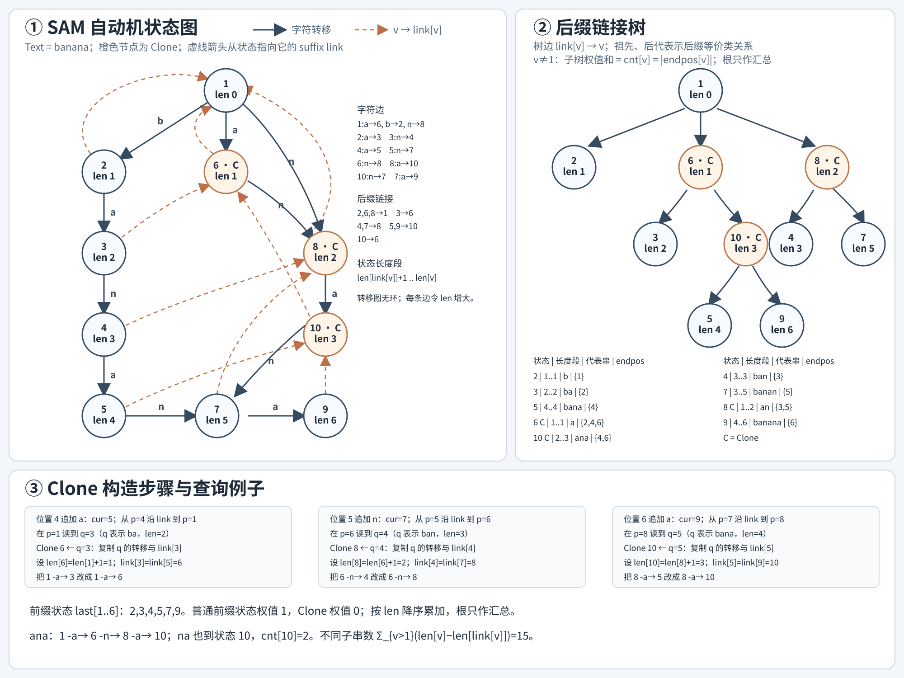

`banana` 共建出 10 个状态，根为 `1`，符合 ACMT 的 1-base 编号。下面每张快照都是处理完当前字符后的完整状态：列出当时所有非空转移、所有非根状态的后缀链接、`len` 和当前 `last`。`-` 表示暂时没有后缀链接；此例每次处理完字符后，所有已有的非根状态都已有 Link。转移写作 `u -c→ v`，后缀链接写作 `u → link[u]`。

下图按 `b → ba → ban → bana → banan → banana` 展示六次 Extend 后的状态。每一步单独成图，左侧只画字符转移，右侧单独画 Link 树；底部列出完整边表与本步的改动。

这里“克隆原节点 `q`”指复制一个已经存在的旧状态 `q`，不是复制当前新建的 `cur`。Clone 会复制 `q` 当时已有的字符转移和后缀链接；再把 Clone 的 `len` 设为 `len[p]+1`，并将旧状态 `q` 与当前 `cur` 的后缀链接改为指向 Clone。之后还要沿 `p` 的后缀链接向上，把仍指向 `q` 的对应字符转移改指向 Clone。

#### Extend 1：追加 `b`，得到 `b`

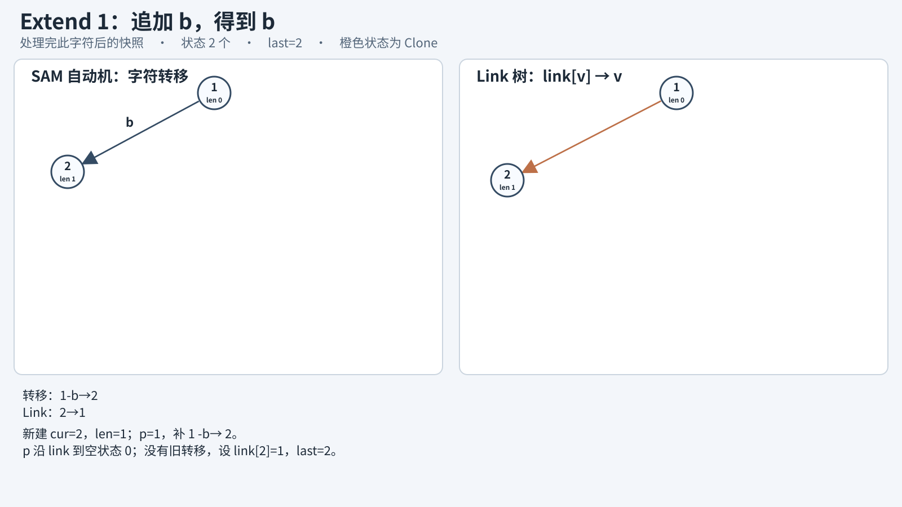

- 新建 `cur=2`，`len[2]=1`。从根 `p=1` 开始，`1` 没有 `b` 转移，于是补上 `1 -b→ 2`；再令 `p=link[1]`，到达空状态 `0`，停止。因为没有旧的 `b` 转移，设 `link[2]=1`，并令 `last=2`。
- **本步快照**：状态 `1(len=0), 2(len=1)`；转移 `1 -b→ 2`；Link `2→1`。

#### Extend 2：追加 `a`，得到 `ba`

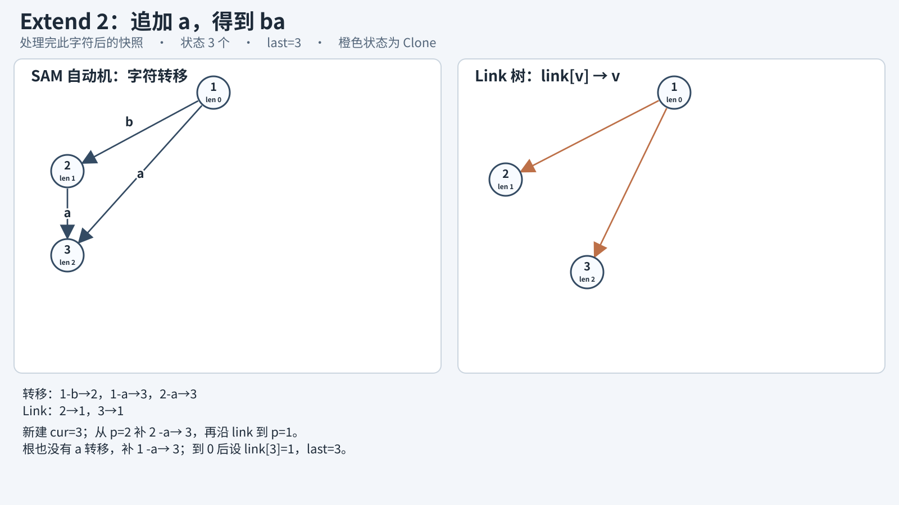

- 新建 `cur=3`，`len[3]=2`。从 `p=last=2` 开始，补 `2 -a→ 3`；沿 `link[2]` 到根 `1`，根也没有 `a` 转移，补 `1 -a→ 3`；再到空状态 `0`。没有遇到旧状态，设 `link[3]=1`，并令 `last=3`。
- **本步快照**：状态 `1(len=0), 2(len=1), 3(len=2)`；转移 `1 -a→ 3, 1 -b→ 2, 2 -a→ 3`；Link `2→1, 3→1`。

#### Extend 3：追加 `n`，得到 `ban`

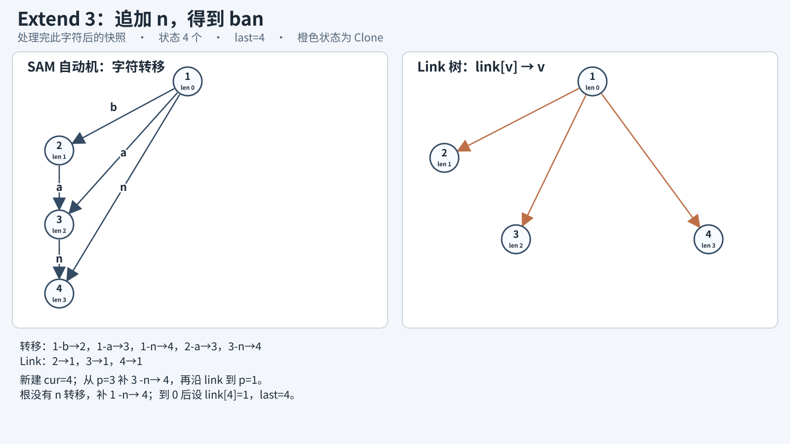

- 新建 `cur=4`，`len[4]=3`。从 `p=last=3` 开始，依次补 `3 -n→ 4`、`1 -n→ 4`；沿 `link[1]` 到空状态 `0`。没有遇到旧状态，设 `link[4]=1`，并令 `last=4`。
- **本步快照**：状态 `1(len=0), 2(len=1), 3(len=2), 4(len=3)`；转移 `1 -a→ 3, 1 -b→ 2, 1 -n→ 4, 2 -a→ 3, 3 -n→ 4`；Link `2→1, 3→1, 4→1`。

#### Extend 4：追加 `a`，得到 `bana`

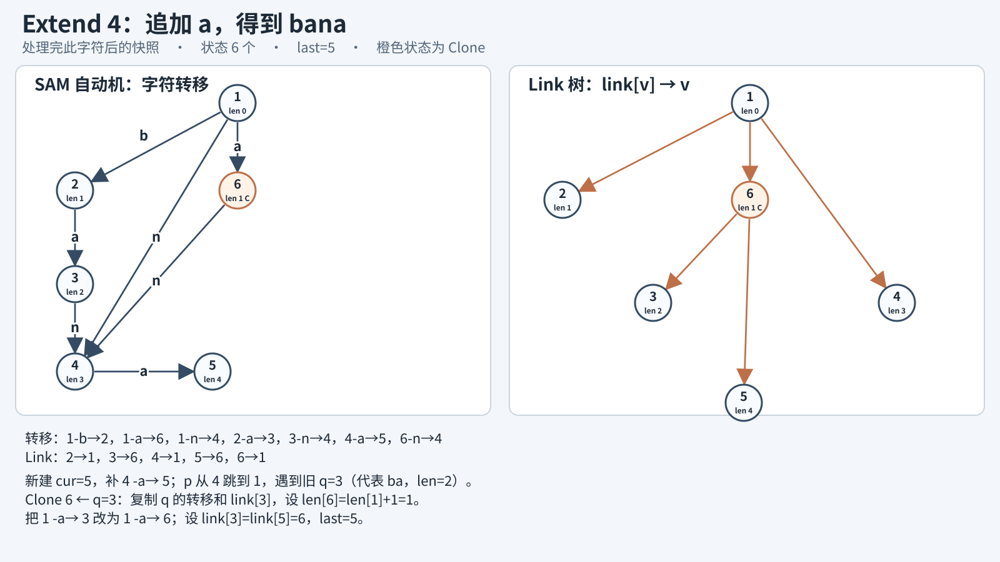

- 新建 `cur=5`，`len[5]=4`。先从 `p=last=4` 补 `4 -a→ 5`。沿 `link[4]` 到根 `p=1` 时，发现 `1 -a→ 3` 已存在，因此旧状态是 `q=3`，不是 `cur=5`。此时 `len[1]+1=1` 小于 `len[3]=2`，需要拆分状态 3。
- 新建 `Clone 6 ← q=3`：复制状态 3 当前的转移 `3 -n→ 4` 和原 Link `link[3]=1`；设 `len[6]=len[1]+1=1`、`link[6]=1`。从 `p=1` 沿 Link 向上，把 `1 -a→ 3` 改为 `1 -a→ 6`。最后改 `link[3]=link[5]=6`，并令 `last=5`。
- **本步快照**：状态 `1(len=0), 2(len=1), 3(len=2), 4(len=3), 5(len=4), 6(len=1, Clone)`；转移 `1 -a→ 6, 1 -b→ 2, 1 -n→ 4, 2 -a→ 3, 3 -n→ 4, 4 -a→ 5, 6 -n→ 4`；Link `2→1, 3→6, 4→1, 5→6, 6→1`。

#### Extend 5：追加 `n`，得到 `banan`

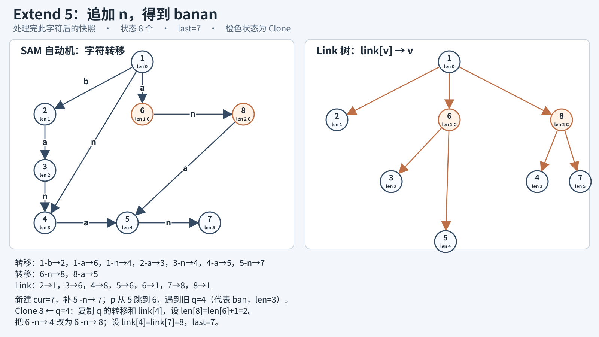

- 新建 `cur=7`，`len[7]=5`。从 `p=last=5` 补 `5 -n→ 7`；沿 `link[5]` 到 `p=6`，发现 `6 -n→ 4` 已存在，所以旧状态是 `q=4`。此时 `len[6]+1=2` 小于 `len[4]=3`，需要拆分状态 4。
- 新建 `Clone 8 ← q=4`：复制状态 4 当前的转移 `4 -a→ 5` 和原 Link `link[4]=1`；设 `len[8]=len[6]+1=2`、`link[8]=1`。从 `p=6` 沿 Link 向上，把 `6 -n→ 4` 改为 `6 -n→ 8`。最后改 `link[4]=link[7]=8`，并令 `last=7`。
- **本步快照**：状态 `1(len=0), 2(len=1), 3(len=2), 4(len=3), 5(len=4), 6(len=1, Clone), 7(len=5), 8(len=2, Clone)`；转移 `1 -a→ 6, 1 -b→ 2, 1 -n→ 4, 2 -a→ 3, 3 -n→ 4, 4 -a→ 5, 5 -n→ 7, 6 -n→ 8, 8 -a→ 5`；Link `2→1, 3→6, 4→8, 5→6, 6→1, 7→8, 8→1`。

#### Extend 6：追加 `a`，得到 `banana`

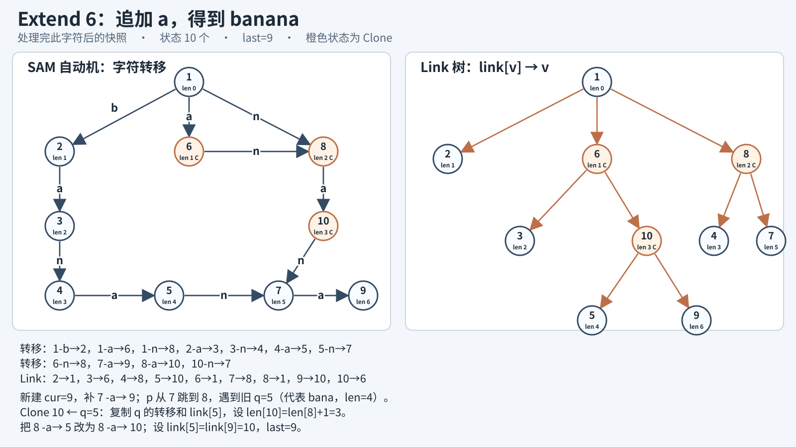

- 新建 `cur=9`，`len[9]=6`。从 `p=last=7` 补 `7 -a→ 9`；沿 `link[7]` 到 `p=8`，发现 `8 -a→ 5` 已存在，所以旧状态是 `q=5`。此时 `len[8]+1=3` 小于 `len[5]=4`，需要拆分状态 5。
- 新建 `Clone 10 ← q=5`：复制状态 5 当前的转移 `5 -n→ 7` 和原 Link `link[5]=6`；设 `len[10]=len[8]+1=3`、`link[10]=6`。从 `p=8` 沿 Link 向上，把 `8 -a→ 5` 改为 `8 -a→ 10`。最后改 `link[5]=link[9]=10`，并令 `last=9`。
- **本步快照**：状态 `1(len=0), 2(len=1), 3(len=2), 4(len=3), 5(len=4), 6(len=1, Clone), 7(len=5), 8(len=2, Clone), 9(len=6), 10(len=3, Clone)`；转移 `1 -a→ 6, 1 -b→ 2, 1 -n→ 8, 2 -a→ 3, 3 -n→ 4, 4 -a→ 5, 5 -n→ 7, 6 -n→ 8, 7 -a→ 9, 8 -a→ 10, 10 -n→ 7`；Link `2→1, 3→6, 4→8, 5→10, 6→1, 7→8, 8→1, 9→10, 10→6`。

最终普通前缀状态为 `2、3、4、5、7、9`，Clone 为 `6、8、10`。普通前缀状态的出现次数初值为 1，Clone 初值为 0；按 `len` 降序沿 Link 累加。每一步的 `last` 依次为 `2、3、4、5、7、9`。

本例 Link 树的父子关系为：根 `1` 的孩子是 `2、6、8`；`6` 的孩子是 `3、10`；`8` 的孩子是 `4、7`；`10` 的孩子是 `5、9`。六个前缀终点状态是 `last[1..6]=2,3,4,5,7,9`，每个权值为 1；Clone `6、8、10` 初值为 0。于是 `subtree(6)` 中的前缀终点对应位置 `{2,4,6}`，`cnt[6]=3`；`subtree(8)` 对应 `{3,5}`，`cnt[8]=2`；`subtree(10)` 对应 `{4,6}`，`cnt[10]=2`。这说明子树汇总的是前缀终点权值，不是子树里的状态节点数。

沿转移走 `ana`：`1 --a--> 6 --n--> 8 --a--> 10`。`na` 也到状态 10，因为状态 10 表示长度 `2..3` 的同一 endpos 等价类，即 `na` 与 `ana` 出现位置相同；本例 `cnt[10]=2`。而 `a` 到状态 6，`cnt[6]=3`。不同子串总数为 `Σ_{v>1}(len[v]-len[link[v]])=15`。

### 5.3 SAM 静态

- `first[v]`：状态内一个代表串的结束位置，恢复某个长度的出现位置。
- `cnt[v]`：出现次数，clone 初值 0，按后缀链接树汇总。
- `mn[v]/mx[v]`：沿后缀链接树汇总，支持最远间距、不重叠重复等。
- `col[v]`：子串出现于哪些输入串；多串公共子串要明确 clone 后如何继承/汇总颜色。
- `ways[v]`：无环转移图上的不同后续路径数，服务第 k 小子串等。
- 长度区间权值：同一状态有多个长度，若答案对长度敏感，需要按 `[len(link)+1,len]` 聚合，不能只给状态一个权值。

### 5.4 SAM 动态

SAM 可在线追加字符，状态数和转移可增量构造；但这不自动提供静态后缀链接树的 Euler 序。追加时会创建 clone，并改变旧状态的 link，所以原有后缀链接树子树区间可能失效。

- **只需当前串的不同子串数**：每次追加时按新状态/clone 的长度差维护增量，避免每次重算。
- **只需当前串某个 Pattern 是否出现**：当前 SAM 转移可直接走，但 Pattern 对应状态可能因 clone/link 变化而需重新定位或谨慎维护。
- **在线出现次数/出现位置**：需动态维护后缀链接树上的位置统计、分块重建，或把查询离线化。标准模板的最终 `cnt` 自底向上统计是静态后处理，不是每次追加后 `O(1)` 自动更新。
- **尾删/回滚**：记录每次扩展创建/改写的边和 link 可尝试撤销，但 clone 改边记录复杂；不能把 SAM 的追加能力直接当作可撤销能力。
- **任意编辑**：普通 SAM 不适用。

### 5.5 SAM 应用清单

#### 5.5.1 节点、父边与状态长度区间

后缀链接树节点是 SAM 状态，父亲 `link[v]` 是该状态最长串的最长真后缀状态。每个状态不是一个串，而代表长度区间

`len[link[v]] + 1 <= |x| <= len[v]`。

这个区间内所有不同子串 `x` 的 `pos[x]` 都相同。因此树的祖先/子树描述的是出现位置集合的包含关系；回答和长度有关的问题时，还要看 `len` 区间。

#### 5.5.2 祖先、子树与 LCA 的含义

- `u` 是 `v` 的祖先，表示 `u` 是 `v` 的后缀链接祖先类；相应位置集合满足 `pos[v] ⊆ pos[u]`。越往祖先走，代表串越短、出现集合通常越大。
- `subtree(v)` 的前缀终点标记恰好给出 `pos[v]`：每个 Text 前缀的 `last[r]` 标记一次，状态 `v` 的所有出现端点就是其子树内标记。
- `lca(u,v)` 是两个状态后缀链接链上的最近公共祖先类。它不是直接求两个代表串的最长公共子串；普通 LCP/LCS 需要转移、SA/LCP 或按具体端点扫描。
- `cnt[v]` 可由子树标记数得到；但 `v` 内多个长度对应多个子串，`cnt[v]` 是每个这些子串共同的出现次数，不能把它乘上任意长度贡献而漏掉区间边界。

#### 5.5.3 子树统计与倍增如何落地

1. 最终 SAM 建好后按 `link` 建树，给每个原 Text 前缀终点状态 `last[r]` 标记位置 `r`；clone 不直接标记新端点。
2. 建树并做 DFS 序后，`pos[v]` 就是 `v` 子树中标记的位置。
3. 全局出现次数是子树点数；端点区间 `[L,R]` 的出现次数是子树 Euler 区间与位置区间的二维计数。
4. `f[k][v]` 可按 link 父亲填表。由于 `len` 沿父链严格下降，可 `O(log n)` 找到满足长度边界的祖先状态；定位具体长度 `k` 时找唯一满足 `len[link[v]]<k<=len[v]` 的状态。
5. 子树内维护 `mn/mx` 可得到最早/最晚出现位置；不重叠要求还需检查距离是否至少为候选长度，必要时二分长度并做可行性判定。
6. 多串时给端点标记附文档颜色，子树上求 不同 colors；可用小数据 bitset 合并，或离线颜色数结构。

#### 5.5.4 维护量与应用场景清单

| 题目问法 | 树上信息 | 典型方法 |
|---|---|---|
| 某个 Pattern 的出现次数 | `pos[v]` 中的位置数 | 数子树标记/沿后缀链接向上累加 |
| 出现位置、最早/最晚位置 | 子树端点集合、min/max | Euler 子树报告/聚合 |
| Pattern 在 Substr 范围出现次数 | `(tin[last[r]],r)` | 二维矩形计数 |
| 出现于多少个文档 | 子树颜色集合 | bitset、小并查集合并、离线 不同 |
| 两状态公共后缀类 | link 链祖先 | LCA、Link 路径长度 |
| 长度受限的后缀状态 | `len` 单调下降 | Link 倍增 |
| 每个不同子串的总贡献 | `len[v]-len[link[v]]` 个长度 | 对状态长度区间求和/截断 |
| 最长重复/最远间距 | 子树端点位置 | min/max、排序、二分可行性 |
| 多串最长公共子串 | 每个状态每个文档的最大匹配长度 | 扫描后沿 Link 向父亲传播，再取跨文档最小值 |

**动态边界**：SAM 可逐字符构造，但新 clone 可能把旧状态改挂到新父亲。转移自动机在线可用，静态后缀链接树上的 `tin/tout`、LCA、倍增和子树聚合却不保证稳定。需要逐前缀在线回答时，必须采用支持 reparent 的动态树/专门在线算法；否则常见做法是构造结束后再一次性建后缀链接树。

---

## 6. GSAM：多串子串自动机

GSAM（Generalized SAM）表达多个字符串的子串集合。目标是对子串去重并按源串携带出现信息，不能把多个 Texts 直接拼接后忽略串边界。

### 6.1 GSAM 状态 与 Link 定义

ACMT 使用的构造路线是：多串先插入 Trie，再按 Trie 边 BFS 构造 SAM 转移。Trie 避免跨串边界产生伪子串，BFS 保证父前缀状态先建立。Trie 节点 `x` 代表一个源串前缀；扩展边 `x --c--> y` 时，在映射的自动机状态上执行 SAM 扩展。若发生 clone，需更新自动机转移，同时另存 Trie 父子关系和源串信息。模板可用 `pre[state]` 保存原 Trie 父节点和边字符。

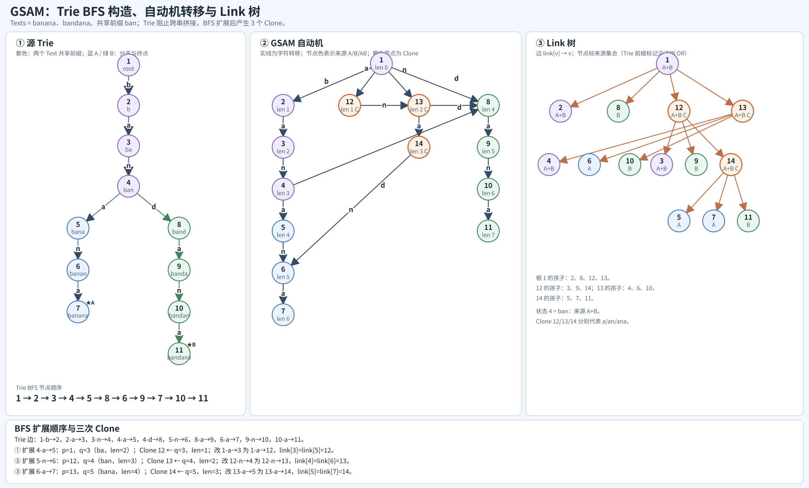

### 6.2 GSAM 自动机 性质

自动机转移识别输入串集合的子串；状态长度区间与 SAM 类似，但位置集合和源串标记要按构造解释。

- 单个源串时退化为普通 SAM 的子串识别。
- 多串不同子串总数不能简单相加各串 SAM 的贡献；GSAM 的状态合并用于去重。
- 判断是否为任一输入串的子串：从根按字符走转移。
- Trie 节点数与总输入长度线性；状态同阶，数组转移空间还需乘字母表大小 `σ`。

### 6.3 GSAM Link 树 性质

GSAM 的 Link 树按最长真后缀等价类组织。祖先表示更短后缀等价类，端点和出现信息还带源串身份。不同 GSAM 构造的种子定义不同，不能不看构造就照搬普通 SAM 的 `last[r]` 公式。

- 对 Trie 前缀/源串终点打符合构造的种子标记，Link 子树汇总才表示相应源串的出现端点或来源集合。
- `lca(u,v)` 是两状态 Link 链的最近公共祖先，不直接等于两个源串的最长公共子串。
- `mask[v]` 可保存来源串集合；源串少用 bitmask，源串多用 bitset。
- `cntString[v]` 表示不同源串数，不是总出现次数。
- 基准 SAM 扫描每个源串并沿 Link 向父状态传播最长匹配长度，可求多串 LCS。

### 6.4 GSAM 静态

固定源串集合建完后，Link 树可预处理 DFS 序、子树统计和倍增。源串维度可作为颜色、bitset 或 `(doc,pos)` 端点坐标挂到状态上。常见查询包括子串出现于哪些/多少个源串、指定文档出现次数、位置区间统计、至少 `k` 个源串共有的最长子串。

### 6.5 GSAM 动态

动态加入源串会改变去重状态和 clone 结构，通常需要重建 GSAM。若只求多串 LCS，可考虑基准 SAM 加逐串扫描；若源串很多且需要子串并集去重，才考虑 GSAM。它不是低成本动态插串结构。

### 6.6 GSAM 应用清单

| 题目问法 | 附加信息 | 常见树上操作 |
|---|---|---|
| 子串出现于哪些/多少个源串 | 源串颜色或 bitset | Link 子树颜色并集/不同颜色数 |
| 所有源串子串并集去重 | 状态长度区间 | 汇总 `len[v]-len[link[v]]` |
| 至少 `k` 个源串共有的最长子串 | 每状态各串匹配长度或颜色数 | Link 传播、阈值筛选、最大长度 |
| 指定源串中的出现次数 | 端点 `(doc,pos)` | Link 子树 × 文档/位置范围查询 |
| 多源串中最早/最晚位置 | 子树内文档位置 | min/max、二维索引 |
| 少量字符串求公共子串 | 基准 SAM + 逐串扫描 | 扫描长度向 Link 父亲传播 |

选择 GSAM 前确认串边界不会产生伪子串、端点/颜色种子与构造严格对应、内存可容纳状态 × 来源信息。精确位置查询必须保留 `(doc,pos)`，单独的来源 bitset 不够。

---

## 7. PAM：回文自动机与回文 Fail 树

PAM（Palindromic Tree / Eertree）表示一个 Text 出现过的所有**不同回文子串**。它有两个根：长度 `-1` 的奇根和长度 `0` 的偶根。

### 7.1 PAM 状态 与 Fail 定义

普通节点 `v` 代表一个具体回文串，`len[v]` 是该回文长度。边 `v --c--> u` 表示

`u = c + v + c`。

```text
len 0 节点：空串
       --a--> "a"
       --b--> "b"
"a" --b--> "bab"      因为 b + "a" + b = "bab"
```

更准确地说，若 `v` 代表回文 `X`，从 `v` 沿 `c` 边到 `u`，则 `u` 代表 `cXc`。图中边标签相同的外层字符必须相同。

**状态是具体回文串，不是等价类**，与 SAM 的状态含义不同。追加字符时，沿 `link` 找到当前前缀中最长的回文后缀 `v`，若两端可以加 `c`，新回文为 `c + str[v] + c`。每次追加最多新建一个节点，因此不同回文节点数 `<= n`。

### 7.2 PAM 自动机 性质

新字符放在当前串尾部。设当前前缀末尾是 `c`，从 `last` 沿 link 找第一个满足前一位置字符也为 `c` 的回文节点 `v`：

```text
... c [ X ] c
    └─ v ─┘
新回文 = c + X + c
```

若 `v --c-->` 已存在，更新 `last`；否则创建新节点 `u`，`len[u]=len[v]+2`。长度 1 节点 link 指向长度 0 根；更长节点的 link 是 `v` 的后缀链接链上第一个可被同字符两侧扩展的节点沿 `c` 的转移。

每次沿后缀链接回退看起来可能很多，但总摊还 `O(n)`（固定字母表转移），每个字符最多增加一个节点。

#### 完整样例：`abacabaaba`

按 ACMT 模板编号：`1` 是长度 `-1` 的奇根，`0` 是长度 `0` 的偶根，普通回文节点从 `2` 开始编号。`fa[v]` 表示 `v` 的最长真回文后缀。输入位置从 `1` 开始；表中的 `last[r]` 是处理完第 `r` 个字符后的最长回文后缀。

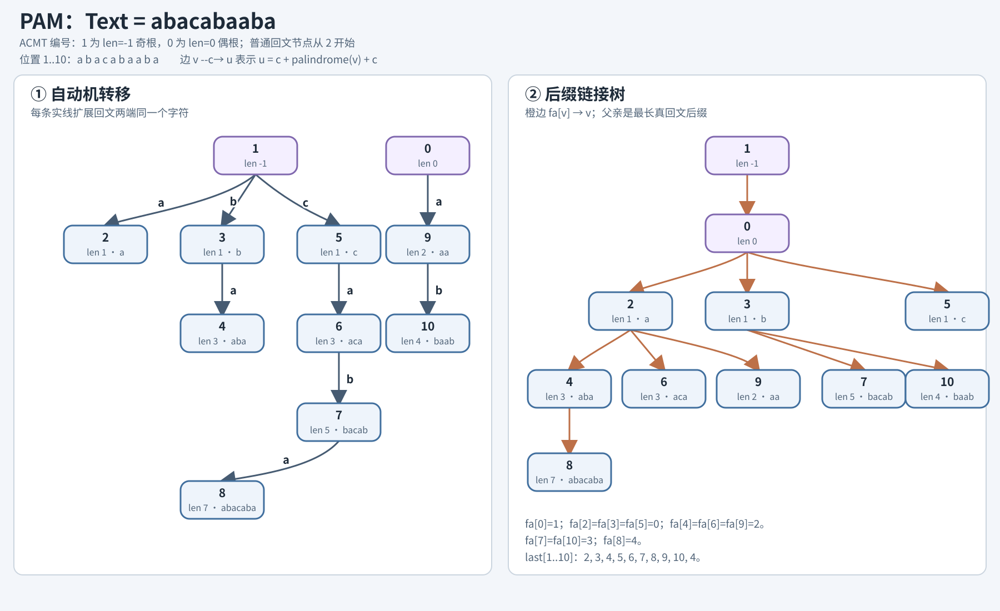

逐字符插入时，只有新出现的不同回文才建节点；若所需转移已经存在，`last` 直接复用已有节点。这个样例既有不断扩展的 `aba → abacaba`，也有重复命中：末尾的 `aba` 回到节点 `4`，而不是再建一个节点。

| `r` | 新字符 | 当前最长回文后缀 `last[r]` | 本步结果 |
|---:|:---:|---|---|
| 1 | `a` | `2: a` | 新建节点 2，`fa[2]=0` |
| 2 | `b` | `3: b` | 新建节点 3，`fa[3]=0` |
| 3 | `a` | `4: aba` | 新建节点 4，`fa[4]=2` |
| 4 | `c` | `5: c` | 新建节点 5，`fa[5]=0` |
| 5 | `a` | `6: aca` | 新建节点 6，`fa[6]=2` |
| 6 | `b` | `7: bacab` | 新建节点 7，`fa[7]=3` |
| 7 | `a` | `8: abacaba` | 新建节点 8，`fa[8]=4` |
| 8 | `a` | `9: aa` | 新建节点 9，`fa[9]=2` |
| 9 | `b` | `10: baab` | 新建节点 10，`fa[10]=3` |
| 10 | `a` | `4: aba` | 转移已存在，复用节点 4 |

### 7.3 PAM Fail 树 性质

`link[u]` 指向 `u` 的最长真回文后缀。树祖先关系表示“是该回文的回文后缀”。这是回文版的后缀包含结构。

- 每次前缀的 `last` 是该前缀最长回文后缀。
- 该前缀的全部回文后缀，就是从 `last` 沿后缀链接到长度 0 根的整条链。
- 节点作为某个前缀 `last` 的祖先，就在该前缀末尾出现一次；故所有回文节点的出现次数可通过对每个位置 `cnt[last]++`，再按长度降序向 link 父亲累加。
- 固定回文节点 `v` 出现于 Text 端点 `r`，当且仅当 `v` 是 `last[r]` 的祖先。故端点区间查询同样可转成后缀链接树子树的二维点计数。

### 7.4 PAM 静态

PAM 是在线追加结构，且已有节点的回文串与后缀链接不会像 SAM clone 那样被重写；因此追加时新建节点后，已有后缀链接树边稳定。这使在线统计比 SAM 的后缀链接树更直接：

- 固定 Pattern 回文出现次数：当前 `last` 的 link 链需包含该 Pattern。若要边追加边维护，可用 Link-Cut Tree 对 `last` 到根的路径加一；HLD 适用于结构已固定后的路径处理，或先收集完整 Text 再离线汇总。
- 每个前缀回文后缀数：`last` 到根的链长（排除两个特殊根）。
- 每个位置的最长回文后缀：`len[last]`。
- 不同回文串种数：普通 PAM 节点数。
- 回文出现次数、`出现次数 × 长度`：后缀链接树汇总 `cnt` 后统计。
- 最小回文划分：对所有回文后缀做 DP；用 `diff` 和 series link 将等差长度组压缩，经典优化通常为 `O(n log n)`。

### 7.5 PAM 动态

PAM 虽在线追加，但任意中间修改会影响后续回文节点和 link，不支持标准意义的动态编辑。尾删可通过记录最后新增节点、旧 `last` 和转移回滚实现栈式撤销，但必须完整记录状态修改。

### 7.6 PAM 应用清单

#### 7.6.1 节点、父边与根

普通节点 `v` 表示一个具体的不同回文串；`link[v]` 指向它的最长真回文后缀。PAM 有长度 `-1` 的奇根和长度 `0` 的偶根，二者的 link 约定用于保证构造时一定能找到可扩展节点。统计非空回文时要排除两个特殊根。

#### 7.6.2 祖先、子树与 LCA 的含义

- `u` 是 `v` 的祖先，当且仅当回文 `u` 是回文 `v` 的回文后缀；父链枚举全部真回文后缀。
- 对前缀端点 `r`，`last[r]` 是最长回文后缀。回文 `u` 在端点 `r` 结束，当且仅当 `u` 是 `last[r]` 的 link 祖先。
- 把每个 `last[r]` 标记一次后，`subtree(u)` 中的端点恰是回文 `u` 的所有结束位置。因此子树点数为出现次数，子树位置集合为出现位置。
- `lca(u,v)` 是两个回文 link 链公共祖先中最深者，也就是两回文的最长公共回文后缀。
- `depth(v)` 是回文后缀链边数/回文后缀个数（按根的排除规则调整）；它不等于 `len[v]`。


#### 7.6.3 倍增、子树与在线维护

- `f[0][v]=link[v]`，`f[k][v]=f[k-1][f[k-1][v]]`。祖先长度严格递减，适合第 k 个回文后缀和长度边界查询。
- 闭区间 `[L,R]` 的长度上限是 `B=R-L+1`。从 `last[R]` 沿 Link 跳过 `len>B` 的祖先，得到的第一个 `len<=B` 状态就是区间内以 `R` 结尾的最长回文；根节点表示不存在非空答案。
- 对每个端点 `r` 在 `last[r]` 加点权，回文 `u` 出现次数/权值和即 `subtree(u)` 聚合；同时限制端点位置时变成子树 Euler 区间 × 位置区间的二维查询。
- 查询 Link 路径上的长度和/节点权值，可用倍增表维护每段聚合；要查询分支子树则用 Euler 序/树上数据结构。
- PAM 新建节点时其 link 父亲确定，既有 Link 边不被后续追加重挂，故祖先倍增表可在线填。但新节点出现会使静态 DFS Euler 序不再适合在线子树区间；点集子树查询要动态结构或离线编号。

#### 7.6.4 维护量与应用场景清单

| 题目问法 | 树上信息 | 典型方法 |
|---|---|---|
| 每个前缀最长回文后缀 | `last[r]` | PAM 构造时直接记录 |
| 每个前缀回文后缀个数 | `depth(last[r])` |后缀链接树深度，调整根计数 |
| 每个回文出现次数 | `last[r]` 端点标记 | Link 子树点数/逆 Link 汇总 |
| 回文出现的位置/位置区间次数 | 端点 `r` | 子树报告或 `(tin[last[r]],r)` 二维查询 |
| `[L,R]` 以 `R` 结尾最长回文 | `last[R]`、上限 `R-L+1` | 按 `len` 单调性 Link 倍增 |
| 第 k 长回文后缀 | `last[R]` | `f[k][last[R]]`，约定是否含自身 |
| 两个回文最长公共回文后缀 | 两个回文节点 |后缀链接树 LCA |
| 回文权值和/最大值 | 节点权或端点权 | Link 路径聚合或子树聚合，按问题方向选择 |
| 最小回文划分 | 每个前缀的回文后缀链 | `diff/seriesLink` 分组 DP；不是普通祖先倍增可直接解决 |
| 只出现于特定 Substr 范围的回文 | 回文节点子树 + 端点范围 | 二维正交计数/离线查询 |

**区分两类树边**：PAM 的普通后缀链接树用于“回文后缀包含”和出现端点聚合；`seriesLink` 用于把相同 `diff` 的回文长度序列分组，优化回文划分 DP。题目问出现次数/共同后缀通常看后缀链接树，题目问最小因子划分通常看 `seriesLink`。

---

## 8. GAM：一般自动机如何建模

### 8.1 GAM → AM：先定义状态，不先写转移

把问题描述成有限状态机时，状态 `state` 必须是“足以决定未来”的信息摘要：读入同一后缀后，若两段历史对所有未来后缀的合法性/输出完全一致，才可以合并成同一状态。

一般自动机模型：

- 状态集合 `Q`，初态 `start`。
- 字符转移 `δ(state,c)`，可能不存在或进入死状态。
- 输出 `result(state)`：接受、匹配 Pattern、得分、计数、颜色等。
- 目标是在状态图上走一条由输入串定义的路径，统计路径/最优路径/第一次到达时间。

常见建模例子：

- 只关心当前与 Pattern 的最长前缀匹配：KMP 自动机。
- 只关心多个禁串是否已出现：ACAM + 坏状态。
- 关心任意子串是否出现在固定 Text：SAM。
- 关心当前回文后缀及不同回文：PAM。
- 关心固定 Text 的子序列匹配：SeqAM。

### 8.2 GAM → Fail：什么时候可以定义 Fail

Fail 不是所有自动机必有的字段。需要存在以下结构：状态对应某个已匹配串/前缀；失配时原有 Text 后缀仍可能成为另一个合法状态；并且这些候选状态按“是后缀”形成链。此时 Fail 指向最长的可复用真后缀。

```text
当前已匹配串 X
失配后不回退 Text 指针
只保留 X 的某个 Border / 合法后缀 Y
Fail(X) = 最长可复用的 Y
```

- KMP Fail：Pattern 前缀的最长 Border。
- ACAM Fail：Trie 前缀中最长的真后缀。
- SAM后缀链接：出现位置相同的一类状态之间的最长真后缀关系。
- PAM后缀链接：最长真回文后缀。
- SeqAM：按位置向后跳，不是后缀复用，因此没有 Fail。

### 8.3 KMP 自动机：一般 Fail 思想的最小模型

KMPAM 状态 `j` 表示当前 Text 的后缀等于 Pattern 前缀 `P[1..j]`。完整匹配后，处理下一个字符前先回到 `ne[m]`。其余情况下，若下一个字符与 `P[j+1]` 不同，就沿 Fail 链回到 `ne[j]`，即已匹配前缀的最长真 Border；继续回退直到能接上字符或回到 0。

- `ne[i]` 是前缀 `P[1..i]` 的最长真 Border 长度；`ne` 下标按前缀长度 1-base 编号。
- Fail 链枚举所有可能保留的前缀长度；它不是任意“删除若干字符后还能匹配”，而是必须同时为已匹配串的后缀和 Pattern 前缀。
- 对单个固定 Pattern，预处理 `O(m)`；扫描一段 Text `O(n)`。Pattern 变化后 ne/自动机需重建。
- 完整 KMP 自动机为每个状态和字符预计算转移，适合小字母表的字符串 DP；大字母表通常按需沿 Fail 回退，不存 `m×σ` 表。
- 找重叠匹配时，匹配完 `m` 个字符后回到 `ne[m]`，不回到 0。

这说明 Fail 的通用来源是**状态字符串的 Border 链**。ACAM 把多个 Trie 前缀的这些后缀合并，SAM/PAM 则在更复杂的等价类/回文集合上定义各自的后缀链接。

### 8.4 自动机 × 倍增：link 链与转移函数

自动机与倍增至少有两种不同的结合方式，别混为一谈。

#### Fail/后缀链接树上的祖先、子孙与 LCA

倍增首先是**树上跳祖先**的技巧。自动机里的 `fail/link` 指针把每个非根状态连到一个更短状态；若每个状态只有一个父亲、不会形成环，这些边反向后就是一棵以根状态为根的树。于是可以直接使用树上工具：倍增求祖先/LCA，Euler 序 把子树变区间，重链剖分维护根路径，虚树压缩少量关键状态。

```text
                 root
                /    \\
              u        v
             / \\       \\
            a   b       c

父指针方向：a -> u -> root
树边方向：  root -> u -> a
```

对状态 `x`、`y` 而言，`x` 是 `y` 的祖先，当且仅当沿 `y` 的 Fail/link 链能够到达 `x`。语义是“`x` 对应的字符串信息，是 `y` 当前状态可保留的一个后缀/类层级”。因此树上集合问题常转成：哪些 Text 端点状态落在 `x` 的子树里？

| 树 | `x` 是 `y` 的祖先意味着什么 | `x` 子树聚合常见含义 |
|---|---|---|
| KMP Border 树 | 前缀状态 `x` 是前缀状态 `y` 的 Border（含自身，按定义处理真 Border） | 有多少前缀/状态把 `x` 当 Border；Border 出现频次、权值和 |
| ACAM Fail 树 | Trie 状态 `x` 对应的 Pattern 前缀，是状态 `y` 对应串的后缀 | 扫描到 `y` 时，`x` 是一个匹配 Pattern；Pattern 在 Text 中的出现次数 |
| SAM 后缀链接树 | `x` 的 出现位置相同的一类状态覆盖 `y` 的 出现位置相同的一类所代表的更长字符串关系 | 子树状态的出现位置集合/出现端点汇总；不同子串的出现次数、颜色/来源统计 |
| PAM 回文后缀链接树 | 回文 `x` 是回文 `y` 的回文后缀 | 哪些回文出现以 `x` 结尾；出现次数、权值或来源汇总 |

其中 SAM 的树祖先关系要结合 `len/link` 区间理解：一个状态代表长度区间 `[len(link[v])+1, len[v]]` 的多个子串；不能把“一个状态”等同于“一个字符串”。按 SAM 建树后，经典 `cnt[v]` 是该状态所代表子串的出现次数，沿后缀链接从长到短汇总 结束位置 计数。若询问指定长度 `k` 的子串，先定位满足 `len[link[v]] < k <= len[v]` 的状态，再用相应的位置集合统计。

**LCA 的语义**：树上 `lca(a,b)` 是两条根到状态路径的最后公共状态，也就是同时位于 `a`、`b` 的 Fail/link 链上的“最长公共可复用后缀状态”。

- KMP Border 树：两个前缀状态的 LCA 是它们最长的公共 Border 状态。
- ACAM Fail 树：两个 Trie 状态的 LCA 是它们最长的公共后缀，且该后缀本身是 Trie 前缀状态。
- PAM后缀链接树：两个回文状态的 LCA 是它们最长的公共回文后缀。
- SAM 后缀链接树：LCA 给出两状态后缀链接链上的最近公共等价类祖先；它表达最长公共的后缀链接类层级。若要问原字符串的最长公共子串，不能直接用 LCA 作答案；需回到子串本身和它的出现位置来判断。

LCA 常用来把“两条后缀链的交集”压成一个状态：例如共同 Border/共同回文后缀的最长者、两条 link 链公共祖先的深度或权值。静态树可用倍增 `O(log V)` 查询，也可用 Euler 序 + RMQ 做 `O(1)` 查询；树若随插入改变，需动态 LCA 或分块重建。

**子孙方向不是反复跳父亲**：给定 `x`，它的子孙可能很多，“第 k 个子孙”没有唯一含义。常见做法是先问清查询对象，再选树工具：

- 判断 `x` 是否为 `y` 的祖先：`tin[x] <= tin[y] < tout[x]`，`O(1)`。
- 汇总 `x` 的所有子孙状态：Euler 序 后变成区间 `[tin[x],tout[x])` 上的点权和/最值/颜色数。
- 按 Text 端点限制统计：把每个端点状态 `state[r]` 作为树上点，并给它附加位置 `r`；子树区间 × 位置区间是二维正交查询，可用 Fenwick/线段树套结构、波列树或离线 CDQ。
- 查询 `x` 到 `y` 路径上的状态值：LCA 拆成两段根路径，使用 HLD、树上差分或可合并路径结构。
- 找满足属性的最近/最远祖先：属性沿父链单调时用倍增；不单调时用 HLD、重链辅助结构或逐链查询，不能仅凭倍增跳过。

从树结构还能自然得到一组常用维护量：`depth`（link 链长度/层数）、`subtree size`（多少状态把它作为祖先）、子树点权和/最大值、子树颜色数、根路径前缀和、子树内按 Text 位置的最小/最大端点，以及关键状态集合的虚树。具体如 ACAM 的子树中的 Pattern 结束节点数可回答“该状态后缀上有多少 Pattern”；PAM 子树大小可统计有多少不同回文以某回文为后缀；SAM 子树的状态权值和可配合 `len[v]-len[link[v]]` 汇总不同子串贡献。最后一类尤其要注意：按状态求不同子串数时，状态 `v` 的贡献通常是 `len[v]-len[link[v]]`，而非简单数节点。

静态和动态的差异也来自“树边是否稳定”：

- **静态 KMP/ACAM**：Patterns 集合固定后建好树，可一次 DFS 得 Euler 序、子树大小、LCA 与倍增表；固定 Text 扫描后，把端点状态的频次放到树上做子树汇总。
- **ACAM 动态插入 Pattern**：新增 Trie 分支可能改变已有状态的 Fail 指针，普通静态 Fail 树的 Euler 序、LCA、倍增表不能直接沿用。常见做法是分批重建/对数分治维护多棵静态 ACAM，或使用专门的动态结构。
- **SAM 在线追加**：新字符可能创建 clone，并把既有状态的后缀链接改挂到 clone；自动机转移在线可用，但旧后缀链接树上的 Euler 序/倍增信息可能失效。只追加且不需要树查询时没问题；需要后缀链接树统计时要用支持 link-cut/reparent 的动态树方案，或离线建完后再做静态树处理。
- **PAM 在线追加**：新增回文节点的后缀链接在创建时确定，旧节点的 link 不因后续追加而改挂，适合在线填祖先倍增表。但新增树节点会改变常规 DFS Euler 序；在线子树统计需要动态 Euler 序/动态树，或者离线处理完再编号。

所以，能在线构造自动机，不等于它的 Fail/后缀链接树查询结构也自动在线。倍增表只适合父边稳定的树；树边变了，祖先表、LCA 和 Euler 子树区间都要同步维护或重建。

注意“子树聚合”的业务含义依自动机而异。ACAM 中 Pattern 结束节点的 Fail 子树可以统计所有扫描端点状态中包含该 Pattern 后缀的端点；SAM 中后缀链接子树关联 `pos` 汇总；PAM 中 Link 子树关联回文后缀出现。必须先证明目标事件等价于“某个状态是另一个状态的祖先”，再把它变成子树查询。后缀链接树本身不会自动提供任意区间答案，也不会自动处理状态代表的长度区间。

#### A. Link/Fail 链上的祖先跳跃

若从状态 `v` 沿 `link/fail` 反复跳，且目标条件随祖先深度单调，就建

`f[k][v] 表示从 v 沿 link 向上跳 2^k 次`。

一次查询从大到小试跳，保留仍满足边界/条件的最深祖先，复杂度 `O(log V)`；预处理和空间 `O(V log V)`。适用于：

- KMP：找最长 Border 长度 `<=B`，找第 k 个 Border，求周期链上的指定阶。
- ACAM：在当前状态的 Fail 链上找最长终止 Pattern、长度不超过上限的终止 Pattern，或第 k 个输出 Pattern。
- SAM：在后缀链接链上按 `len` 上限定位包含目标长度的状态；对 `cnt/color` 等条件，需先证明它沿链单调，再能倍增跳。
- PAM：在 `last[r]` 的回文后缀链接链上找长度不超过区间长度的最长回文后缀。

有些查询可用 `nextEnd`（最近终止祖先）压缩 Fail 链，比在每个普通 Fail 节点上倍增省空间；如果还有限制长度、权值或第 k 个输出，再对压缩链倍增。

#### B. 自动机转移函数的倍增

若已知一段固定 Text 块 `W`，可把“从每个状态读完 W 后到达哪里”视为函数 `F_W(state)`。两块拼接对应函数复合：

`F_(AB) = F_B ∘ F_A`。

对重复 Text `W^K`，预处理 `F_(W^(2^k))`，按 `K` 的二进制位应用，避免真的展开超长字符串。若还要累计匹配数，表中同时维护 `cnt[k][state]`：

`cnt[k+1][s] = cnt[k][s] + cnt[k][jump[k][s]]`。

用途：ACAM/KMP 在 `W^K` 中统计 Pattern 数、处理 run-length/文法压缩 Text、重复执行一个自动机状态转移块。单块转移预处理通常需对每个起点状态模拟一遍 W，代价约 `O(|Q||W|)`；之后每个初态处理 `K` 为 `O(log K)`。状态数大时必须先比较这笔预处理是否划算。

SeqAM 也可把一个 Pattern 块 `P` 的“最早匹配后位置”当作位置状态上的函数，倍增回答 `P` 重复 `K` 次是否仍能匹配；但它的转移是向后找字符，不是 Fail 回退。

#### C. 倍增不自动适用的情况

- 条件在祖先链上不单调，不能用一次二分式跳跃；需要树上路径查询/辅助 RMQ。
- Link 关系会动态改变（SAM clone 会重挂旧 link），静态 `f` 表会过期。在线 SAM 若需要这种查询，应动态维护后缀链接树或分块重建。
- 自动机状态转移受“已访问次数/当前权值”等可变信息影响时，它不是固定函数，不能直接预处理转移倍增。
- 若每个倍增表项存一个长度为 `σ` 的转移向量，内存可能变成 `O(Vσ log K)`；需要压缩状态、分块或只对实际询问状态建表。

**设计 Fail 树统计的通用套路**：

1. 每个 Text 端点映射到一个自动机状态 `state[r]`。
2. 某 Pattern/子结构的代表状态为 `v`。
3. 证明“Pattern 在端点 `r` 匹配”当且仅当 `v` 是 `state[r]` 的 Fail/link 祖先。
4. 在 Fail/后缀链接树做 Euler 序：祖先判断变为子树区间包含。
5. 每个端点成为二维点 `(tin[state[r]], r)`；按要求查询子树、Text 位置、版本或权值维。

若第 3 步不成立，不能套 Fail 树子树公式。尤其不要把“状态图有 link 指针”直接推断为所有匹配统计都是后缀链接树子树查询。

---

## 9. SufTree：后缀树

后缀树是把一个 Text 的所有后缀放进压缩 Trie 得到的结构。它与 SAM 一样表示子串，但组织方式不同：SAM 按“出现位置集合相同”合并子串；后缀树按后缀的公共前缀分叉。SA 保存叶子的字典序，LCP 保存相邻叶子的公共前缀；后缀树则把这两类信息显式组织成树。

### 9.1 后缀树 定义与结构

给 Text `T` 添加一个不在字符集中的唯一终止符 `$`，将每个后缀 `T[i..n]$` 插入 Trie，再把只有一个孩子的非终止节点压缩。最终：

- 每个叶子对应一个后缀起点 `i`；唯一终止符保证任意两个后缀不会出现一个是另一个前缀的情况。
- 根到节点的路径标签拼接后表示一个字符串；边标签通常用原串区间 `[l,r)` 表示，避免复制子串。
- 内部节点表示至少两个后缀的最长公共前缀分叉；叶子集合就是该路径字符串的所有出现位置。
- 从根到任意边上的任意深度，都对应 Text 的一个子串。因此压缩边代表一段子串长度，而不只是一个字符。

```text
压缩 Trie 的含义：

根 ──[一段原串区间]── 内部节点
                         ├──[一段原串区间]── 叶子（后缀起点 i）
                         └──[一段原串区间]── 叶子（后缀起点 j）

根到节点/边内位置的路径标签，对应一个子串；
该节点/边下方的叶子，对应这个子串在 Text 中的出现位置。
```

### 9.2 后缀树 性质

- **子串出现位置**：路径标签为 `X` 的节点，其子树叶子起点恰好是 `X` 在 `T` 中的出现位置。若 `X` 落在一条压缩边内部，仍对应这条边下方的整棵子树叶子。
- **出现次数**：子树叶子数就是该子串出现次数。内部节点可自底向上维护 `leafCount`；同一压缩边上的所有子串共享这组出现位置。
- **最长重复子串**：在所有拥有至少两个叶子的节点/边中，取最大字符串深度。若要求不重叠，需额外维护叶子起点的最小值与最大值，并检查间距。
- **两个后缀的 LCP**：叶子 `i,j` 的 LCA 字符串深度等于 `LCP(T[i..],T[j..])`。
- **Pattern 匹配**：沿边标签与 Pattern 比较；完整匹配后，所在节点或边下方叶子给出全部出现位置。查询成本为 `O(|Pattern| + 输出量)`，前提是字符转移可在 `O(1)` 或 `O(log |Σ|)` 查找。
- **不同子串计数**：每条压缩边从父节点深度 `d₁` 到子节点深度 `d₂`，贡献 `d₂-d₁` 个不同子串；所有边贡献之和是建树字符串 `T$` 的不同子串总数。若只统计原串 `T`，需排除包含终止符 `$` 的子串；唯一终止符下共有 `|T|+1` 个，因此答案为边贡献总和减 `|T|+1`。也可在每条边上只累计不超过 `|T|` 的有效深度。
- **子树聚合**：叶子上的位置权值、颜色、最小/最大起点等可做树形 DP；例如颜色数用于多串公共子串，位置极值用于重复子串间距。

后缀树边上能维护的信息，来自“一个子串对应一组后缀叶子”。如果查询带位置区间、权值排名或复杂函数，需要在叶子集合上另配线段树、合并树、持久化结构等；后缀树本身不会自动回答任意区间统计。

### 9.3 后缀树 静态构造

ACMT 中的两种建法按字符加入方向区分：**前端加入**可对反串建立 SAM，SAM 的 `fa` 树对应原串后缀树；**后端加入**用 Ukkonen 在线构造。前者复用 SAM 的 `extend`，后者显式维护压缩边。

#### 方法一：前端加入字符，反串 SAM

若原串为 `T`，维护 `reverse(T)` 的 SAM。SAM 的转移 `ch` 保存状态自动机，`fa` 保存后缀链接；将 `fa` 反向连边得到树。对原串按“在前端加入字符”更新时，等价于在反串末尾调用 `extend`，因此直接复用 SAM 模板即可。下面沿用 ACMT 的状态编号：根为 `1`，`tot` 为状态数，`len[u]` 为状态最长串长度，`fa[u]` 为后缀链接。

```cpp
const int N=1e6+5,M=26;
struct SAM{
    int tot,np,p,ch[N*2][M],fa[N*2],len[N*2];
    vector<int> e[N*2];

    void init(){
        for(int i=0;i<=tot;i++)e[i].clear();
        memset(ch,0,sizeof(ch[0])*(tot+1));
        memset(fa,0,sizeof(fa[0])*(tot+1));
        memset(len,0,sizeof(len[0])*(tot+1));
        tot=np=1;
    }

    int path(char _){return _-'a';}

    void extend(char _){
        int c=path(_);p=np;np=++tot;
        len[np]=len[p]+1;
        for(;p&&!ch[p][c];p=fa[p])ch[p][c]=np;
        if(!p)fa[np]=1;
        else {
            int q=ch[p][c];
            if(len[q]==len[p]+1)fa[np]=q;
            else {
                int nq=++tot;
                len[nq]=len[p]+1;
                fa[nq]=fa[q];
                fa[np]=fa[q]=nq;
                memcpy(ch[nq],ch[q],sizeof(ch[q]));
                for(;p&&ch[p][c]==q;p=fa[p])ch[p][c]=nq;
            }
        }
    }

    // 原串前端加入 c：反串末尾加入 c
    void push_front(char c){extend(c);}

    // 初始原串 T：按逆序加入，构造 reverse(T) 的 SAM
    void insert_reverse(const string& s){
        for(auto it=s.rbegin();it!=s.rend();++it)extend(*it);
    }

    // 建 fa 树，供树上统计使用
    void build(){
        for(int u=2;u<=tot;u++)e[fa[u]].push_back(u);
    }
}sam;
```

实际在线维护时，先 `sam.init(); sam.insert_reverse(T);`，之后每次原串前端加入字符 `c` 就调用 `sam.push_front(c)`；不能每次加入字符都重新 `init`。需要树上统计时，在构造完成后调用 `sam.build()`，得到 `e[fa[u]]` 到 `u` 的树边。该方法适合前端追加；它不是任意位置编辑结构。

#### 方法二：后端加入字符，Ukkonen

下面按 ACMT 模板写法使用 `tot,now,rem,n,ch,st,len,fa,s`。`ch[u][c]` 是从节点 `u` 出发、首字符为 `c` 的边；边标签由 `s[st[v]..st[v]+len[v])` 表示。叶边的 `len` 用 `inf` 代表“延伸到当前末尾”，`fa` 是 Ukkonen 构造中跳转用的后缀链接，根编号为 `1`，空节点为 `0`。

```cpp
const int N=1e6+5,inf=1e9+7,M=27;
struct SufTree{
    int tot,now,rem,n,ch[N*2][M],st[N*2],len[N*2],fa[N*2];
    int s[N];

    void init(){
        memset(ch,0,sizeof(ch[0])*(tot+1));
        memset(st,0,sizeof(st[0])*(tot+1));
        memset(len,0,sizeof(len[0])*(tot+1));
        memset(fa,0,sizeof(fa[0])*(tot+1));
        now=tot=1;rem=n=0;
        len[0]=inf;
    }

    int path(char c){return c-'a';} // '{' 映射到 26，作为唯一终止符

    int new_node(int sta,int le){
        st[++tot]=sta;
        len[tot]=le;
        return tot;
    }

    void extend(int x){
        s[++n]=x;
        ++rem;
        for(int lst=1;rem;){
            while(rem>len[ch[now][s[n-rem+1]]])
                rem-=len[now=ch[now][s[n-rem+1]]];
            int &v=ch[now][s[n-rem+1]],c=s[st[v]+rem-1];
            if(!v||x==c){
                lst=fa[lst]=now;
                if(!v)v=new_node(n,inf);
                else break;
            }else {
                int u=new_node(st[v],rem-1);
                ch[u][x]=new_node(n,inf);
                ch[u][c]=v;
                st[v]+=rem-1;
                len[v]-=rem-1;
                lst=fa[lst]=v=u;
            }
            if(now==1)--rem;
            else now=fa[now];
        }
    }

    void insert(const string& s){
        for(auto c:s)extend(path(c));
    }

    void finish(){extend(path('{'));}
}stree;
```

使用顺序：`stree.init(); stree.insert(T); stree.finish();`。`finish()` 加入唯一终止符，使所有后缀都在叶子处结束。此模板的字符集为小写字母加 `{`；若输入字符集不同，要同步修改 `M`、`path` 和终止符映射。该写法按 ACMT 的 `st/len` 表示边，边长可能是 `inf`，访问实际边字符时应按 `s` 当前长度截断，不能直接遍历到 `st[v]+len[v]`。

**内存限制**：这份稠密转移表的 `ch[N*2][27]` 在 `N=1e6+5`、`int` 为 4 字节时单独约占 206 MiB；连同 `st/len/fa/s` 等数组，总量约 233 MiB。256 MiB 限制下几乎没有余量，实际应按题目内存限制降低 `N`，或把孩子改为稀疏存储；不能把 `N=1e6` 当作普遍可用的数据范围。

#### 方法三：SA + LCP 恢复静态后缀树

这一路径从原串开始给出完整流程：使用 ACMT 的基数排序倍增模板建 SA，用 Kasai 求相邻后缀 LCP，再按 SA 顺序恢复后缀树。构造中会自动在 Text 末尾加入唯一最小终止符 `\0`。`height[i]=LCP(a[i-1],a[i])`、`height[1]=0`。拓扑用 `e[u]` 存树边，`fa[u]` 是树父亲；`st[u]` 保存子树内一个后缀起点，用它还原压缩边标签。

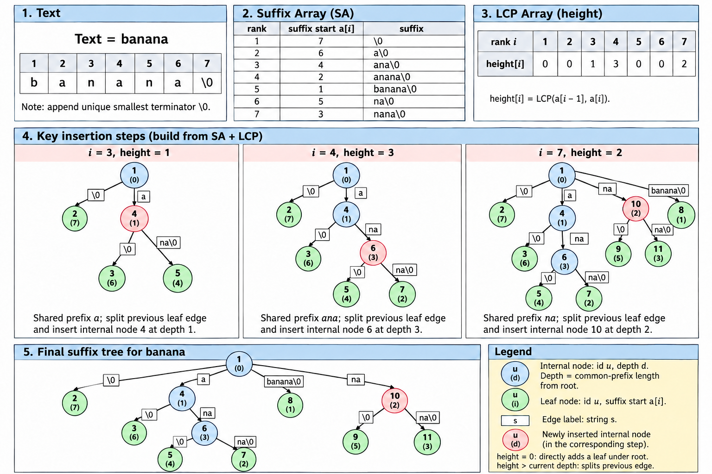

下面把 ACMT 的 SA、`get_height` 和后缀树拓扑封装在同一结构体中，直接传入原串并调用 `sufTree.build(T)`。SA 的字符桶按字节开到 `M=256`；输入串不能含 `\0`。数组总量很大，应像代码末尾一样放在全局/静态存储区，使用前确认题目内存限制；不适合直接创建为局部变量。

```cpp
const int N=1e6+5,M=1<<8;
struct SufTreeSA{
    // SA 部分，沿用 ACMT 命名
    int a[N*2],ta[N],rk[N*2],trk[N*2],cnt[N],n,m,p;
    int height[N];
    string s;

    // 后缀树部分
    int tot,fa[N*2+5],dep[N*2+5],st[N*2+5],pos[N*2+5],stk[N*2+5];
    vector<int> e[N*2+5];

    // 初始化并完成第一轮字符计数排序
    void init(const string& _){
        for(int i=0;i<=tot;i++)e[i].clear();
        tot=1;
        s=_;s.push_back('\0'); // 唯一最小终止符
        n=s.size();m=M-1;p=0;

        // 倍增会访问 rk[a[i]+w]；越过当前串尾的秩必须为 0。
        // 对同一对象重复 build 时，清掉上一次输入留下的旧秩。
        memset(rk+n+1,0,sizeof(int)*(n+1));

        memset(cnt,0,sizeof cnt);
        rk[0]=a[0]=0;
        for(int i=1;i<=n;i++)cnt[rk[i]=(unsigned char)s[i-1]]++;
        for(int i=1;i<=m;i++)cnt[i]+=cnt[i-1];
        for(int i=n;i>=1;i--)a[cnt[rk[i]]--]=i;
    }

    // 基数排序倍增构造 SA：a[i] 是排名第 i 的后缀起点，1-base
    void build_sa(){
        // 原串为空时只剩终止符这一个后缀，直接赋唯一排名。
        if(n==1){rk[a[1]]=1;return;}
        for(int w=1;w<=n;w<<=1,m=p){
            int cur=0;
            for(int i=n;i>n-w;i--)ta[++cur]=i;
            for(int i=1;i<=n;i++)if(a[i]>w)ta[++cur]=a[i]-w;

            memset(cnt,0,sizeof cnt);
            for(int i=1;i<=n;i++)cnt[rk[i]]++;
            for(int i=1;i<=m;i++)cnt[i]+=cnt[i-1];
            for(int i=n;i>=1;i--)a[cnt[rk[ta[i]]]--]=ta[i];

            p=0;
            memcpy(trk,rk,sizeof rk);
            for(int i=1;i<=n;i++){
                if(trk[a[i]]!=trk[a[i-1]]||trk[a[i]+w]!=trk[a[i-1]+w])++p;
                rk[a[i]]=p;
            }
            if(p==n)break;
        }
    }

    // height[i]=LCP(a[i-1],a[i])，1-base
    void get_height(){
        for(int i=1,h=0;i<=n;i++){
            if(rk[i]==1)h=0;
            else {
                if(h)h--;
                int j=a[rk[i]-1];
                while(i+h<=n&&j+h<=n&&s[i+h-1]==s[j+h-1])h++;
            }
            height[rk[i]]=h;
        }
    }

    // 根据 SA 与 height 恢复后缀树拓扑
    void build_tree(){
        fa[1]=0;dep[1]=st[1]=pos[1]=0;
        int top=1;stk[1]=1;
        for(int i=1;i<=n;i++){
            int lcp=height[i];
            while(dep[stk[top]]>lcp)--top;
            if(dep[stk[top]]<lcp){
                int u=++tot,p=stk[top],old=e[p].back();
                e[p].pop_back();
                fa[u]=p;dep[u]=lcp;st[u]=st[old];pos[u]=-1;
                fa[old]=u;e[u].push_back(old);e[p].push_back(u);
                stk[++top]=u;
            }
            int u=++tot,p=stk[top];
            fa[u]=p;dep[u]=n-a[i]+1;
            st[u]=pos[u]=a[i];
            e[p].push_back(u);
        }
    }

    // 输入原串；内部补终止符并完成 SA、LCP、后缀树
    void build(const string& _){
        init(_);
        build_sa();
        get_height();
        build_tree();
    }

    // 子节点 u 的边标签为原串 s 上的 1-base 半开区间 [l,r)
    pair<int,int> edge(int u){
        return {st[u]+dep[fa[u]],st[u]+dep[u]};
    }
}sufTree;
```

例如 `T="banana"`，模板会在末尾补 `\0`。取路径标签为 `"ana"` 的内部节点 `u`：它的父亲对应 `"a"`，所以 `dep[fa[u]]=1`、`dep[u]=3`；若该子树选后缀起点 `st[u]=2`（1-base），则

```text
edge(u) = [2+1, 2+3) = [3,5)
```

这条边标签就是 `T[3..4] = "na"`。代码返回的是**1-base、左闭右开**区间；若用 C++ 的 0-base `string s` 取出（`s` 已在末尾补了 `\0`），写作 `s.substr(l-1,r-l)`。`st[u]` 可以是子树中任意一个后缀起点，因为该节点表示的公共前缀在子树所有后缀中都相同。

`sufTree.build(T)` 内部依次构造 SA、`height` 与后缀树。SA 部分沿用 ACMT 的 `a / ta / rk / trk / cnt` 基数排序实现，时间 `O(n log n)`；`get_height` 与树拓扑恢复均为 `O(n)`。字符按字节处理，要求原串不含 `\0`；`sufTree.a[i]` 是排名第 `i` 的后缀起点（1-base），`height[i]=LCP(a[i-1],a[i])`。树节点深度 `dep[u]` 是根到节点的字符串长度，`edge(u)` 返回压缩边在 `s` 中的 1-base 半开区间。该模板只构造静态后缀树；若只要后缀排名和 LCP 查询，通常直接使用 SA + RMQ 更简洁。

### 9.4 后缀树 动态与多串

- **逐字符追加**：Ukkonen 构造支持在线追加字符；但这不代表出现次数、LCA、颜色数等所有查询信息都能自动在线维护。
- **任意位置编辑**：插入、删除、替换会影响大量后缀与分叉，普通后缀树不支持简单局部更新。常见做法是重建、分块，或使用专门动态字符串结构。
- **多个 Texts**：给每个 Text 添加不同的唯一终止符后拼接，建立广义后缀树。叶子记录来源 Text 与起点；内部节点维护来源颜色集合，可求多串最长公共子串、指定 Text 集合共有的子串等。
- **字符集与转移**：小字符集可用数组存孩子，查询快但空间约 `O(n|Σ|)`；大字符集用平衡树或哈希表存稀疏孩子，空间 `O(n)`，转移为 `O(log |Σ|)` 或期望 `O(1)`。

### 9.5 后缀树 应用清单

| 题目问法 | 树上对象 | 常用维护 |
|---|---|---|
| 子串 `X` 的出现次数/位置 | `X` 所在节点或压缩边下方的叶子 | 叶子数、叶子起点列表或位置数据结构 |
| 最长重复子串 | 至少有两个叶子的最深节点/边 | 子树叶子数；不重叠时再维护起点极值 |
| 两后缀 LCP | 两个后缀叶子的 LCA | LCA + 字符串深度 |
| 不同子串总数 | 所有压缩边 | 累加子节点深度减父节点深度 |
| 多 Text 最长公共子串 | 覆盖足够多来源颜色的节点/边 | 子树来源颜色数或颜色集合 |
| 子串对应位置的权值/颜色统计 | 路径代表的后缀叶子集合 | 子树 DP、合并线段树或离线区间结构 |

SA 与后缀树不是互不相关的两种建模：SA 是后缀树叶子的字典序，LCP 描述相邻叶子在哪个深度分叉。需要排序与快速 LCP 查询时选 SA；需要围绕子串对应的后缀集合做树形组织时选后缀树。

## 10. SufBalanceTree：后缀平衡树

这里特指 ACMT `04_string.typ` 的 SGT 版本。它不是 suffix tree，也不是普通静态 SA；它用平衡搜索树维护一组后缀的字典序排名，适合字符串端点增删时动态维护后缀顺序。

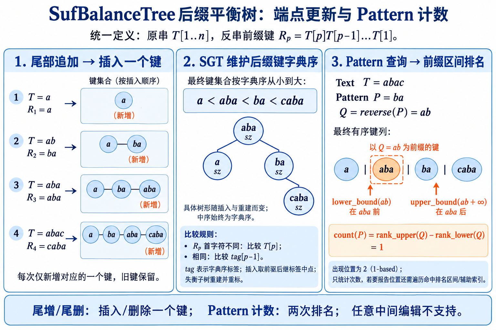

### 10.1 后缀平衡树 定义

ACMT 模板的操作模型：

- 当前字符串尾部追加若干字符。
- 当前字符串尾部删除若干字符。
- 强制在线询问 Pattern `P` 在当前 Text 中出现几次。

关键变换：维护当前串的**反串前缀对应的所有后缀**。设原串追加字符后，反串首部增加该字符；在这一表示下，旧反串后缀内容保持不变，只新增一个后缀。因此尾增/尾删分别变成后缀字典序集合的一次插入/删除。

若模板中原串字符数组为 `t[1..n]`，节点 `p` 表示的键是：

`R_p = t[p] t[p-1] ... t[1]`。

```text
原串逐步追加：   a  →  a b  →  a b c
对应 R_p 集合： {a}
                 {a, ba}
                 {a, ba, cba}

每次只插入一个新键；尾删则删除最大的 p 对应的那一个键。
```

#### 后缀键的比较

比较结束位置 `firstEnd`、`secondEnd` 对应的两个后缀串，递归按首字符分解：

```text
R_firstEnd = t[firstEnd] + R_(firstEnd-1)
R_secondEnd = t[secondEnd] + R_(secondEnd-1)

t[firstEnd] != t[secondEnd]  → 比较 t[firstEnd], t[secondEnd]
t[firstEnd] == t[secondEnd]  → 比较 R_(firstEnd-1), R_(secondEnd-1)
```

ACMT 用 SGT 上的序标签 `tag[endPos]` 表示键 `R_endPos` 的字典序位置。于是比较可以写成：先比 `t[endPos]`，相同再比 `tag[endPos-1]`。`tag[0]` 代表空串，设为最小哨兵。

插入新键时，在前驱和后继标签间取中点。标签可能越来越密，SGT 在失衡子树上中序遍历并重建，重新均匀分配标签；同时维护子树大小 `sz`，用 `alpha` 检查平衡。这个方案使后缀比较本身 `O(1)`，比较不依赖字符集大小。

### 10.2 后缀平衡树 静态

原串中 `P` 的每个出现位置，反转后对应某个反串后缀以 `reverse(P)` 开头。字典序中，所有以同一前缀 `Q=reverse(P)` 开头的字符串连续：

```text
... < Q < Q+a < Q+aa < Q+b < ... < R < ...
       └────── 所有以 Q 为前缀的后缀键 ──────┘
```

因此答案是后缀集合中 `Q` 前缀区间的大小：

`count(P) = rank_upper(Q) - rank_lower(Q)`。

ACMT 代码用两个查询边界围出这个前缀区间：上界是在 `Q` 后接一个大于字母表最大字符的哨兵；下界则把 `Q` 的最后一个字符减一，形成小于所有 `Q` 前缀串的边界。两次排名相减得到以 `Q` 开头的后缀数。这个技巧要求字符编码连续且末字符存在前驱；若末字符已是字母表最小值，不能直接做 `--char`，应实现真正的字典序 lower_bound 或引入虚拟字母表哨兵。

平衡树的 `query` 在每个结点将外部 Pattern 与该后缀比较。若 Pattern 长度 `m`，单次 Pattern 比较最坏 `O(m)`，树高 `O(log n)`，所以一个排名最坏 `O(m log n)`；实际总复杂度还依赖共同前缀和题目给出的总询问长度限制。不可只报插删的平衡树复杂度而忽略 Pattern 比较。

SGT 插入或删除沿树高递归，若触发重建，单次操作最坏需要 `O(n)`；按 SGT 的平衡阈值摊还，更新为 `O(log n)` 摊还，空间为 `O(n)`。因此不能把每次更新都写成最坏 `O(log n)`。若有 `q` 次更新，更新总量按摊还计为 `O(q log n)`；Pattern 查询仍需另计字符比较，题目给出的询问总长度限制是复杂度判断的一部分。

#### 静态结构可维护的信息

平衡树节点对应一个后缀起点 `p`，子树对应一段连续字典序排名。除 `sz` 外，可以维护：

- `minPos/maxPos`：排名区间中的最小/最大起点；查询 Pattern 出现位置跨度或筛选位置。
- 位置权值和、最大值、计数：若 Pattern 前缀命中排名区间，可聚合该区间内后缀起点的函数。
- 版本标签/颜色：来自多个 Texts 或多个来源时统计来源数；前提是键集合的更新模型仍然有效。
- 持久化根：若使用可持久化平衡树，可保留每个端点版本的后缀集合；Text 内容、反转映射、标签分配都要与版本一致。

基本模板没有自动支持“子串位置区间查询”或“所有位置报告”；要报告位置需在命中排名区间上做树上遍历/二级索引，时间至少与输出量有关。

### 10.3 后缀平衡树 动态

| 操作 | 后缀平衡树 | 静态 SA |
|---|---|---|
| 构建 | 动态逐个插入 | 一次排序所有后缀 |
| 端点追加/删除 | 支持模板规定的一端 | 需重建 |
| 子串 Pattern 出现次数 | 两次排名 | 二分前缀区间 |
| 任意后缀 LCP | 需另存 LCP/辅助结构 | LCP+RMQ 原生支持 |
| 空间/常数 | 平衡树节点与标签，常数较大 | 数组紧凑，通常更省 |
| 任意中间编辑 | 不支持 | 不支持 |

平衡树更新的是“后缀有序集合”，并不自动维护完整 SA-LCP、后缀树内部节点或任意子串 LCP。若需求是静态 LCP/重复子串统计，用 SA+LCP 通常合适；若明确有端点增删和在线 Pattern 查询，才考虑此 SGT。

#### 实现检查点

- 先确认键是反串后缀 `t[p]...t[1]`，而非原串后缀。
- 同首字符时递归比较下一段的排名标签；空串标签必须正确。
- `tag` 取中点后要监控失衡并重建，浮点标签不能无限插入而不重标号。
- 删除的是当前末尾所对应的键，删除后子树大小和标签重建区间都要更新。
- Pattern 计数依赖“前缀字符串在字典序中连续”的性质；上界哨兵必须高于字母表最大值。
- 若字母表不是小写字母，字符映射、哨兵和比较规则都要一起改。

---

### 10.4 后缀平衡树 应用清单

- 当前 Text 末尾追加/删除，并在线查询 Pattern 出现次数：维护反串前缀对应的有序后缀集合，Pattern 计数转成两次排名之差。
- 在匹配排名区间内维护位置最小值、最大值、权值和或颜色：将相应信息作为平衡树子树摘要。
- 只需静态 Pattern 查询、完整 SA/LCP 或任意后缀 LCP：优先考虑 SA + LCP/RMQ；后缀平衡树主要解决端点动态增删。

---

