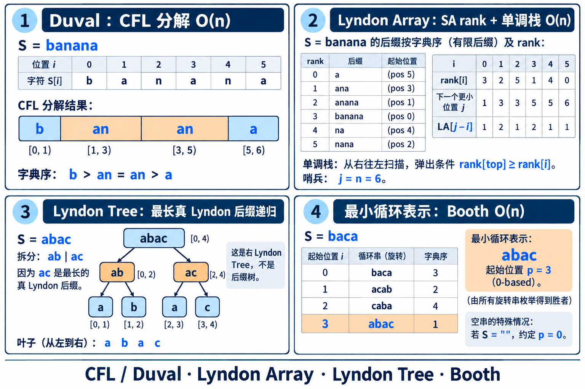

# 字符串问题与扩展结构

## 目录

1. [子串](#1-子串匹配与统计)
   - [Pattern in Texts （单模多文）](#11-pattern-in-texts-单模多文)
   - [Patterns in Text （多模单文）](#12-patterns-in-text-多模单文)
   - [Pattern in Substrs （单模多区间）](#13-pattern-in-substrs-单模多区间)
   - [Patterns in Substr （多模单区间）](#14-patterns-in-substr-多模单区间)
   - [F(Patterns) in Text （文本函数）](#15-fpatterns-in-text-文本函数)
   - [F(Patterns) in Substr （区间函数）](#16-fpatterns-in-substr-区间函数)
2. [子序列](#2-子序列匹配与统计)
   - [First / Contains (Global)](#21-first--contains-global)
   - [First / Contains (Range)](#22-first--contains-range)
   - [Count / Function](#23-count--function)
3. [回文串](#3-痛点三回文串的端点中心与区间查询)
   - [以 i 为中心](#31-以-i-为中心)
   - [以 i 开头 / 结尾](#32-以-i-开头--结尾)
   - [不同回文串 后缀链](#33-不同回文串-后缀链)
   - [区间回文查询](#34-某区间内回文串相关)
   - [Trick: PAM + 倍增查询区间最长回文](#35-trick-pam--倍增查询区间最长回文)
4. [LCP](#4-痛点四lcp-的各种求法)
   - [方法](#41-方法)
   - [Trick1: SA + LCP + RMQ](#42-trick1-sa--lcp--rmq)
   - [Trick2: Hash + 二分](#43-trick2-hash--二分)
   - [Trick3: 固定 Pattern 的 Z / exKMP](#44-trick3-固定-pattern-的-z--exkmp)
   - [Trick4: 前缀与所有后缀的 LCP](#45-trick4-前缀与所有后缀的-lcp)
   - [Trick5: 多 Patterns 的 ACAM / KMP](#46-trick5-多-patterns-的-acam--kmp)
   - [Trick6: 动态区间 Hash](#47-trick6-动态区间-hash)
5. [Hash](#5-痛点五hash-的适用方式)
   - [Rolling Hash 的信息能力](#51-rolling-hash-的信息能力)
   - [错误概率与实现边界](#52-随机化与错误概率)
6. [数据范围 Tricks](#6-痛点六由数据范围触发的-tricks)
   - [字符集、询问长度与根号分治](#61-字符集触发稠密-vs-稀疏转移)
   - [输出量、周期性与离线处理](#64-输出量触发)
7. [Lyndon](#7-lyndon)
   - [定义与 Duval 分解](#71-lyndon-词的定义与等价刻画)
   - [Duval 分解代码](#72-duval-算法线性求唯一分解)
   - [Lyndon Array、Lyndon Tree 与应用](#74-lyndon-array-与后缀排名)
   - [最小表示法代码](#76-lyndon-与最小循环表示)
8. [字符串题建模流程](#8-字符串题建模流程)
   - [匹配语义、状态结构、挂载信息与复杂度](#第一步确定匹配语义)
---

## 1. 子串匹配与统计

统一把题目写成：Patterns 集合 `A` × Texts 集合 `B` × Substr 范围 × 函数 `f`。其中 Pattern 是模式串，Text 是长文本，Substr 是 Text 上的连续子串，写作 `Text[l,r]`；末尾加 `s` 表示多个对象。

`f` 可以是出现位置集合、出现次数、最早/最晚位置、出现端点权值和、不同来源数、最长匹配、出现位置两两距离等。

### 1.1 Pattern in Texts （单模多文）

- 一个 Pattern 查询多个 Texts：每个 Text 独立做 KMP/Z/exKMP；若 Pattern 固定，可预处理 KMP 自动机后重复扫描。
- 一个 Pattern 查询多个固定 Texts：若还要多次查询出现位置或区间统计，可分别建 SA/SAM，或把 Texts 合并并用唯一分隔符隔开，再维护来源信息。
- 只判断 Pattern 是否为 Text 的子串：SAM 中沿转移走完即可；需要输出位置时，再为状态维护出现端点集合或后缀位置索引。
- Patterns 集合也变化或需要同时查很多 Pattern 时，问题就转为下一节的多模单文。

### 1.2 Patterns in Text （多模单文）

多个 Patterns 在同一个 Text 中查找，典型结构是 ACAM。建好 Trie 和 Fail 转移后扫描 Text 一次；扫描端点状态 `v` 时，所有 Fail 祖先中的 Pattern 结束节点，都是在该端点结束的匹配。

- 需要报告所有匹配：沿 Fail 链枚举终止节点，时间为 `O(|Text|+Z)`，其中 `Z` 是输出总数。
- 只统计每个 Pattern 的出现次数：扫描时记录各端点状态频次，再沿 Fail 树自底向上汇总；不要对每个 Pattern 各自重扫 Text。
- 只统计匹配 Pattern 的总数：预处理 `matchCnt[v]=endCnt[v]+matchCnt[fail[v]]`，扫描时累加 `matchCnt[state[r]]`。
- Patterns 固定而 Text 很多：ACAM 可复用，每个 Text 从根开始扫描；Patterns 动态插入时通常用分桶重建，不直接复用旧 Fail 树。

### 1.3 Pattern in Substrs （单模多区间）

设一个 Text 上有许多待查询的 Substr `[l,r)`，同一个 Pattern 要分别在这些 Substr 中查找。Pattern 长度为 `m` 时，合法起点范围是 `[l,r-m+1]`，等价的结束位置范围是 `[l+m-1,r)`；若 `m>r-l`，该 Substr 中没有匹配。

- 已有 KMP/SA/SAM 匹配位置列表：按起点或结束位置排序，每个 Substr 用两次 `lower_bound` 求次数，或截取区间内的位置。
- 查询很多、Pattern 固定：对每个 Substr 区间做离线事件，用前缀差、扫描线、Fenwick 或 CDQ 统计。
- 需要输出位置：先用二分定位区间左右边界，再报告列表中的位置；复杂度至少包含输出量。

### 1.4 Patterns in Substr （多模单区间）

多个 Patterns 在同一个 Text 的 Substr `[l,r)` 中查找。固定 Pattern 集合时，用 ACAM 从根状态开始扫描 `Text[l..r)`；每到一个端点，就沿 Fail 链输出在此结束的 Patterns。

- 报告所有匹配位置：输出 Pattern 及其结束位置，复杂度为 `O(r-l+Z)`。
- 只统计各 Pattern 的出现次数：记录扫描经过的状态频次，扫描结束后沿 Fail 树自底向上汇总。
- 只求匹配总数或匹配权值：将终止 Pattern 的个数/权值沿 Fail 链预先聚合到状态，扫描时直接累加状态答案。
- 若有很多 Substr 查询，则属于“Patterns in Substrs”的批量版本；按查询范围选择离线扫描、持久化或二维范围结构，不能对每个区间都重扫整段 Text。

### 1.5 F(Patterns) in Text （文本函数）

先在整个 Text 中收集每个 Pattern 的出现端点列表 `E(P)`，再按题目给出的函数 `F` 汇总：

- 次数：`|E|`。
- 最早/最晚：`min/max(E)`。
- 区间次数：`lower_bound(R)-lower_bound(L)`。
- 端点权和：前缀和或 Fenwick。
- 相邻出现间距最大/最小：排序后扫相邻差。
- 最长不重叠重复：需要同时约束起点差至少 Pattern 长度，可在后缀结构上维护 `minStart/maxStart` 或二分长度。
- 出现位置函数若是非线性（如 `Σg(r)`），只要 `g` 可维护，就在列表上做前缀聚合；若查询动态权值，升级为 Fenwick/线段树。

### 1.6 F(Patterns) in Substr （区间函数）
这里的 `F(Patterns)` 表示对每个 Pattern 分别计算函数 `F(P)`，也可以继续对这些结果求和、最大值或不同 Pattern 数。若函数依赖出现位置，应先定义位置记作起点还是终点，并统一使用同一种端点约定。

当查询范围限制在 Substr `[l,r)` 时，先把 Pattern 的出现端点限制到 `[l+|P|-1,r)`，再计算函数 `F(P)`。若 `E(P)` 已排序，计数和端点截取用两次二分；端点权和用前缀和；动态权值用 Fenwick 树或线段树。

多个 Patterns 共用同一 Text 或多个 Substr 查询时，可先用 ACAM 收集匹配端点，再按 Pattern 分组；若查询量大且 Pattern 固定，可将端点、区间边界离线排序，用扫描线、Fenwick 或 CDQ 统一回答。注意闭区间与左闭右开区间下标要一致。

---

## 2. 子序列匹配与统计

子序列不能用连续子串自动机代替。设 Pattern `P` 长度 `m`，Text `T` 长度 `n`。

### 2.1 First / Contains (Global)

SeqAM 贪心地逐字符取 Text 中最早可用位置，时间 `O(m)`。输出匹配位置本身就是“最早结束”的证据。

若要列出所有子序列嵌入，答案可能指数级；题目通常只问是否、最早/最晚、方案数或优化目标。

- 查询串总字符数 `K` 不大：每个 Pattern 用“下一个字符位置表”，`O(K)`。
- Patterns 共享前缀：把所有 Patterns 放 Trie，在 Trie 节点保存 Text 的贪心匹配位置；沿字符转移可共享前缀工作。
- Patterns 是固定字典：可建 Trie × Text 位置的 DP，状态 `(trieNode, textPosition)`，但最坏乘积要估算。
- Pattern 数极多且由一个 Text 的子串产生：不要显式产生所有 Pattern；利用子序列计数 DP/最短未出现子序列递推。

### 2.2 First / Contains (Range)

要求 Pattern 在 Substr `[L,R)` 中作为子序列出现：从 `L` 开始做 SeqAM 贪心，匹配完后检查终点 `<R`。静态 next 表可以从任意起点查询。

如果对大量区间询问：

- 查询 `(L, Pattern)` 的最早结束位置，可按 Pattern 逐字符跳转；若 Pattern 短且 Substrs 多，预处理跳转表/倍增组合。
- Pattern 固定而区间变化，预先存它的所有/最早匹配链，再对边界二分。
- Text 动态修改时，按块维护“从块内任意起点读入字符后到达的位置”的转移函数；块函数按顺序复合。单块更新重建，查询扫边界并跳块。

### 2.3 Count / Function

一个 Pattern 的不同嵌入数可用 DP：`dp[j]` 表示处理当前 Text 前缀后，匹配 Pattern 前 `j` 个字符的方案数；扫描到字符 `c` 时 `j` 必须降序更新，避免一个 Text 字符被重复使用。

- 若字符相同，必须明确算的是不同位置嵌入还是不同生成字符串；同一个 Pattern 的不同下标组合通常算不同嵌入。
- 计数在模数下还是饱和计数要按题意。
- Substr 上的子序列数不是端点独立的简单匹配计数；可用矩阵转移表示每个字符/块，区间查询做矩阵乘法，块修改做重建或线段树维护乘积。
- 矩阵维数通常与 Pattern 长度相关，复杂度约 `O(m³ log n)` 的乘法不能只看 `O(log n)` 个块；稀疏转移或小 `m` 才适合。

---

## 3. 痛点三：回文串的端点、中心与区间查询

回文问题先按“枚举对象”分类：所有回文出现（位置/长度）、不同回文值、回文中心、回文被区间包含、回文端点函数。Manacher 与 PAM 保存的信息不同，不能互相替代。

### 3.1 以 i 为中心

对字符串 `S`：

- `d1[i]` 是奇回文半径，表示中心 `i` 向两边最多扩展多少字符（含中心）。区间 `[i-d1[i]+1, i+d1[i])`。
- `d2[i]` 是偶回文半径，中心在 `i-1` 和 `i` 之间。区间 `[i-d2[i],i+d2[i])`。

Manacher 维护最右回文 `[l,r)`，用镜像半径下界避免重复比较，复杂度 `O(n)`。

**以某位置为中心的回文相关函数**：

- 最长回文长度：直接由 `d1/d2` 得到。
- 中心 `i` 的回文个数：奇回文 `d1[i]` 个、偶回文 `d2[i]` 个。
- 对所有中心求总回文出现次数：`Σ(d1[i]+d2[i])`。
- 长度恰为 `k` 的回文中心数：中心半径至少覆盖 `k` 的对应半径；可按半径频次统计后缀和。
- 按中心权值 `w[i]` 统计所有回文的权和：该中心每个长度贡献是否相同；若只按中心计数，乘 `d1/d2`，若权值依赖长度则需对半径区间求和。

### 3.2 以 i 开头 / 结尾

Manacher 原生按中心组织；要转成端点函数可做差分：

- 每个奇中心 `i` 的最大区间覆盖 `[L,R]`，它贡献的回文左端点/右端点落在一段连续范围。
- 若每个中心内所有半径都算一个回文，则对 `k=1..d1[i]` 的起点/终点分别是 `i-k+1` 与 `i+k-1`；偶中心同理。
- 只问每个位置作为**某个回文起点/终点的次数**：把每个中心对应的半径区间映射成端点区间加法/事件，再前缀和；具体差分式由奇偶中心定义推导，建议用小例子验证下标。
- 只问最长回文以 `i` 开始/结束：将中心半径映射为端点候选，按长度/端点做区间最大值更新；可用线段树或离线排序。

当回文还需要统计“出现位置函数”时，Manacher 不会显式给所有回文节点，端点贡献可直接按中心/半径聚合；若问不同回文字符串的次数，则用 PAM。

### 3.3 不同回文串 后缀链

PAM 每个节点代表一个**不同的回文字符串**。位置 `r` 的最长回文后缀节点 `last[r]` 沿后缀链接的整条链，恰好列出所有以 `r` 结尾的回文串。

- `以 r 结尾的回文数` = `last[r]` 到长度 0 根的链上普通节点数。
- `某个不同回文串出现次数`：`last[r]` 链上是否包含该节点；全串计数用 `cnt[last[r]]++` 后沿后缀链接树自底向上。
- `某回文字符串出现的端点列表`：所有 `last[r]` 中以该节点为祖先的 `r`；Euler 序变成子树点计数/报告。
- `每个前缀有多少不同回文串`：PAM 节点数随追加单调增加，每步新增 0 或 1。
- `每个前缀的不同回文后缀数`：取当前 `last` 的 link 链长度，不等于全局不同回文数。

### 3.4 某区间内回文串相关

**一个指定区间 `[l,r)` 是否回文**：Manacher 半径 `O(1)` 判断，或正反双哈希（有碰撞风险）。

**区间内回文子串出现总数**：每个回文出现位置完全包含于 `[l,r)`。可以把中心/半径贡献转成二维几何计数：中心 `c`、半径 `k` 对应端点 `(c-k+1,c+k-1)`；区间约束为左端点 `>=l`、右端点 `<r`。按几何形式离线排序/Fenwick，或对中心按半径结构做范围计数。不能将每个回文显式列出，因为总数可 `Θ(n²)`。

**区间内不同回文串数**：这比出现总数难。Manacher 只给中心最大半径，无法直接去重；PAM 的回文节点全局去重，但限制某区间出现又需要每个节点的位置集合/区间查询。可建 PAM后缀链接树，用每节点位置集合 点集做二维查询；对所有区间在线查询可能需要波列树、持久化结构或离线算法。

**最长回文子串（区间查询）**：查询区间内最大可包含回文。可把回文表示为中心和半径，转成“中心在区间内且半径足够”的范围最大值/二分长度判定；静态多询问可考虑中心分治/线段树维护覆盖。具体选型取决于查询数和是否修改，Manacher 本身只解决全串预处理，不自动给所有区间查询。

### 3.5 Trick: PAM + 倍增查询区间最长回文

这是 PAM 的后缀链接树和区间长度上限的直接结合。本文前文用半开区间；本小节按题目常见的闭区间 `[L,R]` 书写。

**结论**：在整串 `S` 上建 PAM，保存 `last[r]`（前缀 `S[0..r]` 的最长回文后缀）。查询 `[L,R]` 时，所有以 `R` 结尾的回文串正好是 `last[R]` 沿回文 Fail 链的节点；要留在 `[L,R]` 内，长度必须满足 `len <= R-L+1`。因此沿 Fail 链找长度不超过上限的最大节点。

```text
回文 Fail 链（长度递减）：
last[R] : len 11  --link-->  len 7  --link-->  len 4  --link-->  len 1  --> root
                                ↑ 若 R-L+1 = 8，答案是 len 7
```

**倍增表**：

`f[0][v] = link[v]`

`f[k][v] = f[k-1][f[k-1][v]]`

初始化需要 `O(V log V)` 时间和空间，`V<=n+2`。每个 PAM 节点创建时，它的 Link 已知，可立即填好该节点的 `f[*][v]`；因此可一边追加字符、一边支持已出现前缀的区间查询。

```text
query(L, R):                 // 闭区间，0-based
    limit = R - L + 1
    v = last[R]
    if len[v] <= limit:
        return [R-len[v]+1, R]

    for k = LOG-1 ... 0:
        if len[f[k][v]] > limit:
            v = f[k][v]

    v = link[v]              // v 仍超长；父亲是第一个不超长节点
    if v 是特殊根:
        return "不存在非空回文"
    return [R-len[v]+1, R]
```

**正确性**：回文后缀链接每跳一次，长度严格下降；链上恰好是所有以 `R` 结尾的不同回文。倍增循环跳过所有 `len>limit` 的祖先，最终取其父亲，就是链上长度仍不超过 `limit` 的最长节点。答案右端固定为 `R`，左端自然是 `R-len+1`。

**复杂度**：PAM 构建 `O(n)`（固定字母表转移）；倍增表 `O(n log n)`；每个区间查询 `O(log n)`；在线追加后查询历史 `[L,R]` 也可用，但只要 `R` 已处理且 link 结构保持稳定。普通 PAM 的旧后缀链接不会因追加产生 clone 重挂。

**常见变形**：

- 查询最长长度落在 `[A,B]` 的回文后缀：先找 `len<=B` 的最长节点，再检查 `len>=A`。
- 查询第 `k` 长回文后缀：按 `f[k][last[R]]` 跳（注意根节点和 `k` 从 0 还是从 1 开始的约定）。
- 查询所有回文后缀的长度和/权值：在倍增表同时维护 `sumLen[k][v]`、`sumWeight[k][v]`，按二进制跳 `k` 个 link。
- 查询以 `R` 结尾、且满足节点属性（例如出现次数至少 `K`）的最长回文：若该属性沿后缀链接链单调，再把属性加入跳跃判定；不单调时需额外做树上路径数据结构。
- 查询以 `L` 开头的最长回文：反转字符串，在反串中把起点问题变成右端点问题；区间映射要同步反转。

这个技巧与 Manacher 的差别：Manacher 适合“所有中心的最大半径”和静态回文判断；PAM+倍增适合“给定右端点，沿不同回文后缀链加长度/属性约束”。

---

## 4. 痛点四：LCP 的各种求法

`LCP(X,Y)` 是两个字符串从开头开始相等的最长长度。先看 `X,Y` 的表示方式：原字符串后缀、任意子串、两个独立串、哈希对象，决定可用结构。

### 4.1 方法

| 对象 | 方法 | 预处理 | 单次查询 | 特点 |
|---|---|---:|---:|---|
| 一个串的两个后缀 | SA + LCP + RMQ | `O(n log n)` 或 SA-IS | `O(1)` | 大量静态后缀对查询首选 |
| 一个串的两个后缀 | Rolling Hash + 二分 | `O(n)` | `O(log n)` | 简单，有碰撞概率 |
| 一个串后缀与固定 Pattern | Z / exKMP | `O(n+m)` | 所有起点一起给 | 匹配/前缀相似度 |
| 一个串的前缀与各后缀 | Z | `O(n)` | `O(1)` 读表 | 定义正是 prefix-vs-suffix LCP |
| 多个 Patterns 与一个 Text | ACAM/KMP | `O(Σ|Patterns|)` | 扫描输出 | 不需要任意后缀对 LCP |
| 动态字符序列的两个区间 | Hash + 平衡序列树 | 结构维护 | `O(log n)` 或二分叠加 | 需要接受碰撞或做确定性替代 |

### 4.2 Trick1: SA + LCP + RMQ

令 `SA[k]` 为第 `k` 小后缀起点，`rank[i]` 为后缀 `i` 的排名；`height[k]=LCP(SA[k-1],SA[k])`。

**倍增构造 SA**：先把字符离散化成初始 rank。每轮将每个后缀按二元组 `(rank[i], rank[i+k])` 排序，相当于把已知长度 `k` 的有序块拼成长度 `2k` 的有序块；排序后重新压缩 rank，令 `k*=2`。当所有 rank 唯一时结束。比较排序实现 `O(n log² n)`；基数/计数排序每轮 `O(n)`，总 `O(n log n)`。空后缀/唯一哨兵要统一处理。

**Kasai 构造 LCP**：按 Text 起点 `i` 扫描，用 `rank[i]` 找它在 SA 中的前一个邻居；若前一位置的 LCP 为 `h`，当前比较可从 `max(h-1,0)` 起步。由于相邻 Text 后缀去掉首字符后 LCP 至少少 1，`h` 总体摊还线性，LCP 构造 `O(n)`。

接 RMQ：ST 表 `O(n log n)` 预处理、`O(1)` 查询；线段树 `O(n)` 建、`O(log n)` 查询；按题目是否修改选择。

#### SA + LCP：虚拟后缀树

SA 的叶子按字典序排好；LCP 数组描述相邻叶子的公共前缀深度。对 LCP 做笛卡尔树/单调栈，可以恢复后缀树的分叉结构，而不必显式存压缩边：一个内部节点对应连续后缀排名区间 `[L,R]` 和深度 `d`。

```text
后缀数组叶子顺序：  s0  s1  s2  s3  s4
相邻 LCP：             1   3   1   2

某个深度 d 的内部节点：连续叶子区间 [L,R]
节点字符串 = 这些后缀共享的长度 d 前缀
该子树叶子 = 该字符串在原文中的所有出现位置
```

因此每个虚拟节点/区间可以维护：

- `leafCount`：子串出现次数。
- `minStart/maxStart`：最早、最晚出现位置；可判不重叠重复、最大间距。
- 来源颜色集合/不同颜色数：多串公共子串。
- 叶子位置权值和、最大值、排序列表：按出现位置的函数统计。
- 父子节点深度差：一条压缩边代表长度 `parentDepth+1 ... childDepth` 的多个不同子串，可把长度相关贡献按区间求和。

这就是“SA 上建后缀树维护信息”的实际含义：**先把 LCP 区间恢复成树形分组，再对每个连续叶子区间做树形 DP/区间聚合**。位置范围约束还需在 `[L,R]` 的 SA 排名区间内对 `SA[k]` 做二维查询；这些聚合不是裸 SA 自动提供的。

若 `rank[i]<rank[j]`，则

`LCP(i,j) = min(height[rank[i]+1 ... rank[j]])`。

原因：按字典序排在两者之间的所有后缀共同夹住两端；两端公共前缀长度等于该连续段相邻 LCP 的最小值。接 ST 表后查询 `O(1)`。

### 4.3 Trick2: Hash + 二分

判断长度 `k` 的两个子串是否相等是单调的：若长度 `k` 相同，则所有 `<=k` 的前缀也相同。因此可二分最大相等长度，`O(log n)` 次子串 Hash 查询。

适合查询量不大、实现简单且能接受碰撞概率的场景。静态单串上的大量 LCP 查询通常使用 SA + RMQ；动态字符序列上的区间 Hash 则见 Trick6。

### 4.4 Trick3: 固定 Pattern 的 Z / exKMP

固定 Pattern `P` 与 Text `T`，需要求 Pattern 和 Text 每个后缀的 LCP 时，可将 `P + # + T` 拼接后跑 Z，或直接使用 exKMP。分隔符 `#` 必须不属于字符集；字符集无法留出分隔符时，改用整数序列和唯一哨兵。

- 一次得到 Pattern 与 Text 各位置的匹配长度，时间 `O(|P|+|T|)`。
- 只查询少数后缀对时，不必构造整张 Z 表，可直接比较或用 Hash 二分。
- 两个任意 Text 后缀的 LCP 属于 SA/RMQ 或 Hash 的范围，不是 exKMP 的查询模型。

常见 LCP 变形：

- **LCS（最长公共后缀）**：反转字符串后做 LCP；或从右向左扫描的 exKMP。
- **最长公共子串**：不是一个 LCP，而是两个字符串后缀集合间的最大 LCP；SA 相邻跨色后缀、SAM 匹配、后缀树颜色节点都可做。
- **周期**：比较 `LCP(i,i+p)` 与剩余长度，判断周期 `p` 是否成立。
- **最长重复**：同串两个不同后缀的最大 LCP，需区分是否允许重叠。
- **带位置范围的 LCP**：先按后缀位置过滤，再在后缀集合中求最大相邻 LCP；普通全局 SA 的相邻项未必仍相邻，需 RMQ/滑窗或二维结构。

### 4.5 Trick4: 前缀与所有后缀的 LCP

对一个 Text 求每个后缀与 Text 前缀的 LCP，直接跑 Z。`Z[i]` 就是 `Text[i..]` 与 `Text[0..]` 的 LCP，预处理 `O(|Text|)`，每个位置 `O(1)` 读取。

- 常用于统计各位置与全串前缀的相似长度、前缀匹配次数和周期边界。
- Pattern 与 Text 不同时，改用 `Pattern + 分隔符 + Text` 或 exKMP。

### 4.6 Trick5: 多 Patterns 的 ACAM / KMP

多个 Patterns 与一个 Text 的匹配不是任意后缀对 LCP。Patterns 较少时分别使用 KMP；Patterns 多且固定时建 ACAM 后扫描 Text 一次。报告所有匹配的复杂度为 `O(|Text|+Z)`；只求每个 Pattern 的出现次数，可记录端点状态频次并沿 Fail 树汇总。

### 4.7 Trick6: 动态区间 Hash

动态字符序列可以用平衡序列树维护子树长度与正反向 Hash。合并左右子树时，使用 `H(A+B)=H(A)B^{|B|}+H(B)` 更新；区间拆分或聚合通常为 `O(log n)`。

若要查询两个动态区间的 LCP，对答案长度二分并比较区间 Hash，总复杂度通常为 `O(log² n)`。该方法适合需要插入、删除或修改字符的场景，并需要接受 Hash 碰撞概率。

## 5. 痛点五：Hash 的适用方式

### 5.1 Rolling Hash 的信息能力

Hash 把区间内容映射到有限整数。它适合快速验证候选，不会像 Trie/SAM 那样保存结构语义。

- 子串相等、LCP 二分、回文判定。
- 多串拼接/动态序列聚合：节点保存长度与哈希，合并 `H(A+B)=H(A)B^{|B|}+H(B)`。
- 字符串去重/字典序分组（先比长度或二分 LCP，再比字符）。
- 树上路径字符串：哈希正向与反向信息，合并 HLD 分段；每个节点需维护双向 Hash。

### 5.2 随机化与错误概率

常见多项式哈希在随机基数下可把碰撞概率压低；双模独立哈希进一步降低风险。但它仍是 Monte Carlo：极端对抗下不保证正确。严格判定用后缀数组/自动机/直接比较，或用 Hash 找候选后确定性复核。

### 5.3 Hash 易错点

- 子串取模归一化和幂次对齐。
- 空串与字符编码 0 的歧义。
- 乘法先溢出再取模；用 `__int128` 或安全乘法。
- 正反串 Hash 拼接方向不一致。
- 动态合并时右段长度要用于左段哈希乘幂。
- 多串 Hash 比较应纳入长度/边界，分隔符不能与原字母混淆。

### 5.4 什么时候不要用 Hash

- 题目强对抗且错误不可接受。
- 已经有 `O(1)` 的 SA-LCP 查询，Hash 只增加随机风险。
- 查询需要报告所有结构性关系（Fail 祖先、出现位置集合、不同回文节点），单个 Hash 无法替代这些集合信息。
- 需要对子串做真实字典序排序，Hash 二分 LCP 虽可做但有碰撞风险且 `O(log n)` 比较成本。

---

## 6. 痛点六：由数据范围触发的 Tricks

Trick 不应是“看见 `n=1e5` 就上根号”。先把各维规模分开：`n` Text 长度、`m` Pattern 数、`Q` 查询数、`σ` 字符集、`K=Σ|queryLen|`、输出量 `Z`、版本数 `V`。瓶颈可能是总长度而不是查询数。

### 6.1 字符集触发：稠密 vs 稀疏转移

- `σ` 很小（如 26/字符压缩后很小）：数组转移，常数小，空间约 `状态数 × σ`。
- `σ` 大但每状态出边少：vector/map/hash 边表，空间按实际边数 `E`；要把 `log σ` 或哈希因子计入查询。
- 混合：高频状态稠密化、低频状态稀疏化；或按度数阈值 `B` 分层。
- 总内存估算比渐进阶更重要：`Vσ*sizeof(int)`，例如 `V=2e6, σ=26` 已超过 200 MB。

### 6.2 总询问长度触发

若 `Q` 很大但 `K=Σ|P_i|` 小，按 Patterns 总长度逐个走自动机可能比按 `Q×|T|` 扫描好得多。若许多 Patterns 共享前缀，用 Trie 合并总长度；若 Pattern 重复，缓存答案/匹配位置。

反之，若 Patterns 总长度巨大但 Patterns 固定，ACAM 只建一次，Text 扫描成本按 Texts 总长度算。比较：

`Σ|Patterns| + Σ|Texts| + Z`

与

`Q × (每次匹配/查询成本)`。

### 6.3 根号分治：常见触发条件

根号来自“一个量小、另一个量大”，把两类成本平衡：

- **小字母表/高频状态**：按出度阈值 `B`；度数 `>B` 的重状态至多 `E/B` 个，单独稠密处理；轻状态遍历实际边。选择 `B≈√E` 平衡内存与查询。
- **多 Pattern 长度**：按长度阈值 `B` 分短/长。短 Pattern 可预处理/批量匹配；长 Patterns 数量或每个 Text 可容纳的长匹配数量受长度限制。必须把“长 Patterns 数量为何小”写成证明，不能仅凭长度大就断言出现少（周期串可高度重叠）。
- **查询数与重建成本**：每累计 `B` 次修改重建静态结构；每次查询承担小块增量，摊还成本约 `重建成本/B + B×查询成本`，令两项同阶选择 `B`。
- **Text 分块**：每块构建局部 ACAM/SAM/Hash 索引，整块跳过、边缘暴力。适用于区间更新/查询的分块问题，块摘要必须能正确复合。

### 6.4 输出量触发

所有匹配位置、所有平方重复、所有不同子串都可能有 `Θ(n²)` 输出。若题目只问计数/最大值，不要显式枚举；把答案转成状态权、区间贡献、LCP 区间或端点差分。

- ACAM 输出所有匹配：复杂度写 `O(|Text| + matches)`，不是只写 `O(|Text|)`。
- 所有回文出现：`Θ(n²)`，Manacher/PAM 只能压缩表示或聚合，不能让显式输出变线性。
- 所有不同子串：个数 `Θ(n²)`；SA/SAM 能统计和排名，不代表能全部打印。

### 6.5 周期性触发

字符串有周期时，同一匹配可能大量重叠，粗暴枚举会超时。用 KMP Border 链、LCP、Main–Lorentz 或 runs 结构压缩周期族。区分：

- 同一 Pattern 的重叠出现位置；
- primitive root（不能再由更短串重复得到的根）；
- 所有周期长度；
- maximal repetition / run 的极大周期区间。

复杂度依赖输出定义：输出所有出现位置 可能平方级，输出压缩后的 maximal runs 才有机会接近线性。

### 6.6 离线触发

若输入允许重排查询：

- ACAM 状态端点 + Fail 子树：Euler 序区间，离线用 Fenwick/CDQ 做二维计数。
- SA 中 Pattern 对应排名区间 + Text 位置：波列树/主席树在线，或按位置扫描离线。
- 子串匹配端点区间：前缀差、事件排序、扫描线。
- 多串来源颜色：按 SA 窗口维护颜色数和最小 LCP。

离线不只是“排序一下”：要证明每个事件被加入/删除的时间顺序与贡献不变量。

---

## 7. Lyndon

Lyndon 不是自动机。它是字典序与周期结构中的规范字符串块；围绕它形成的主要工具是 Lyndon 分解、Duval 算法、Lyndon array/tree，以及最小循环表示的相关算法。



### 7.1 Lyndon 词的定义与等价刻画

非空串 `w` 是 Lyndon 词，当且仅当它严格小于自己的每个非平凡循环移位。等价刻画之一：`w` 严格小于自己的每个真后缀。

例如 `abac` 是 Lyndon：所有非平凡旋转 `baca, acab, caba` 都大于它；`abab` 不是，因为它是 `ab` 的重复，旋转后可得到相同串。

重要性质：

- Lyndon 词一定是 primitive（不是更短串的整数次幂）。
- 任意非空字符串有唯一的 Chen–Fox–Lyndon 分解：`S = w1 w2 ... wk`，其中每个 `wi` 是 Lyndon，且 `w1 >= w2 >= ... >= wk`（字典序非递增）。
- 若 `u,v` 是 Lyndon 且 `u<v`，则 `uv` 也是 Lyndon；这是 Lyndon 连接性质的一种常用形式。
- 单字符是 Lyndon；空串不作为 Lyndon 因子。

### 7.2 Duval 算法：线性求唯一分解

Duval 从左到右找当前最左位置开始的 Lyndon 块，并利用周期一次输出多个相同块。核心变量：

- `i`：尚未分解的起点。
- `j`：当前比较窗口中候选 Lyndon 前缀的比较位置。
- `k`：向右扫描的位置。

0-based 伪代码（输出区间 `[i,i+len)`）：

```text
i = 0
while i < n:
    j = i
    k = i + 1
    while k < n and s[j] <= s[k]:
        if s[j] < s[k]:
            j = i
        else:
            j++
        k++

    len = k - j
    while i <= j:
        输出 S[i .. i+len)
        i += len
```

代码返回每个因子的左闭右开区间 `[l,r)`，顺序与 CFL 分解一致：

```cpp
vector<pair<int,int>> Duval(const string& s){
    int n=s.size();
    vector<pair<int,int>> res;
    for(int i=0;i<n;){
        int j=i,k=i+1;
        while(k<n&&s[j]<=s[k]){
            if(s[j]<s[k])j=i;
            else ++j;
            ++k;
        }
        int len=k-j;
        while(i<=j){
            res.push_back({i,i+len});
            i+=len;
        }
    }
    return res;
}
```

调用后用 `s.substr(l,r-l)` 取第 `i` 个因子。若要像 ACMT 模板那样只返回每个因子的右端点，可遍历区间并保存 `r`；推荐区间接口，避免调用方再反推左端点。比较条件先判断 `k<n`，不能先访问 `s[k]`。

比较相等时，候选串保持周期性并推进 `j`；遇到严格上升时，候选起点重置；遇到下降或扫描到末尾时，`k-j` 给出最短重复块长度，按该长度重复切出当前 Lyndon 因子。每次比较使扫描指针前进，输出指针也只前进，总时间 `O(n)`、额外空间 `O(1)`（不含输出）。

示例：`banana = b · an · an · a`。每个因子是 Lyndon，且 `b > an > an > a`。

### 7.3 Lyndon 分解维护的信息

分解不是简单的“把字符串切成若干最小循环串”。每个因子都是 Lyndon 词，因子顺序非递增且分解唯一。

- 可将原串表示成规范因子序列，比较、枚举周期块时减少等价表示。
- 对每个位置求 Lyndon 因子的边界，可回答某些局部字典序/周期分块问题。
- 拼接与区间查询时不能随意把两个分解直接连接：边界处若末因子 `<` 下一串首因子，需要继续合并/重新分解以恢复非递增条件。
- 若只想求一个循环移位最小值，CFL 分解本身不等于最小表示法；应使用 Booth/双指针、SA 排序 `S+S` 后缀等专用方法。

### 7.4 Lyndon Array 与后缀排名

定义 `LA[i]` 为从位置 `i` 开始的最长 Lyndon 前缀长度。它可由“右侧第一个字典序更小的后缀”刻画：

- 在所有 `j>i` 中，找最小的 `rank[j] < rank[i]` 的位置 `j`。
- 若存在，则 `LA[i]=j-i`；若不存在，则 `LA[i]=n-i`。
- 因为 `S[i..j)` 小于其真后缀，且 `j` 是下一个更小后缀边界，该前缀是从 `i` 出发的最长 Lyndon 前缀。

给定 SA 的 `rank` 后，可用单调栈求每个位置右侧最近的更小 rank，`O(n)`。需先统一后缀比较规则与终止哨兵；重复前缀情况下，短后缀字典序小。

`rank[i]` 是后缀 `S[i..n)` 的字典序排名，下面代码返回 `LA[i]`：

```cpp
vector<int> LyndonArray(const vector<int>& rank){
    int n=rank.size();
    vector<int> LA(n),stk;
    for(int i=n-1;i>=0;i--){
        while(!stk.empty()&&rank[stk.back()]>=rank[i])stk.pop_back();
        int j=stk.empty()?n:stk.back();
        LA[i]=j-i;
        stk.push_back(i);
    }
    return LA;
}
```

这里的栈维护“右侧下一个更小的后缀排名”：每个位置入栈、出栈至多一次，所以后处理为 `O(n)`。若 SA 是 1-base，先构造 0-base 的 `rank` 数组：`rank[sa[k]-1]=k-1`。此处不需要把唯一终止符加入 Lyndon Array 的 `n` 个位置；SA 对原串所有有限后缀的常规字典序排名即可。

### 7.5 Lyndon Tree

对一个 Lyndon 词 `w`，取它最长的真 Lyndon 后缀 `v`，令 `w=u·v`；`u` 也是 Lyndon。递归分解 `u` 和 `v`，得到二叉 Lyndon Tree；叶子对应字符，内部节点区间对应一个 Lyndon 词。也存在基于最长真 Lyndon 前缀的左 Lyndon Tree，左右定义不能混用。

对一般字符串，先用 Duval 求 CFL 因子，再分别给每个 Lyndon 因子建树，结果是一片 Lyndon Tree 森林。栈中放当前尚未合并的 Lyndon 块；新块在左边，若 `左块 < 右块`，就合成父节点并继续向左合并。下面把块比较写成 SA + LCP/RMQ 查询：

```cpp
struct LyndonNode{
    int l,r,left,right;
};

struct LyndonForest{
    vector<LyndonNode> node;
    vector<int> root;
};

template<class LCP>
LyndonForest LyndonTree(const string& s,LCP lcpSuffix){
    LyndonForest tree;
    int n=s.size();
    for(int i=0;i<n;i++)tree.node.push_back({i,i+1,-1,-1});

    auto lessBlock=[&](int left,int right){
        int leftLen=tree.node[left].r-tree.node[left].l;
        int rightLen=tree.node[right].r-tree.node[right].l;
        int same=min(lcpSuffix(tree.node[left].l,tree.node[right].l),
                     min(leftLen,rightLen));
        if(same==min(leftLen,rightLen))return leftLen<rightLen;
        return s[tree.node[left].l+same]<s[tree.node[right].l+same];
    };

    for(auto [l,r]:Duval(s)){
        vector<int> stk;
        for(int i=r-1;i>=l;i--){
            stk.push_back(i);
            while(stk.size()>=2){
                int left=stk.back();
                int right=stk[stk.size()-2];
                if(!lessBlock(left,right))break;
                stk.pop_back();
                stk.pop_back();
                tree.node.push_back({tree.node[left].l,tree.node[right].r,
                                     left,right});
                stk.push_back((int)tree.node.size()-1);
            }
        }
        tree.root.push_back(stk.back());
    }
    return tree;
}
```

`lcpSuffix(i,j)` 返回 `s[i..n)` 与 `s[j..n)` 的 LCP 长度，要求 `O(1)`。块比较先取两个起点后缀的 LCP，再截断到较短块的长度；若短块被完整匹配，它就是字典序较小者，否则比较首个不同字符。这样正确处理了「一个块是另一个块前缀」的情况。

下面给出一份可直接接入 ACMT `SufTreeSA` 的 `O(1)` RMQ 和完整调用。`SparseMin` 对 `height` 做闭区间最小值查询：

```cpp
struct SparseMin{
    vector<int> lg;
    vector<vector<int>> st;

    void build(int n,const int a[]){
        lg.assign(n+1,0);
        for(int i=2;i<=n;i++)lg[i]=lg[i/2]+1;
        st.assign(lg[n]+1,vector<int>(n+1));
        for(int i=1;i<=n;i++)st[0][i]=a[i];
        for(int k=1;k<(int)st.size();k++){
            for(int i=1;i+(1<<k)-1<=n;i++){
                st[k][i]=min(st[k-1][i],st[k-1][i+(1<<(k-1))]);
            }
        }
    }

    int query(int l,int r)const{
        int k=lg[r-l+1];
        return min(st[k][l],st[k][r-(1<<k)+1]);
    }
};

// s 是未加哨兵的原串；sufTree 是结构篇中的 ACMT SufTreeSA 全局对象
LyndonForest buildLyndon(const string& s){
    sufTree.init(s);
    sufTree.build_sa();
    sufTree.get_height();

    SparseMin rmq;
    rmq.build(sufTree.n,sufTree.height);

    auto lcpSuffix=[&](int i,int j){ // i,j 是 s 上的 0-base 起点
        if(i==j)return (int)s.size()-i;
        int left=sufTree.rk[i+1],right=sufTree.rk[j+1];
        if(left>right)swap(left,right);
        return rmq.query(left+1,right);
    };

    return LyndonTree(s,lcpSuffix);
}

// 调用：LyndonForest tree=buildLyndon(s);
```

`SufTreeSA` 的 SA 起点和 `rk` 是 1-base；原串起点 `i` 对应 SA 起点 `i+1`。当 `rk[i+1]<rk[j+1]` 时，两个后缀的 LCP 是 `min(height[rk[i+1]+1 .. rk[j+1]])`，所以代码用 Sparse Table 查该闭区间。SA 内部补了末尾哨兵，但 Lyndon 区间仍只落在原串 `s` 内；块比较会把 LCP 截到块长，不会把哨兵算进答案。

节点 `i` 的字符串区间为 `[l,r)`；`left/right` 是左右孩子编号，叶子孩子为 `-1`。字符叶子的编号就是原串下标 `i`，内部节点按创建顺序追加到 `node`。对 `abac`，处理顺序为 `c → a → b → a`：先合并 `a+c=ac`，再合并 `a+b=ab`，最后因 `ab<ac` 合成根 `abac`。

每个字符入栈一次；每次成功合并使栈块数减少一次，失败比较至多发生在每个新字符的合并结束处，所以总比较次数 `O(n)`。`buildLyndon` 中倍增 SA 为 `O(n log n)`，Kasai 为 `O(n)`，Sparse Table 为 `O(n log n)`；LCP 查询与 Lyndon Tree 构造均为 `O(1)` / `O(n)`，空间为 `O(n log n)`。若已有 ACMT SA 和 O(1) RMQ，只需从 `auto lcpSuffix` 开始接入，额外构树时间和空间均为 `O(n)`。空串返回空森林。

它的价值是把 Lyndon 分解的字典序结构变成树：

- 节点区间对应一个 Lyndon 词，便于对词块做区间聚合。
- 父子关系暴露标准因子分解，可用于基于 Lyndon 词的周期/重复算法。
- 与 SA 的 LCP、后缀排名、单调栈结合，可快速找 Lyndon 前缀/后缀边界。
- Lyndon Tree 不是 suffix tree；节点代表 Lyndon 分解区间，不是“所有后缀的公共前缀”。

### 7.6 Lyndon 与最小循环表示

最小循环表示（minimum rotation）是所有旋转中字典序最小的那个。常用 Booth/双指针算法：比较候选起点 `i,j` 的旋转，若前 `k` 位相同而第 `k` 位一方更大，则可一次淘汰该候选及其前面的 `k` 个候选；总淘汰次数 `O(n)`。

```text
S = a b a b c
旋转起点 i：S[i..n) + S[0..i)
在候选 i,j 首次失配处淘汰较大的候选段
最后保留的起点给出最小旋转
```

ACMT 的 `min_string` 返回最小循环移位的 0-base 起点，代码如下：

```cpp
int min_string(const string& s){
    int n=s.size(),i=0,j=1,k=0;
    while(i<n&&j<n&&k<n){
        if(s[(i+k)%n]==s[(j+k)%n])++k;
        else if(s[(i+k)%n]>s[(j+k)%n])i+=k+1,k=0;
        else j+=k+1,k=0;
        if(i==j)++i;
    }
    return min(i,j);
}
```

最小旋转串可写为 `s.substr(p)+s.substr(0,p)`，其中 `p=min_string(s)`。空串需要在调用前特判；非空输入时间 `O(n)`、额外空间 `O(1)`。

Lyndon 词本身是其旋转中字典序最小的 primitive 词，但一般字符串的最小旋转不能直接从“对原串跑一次 CFL 分解”得出。两种方法都利用字典序/周期结构，关系密切但目标与不变量不同。

### 7.7 Lyndon 在竞赛中的使用清单

- 求唯一 CFL 分解：Duval，`O(n)`。
- 求每个位置最长 Lyndon 前缀：SA rank + next smaller rank，`O(n)` 后处理。
- 求最小循环表示：Booth/双指针；若还要大量旋转排名，可用 `S+S` 的 SA。
- 周期、重复、run 题：若题面出现 primitive root、循环最小词、重复块，考虑 Lyndon 根/分解；必须确认题目是要求压缩表示还是逐个输出。
- 多次区间修改：普通 Duval 分解不支持局部修改的 `O(log n)` 维护；需平衡序列树并维护可合并摘要，且 CFL 边界可能级联变化。

---

## 8. 字符串题建模流程

### 第一步：确定匹配语义

- 连续子串还是允许跳过字符的子序列？
- 一个 Pattern 还是一组 Patterns？
- 一个 Text 还是多个 Texts？
- 固定整个 Text 还是查询其中的 Substr？
- 统计位置、次数、不同字符串、来源颜色还是权值函数？

### 第二步：选择状态结构

```text
多 Pattern 连续匹配       → ACAM
固定 Text 的所有子串   → SAM / SA / 后缀树
不同回文字符串       → PAM
每中心的最长回文     → Manacher
子序列查询           → SeqAM
任意后缀 LCP         → SA + RMQ
动态区间字符串       → Hash + 序列树，或分块
```

### 第三步：指出要挂载的信息

- Pattern 结束节点 / Text 端点状态。
- Fail/后缀链接树子树聚合或无环转移图 DP。
-位置集合、出现次数、来源颜色。
- Euler 区间、位置维、版本维、权值维。
- 是否有重复 Patterns、重复 Texts、重叠匹配、空串。

### 第四步：把复杂度按所有规模写全

至少写 `n,m,Q,σ,K,Z` 中相关项；包括构建、查询、输出、重建和内存。静态结构回答的是“结构建好以后”；在线题还要把每次更新成本算进去。

### 第五步：做小样例和暴力校验


用 `a`, `aa`, `aba`, `ababa` 这类高重复字符串检查重叠、Fail/link 祖先、端点范围和回文长度。对小 `n` 暴力枚举子串/子序列，与自动机统计对拍。