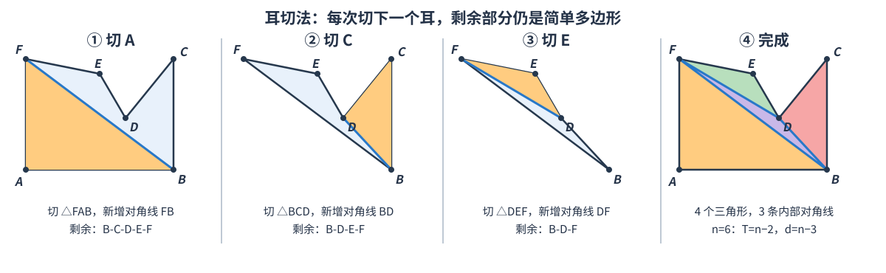

- 简单多边形 三角剖分
  - 对角线与剖分定义
  - 三角形数量与对角线数量
  - 耳切法 原理与步骤
  - 耳切法 代码
- 三角剖分 的 应用
  - CF1140D Minimum Triangulation
  - NWERC 2004 Minimax Triangulation
  - CF512E Fox And Polygon

## 简单多边形 三角剖分

### 对角线与剖分定义

简单多边形内部的一条对角线，其两个端点是互不相邻的多边形顶点，且线段除端点外完全位于多边形内部。用若干条互不相交的内部对角线把简单多边形分成三角形，称为三角剖分。

三角剖分不增加新顶点。若多边形有 $n$ 个顶点，设内部对角线数为 $d$、三角形数为 $T$。把对角线逐条加入后，区域数从 $1$ 增至 $d+1$，所以 $T=d+1$。数三角形边的邻接次数：每条边界边被数一次，每条内部对角线被数两次，因此 $3T=n+2d$。联立得到 $T=n-2,d=n-3$。



图中多边形按逆时针顺序为 $A,B,C,D,E,F$。内部对角线是 $FB,BD,DF$，最后得到 $FAB$、$BCD$、$DEF$、$BDF$ 四个三角形，数量满足 $6-2=4$。

### 耳切法 原理与步骤

设当前多边形中连续三个顶点为 $a,b,c$。如果：

1. $b$ 是凸顶点，即转向与多边形方向一致；
2. 三角形 $abc$ 内部及边界上没有其它当前多边形顶点；

那么 $b$ 是一个耳尖，三角形 $abc$ 可以从多边形上切下，线段 $ac$ 成为新的内部对角线。切掉一个耳后，剩余部分仍是简单多边形，重复操作直到只剩一个三角形。

下面按图中的顶点编号，走一遍过程：

| 步骤 | 当前多边形 | 切下的耳 | 新增对角线 | 剩余多边形 |
| --- | --- | --- | --- | --- |
| 1 | `A B C D E F` | `F A B` | `F B` | `B C D E F` |
| 2 | `B C D E F` | `B C D` | `B D` | `B D E F` |
| 3 | `B D E F` | `D E F` | `D F` | `B D F` |
| 4 | `B D F` | 最后一个三角形 | 无 | 完成 |

简单多边形至少有两个耳，因此只要当前顶点数大于 $3$，总能找到可切的耳。候选耳只需检查凹顶点是否落在三角形内：凸顶点不可能位于另一个耳三角形内部。用双向链表删除耳尖，并只重算被删除顶点的两个相邻顶点，就能把直接实现优化到 $O(n^2)$。

### 耳切法 代码

代码返回的三角形保存原多边形顶点下标，顶点顺序与输入边界顺序一致。为简化退化处理，输入要求：简单多边形、面积非零、没有重复顶点，且任意三点不共线。顶点可以顺时针或逆时针。

> **输入**：满足上述条件的简单多边形顶点数组 `p`。
>
> **输出**：成功时得到 $n-2$ 个三角形，每个三角形由三个原顶点下标表示；面积退化或过程找不到耳时返回 `false`。函数只检查顶点数与有向面积，不检查多边形是否简单、是否有重复点或三点共线；调用前必须保证上面的输入条件。
>
> **范围**：$O(n^2)$ 时间、$O(n)$ 额外空间。初始化时逐点检查耳需要 $O(n^2)$；每次切耳后只重算相邻的两个候选点，各自最多扫描当前所有顶点，合计仍为 $O(n^2)$。

```cpp
bool point_in_triangle_closed(Vec a, Vec b, Vec c, Vec p) {
    int s1 = sign((b - a) % (p - a));
    int s2 = sign((c - b) % (p - b));
    int s3 = sign((a - c) % (p - c));
    return (s1 >= 0 && s2 >= 0 && s3 >= 0) ||
           (s1 <= 0 && s2 <= 0 && s3 <= 0);
}

bool ear_clip(const vector<Vec>& P, vector<array<int, 3>>& Triangles) {
    Triangles.clear();
    int n = P.size();
    if (n < 3) return false;

    db area2 = polygon_area2(P);
    int orient = sign(area2);
    if (orient == 0) return false;

    vector<int> Pre(n), Nxt(n);
    vector<char> Alive(n, true);
    for (int i = 0; i < n; ++i) {
        Pre[i] = (i + n - 1) % n;
        Nxt[i] = (i + 1) % n;
    }

    vector<char> Convex(n), Ear(n);
    for (int i = 0; i < n; ++i) {
        int a = Pre[i], c = Nxt[i];
        Convex[i] = sign((P[i] - P[a]) % (P[c] - P[i])) == orient;
    }

    auto is_ear = [&](int i) {
        if (!Convex[i]) return false;
        int a = Pre[i], c = Nxt[i];
        for (int j = 0; j < n; ++j) {
            if (!Alive[j] || Convex[j] || j == a || j == i || j == c) continue;
            if (point_in_triangle_closed(P[a], P[i], P[c], P[j])) return false;
        }
        return true;
    };

    vector<int> Ears;
    for (int i = 0; i < n; ++i) {
        Ear[i] = is_ear(i);
        if (Ear[i]) Ears.push_back(i);
    }

    int left = n, ear_head = 0, cur = 0;
    while (left > 3) {
        while (ear_head < (int)Ears.size() &&
               (!Alive[Ears[ear_head]] || !Ear[Ears[ear_head]]))
            ++ear_head;
        if (ear_head == (int)Ears.size()) {
            Triangles.clear();
            return false;
        }

        int i = Ears[ear_head++];
        int a = Pre[i], c = Nxt[i];
        Triangles.push_back({a, i, c});
        Nxt[a] = c;
        Pre[c] = a;
        Alive[i] = false;
        Ear[i] = false;
        --left;
        cur = c;

        // 删除耳尖后，只会改变两个相邻顶点的转向。
        for (int v : {a, c}) {
            int l = Pre[v], r = Nxt[v];
            Convex[v] = sign((P[v] - P[l]) % (P[r] - P[v])) == orient;
        }
        for (int v : {a, c}) {
            bool was_ear = Ear[v];
            Ear[v] = is_ear(v);
            if (Ear[v] && !was_ear) Ears.push_back(v);
        }
    }

    int a = cur, b = Nxt[a], c = Nxt[b];
    Triangles.push_back({a, b, c});
    return true;
}
```

代码依赖多边形专题中的 `polygon_area2`，以及 `Vec`、`sign`。`point_in_triangle_closed` 把落在三角形边界上的其它顶点也视作阻挡点，避免切出经过其它顶点的对角线。耳切更新依赖一般位置前提；若输入可能有三点共线或重复点，应先单独规范化，并确认不会改变题目要求的顶点集合。代码不会验证这些前置条件，也不会验证多边形没有自交。

```cpp
vector<Vec> P = {
    {0, 0}, {4, 0}, {4, 3}, {2.7, 1.4}, {2, 2.6}, {0, 3}
};
vector<array<int, 3>> Triangles;

if (ear_clip(P, Triangles)) {
    // 依次得到 {5, 0, 1}, {1, 2, 3}, {3, 4, 5}, {5, 1, 3}
}
```

## 三角剖分 的 应用

下面收录真实竞赛题。两题分别展示：在所有剖分中做区间 DP，以及把两个剖分通过对角线翻转连接起来。

### CF1140D Minimum Triangulation

[Codeforces 1140D](https://codeforces.com/problemset/problem/1140/D) 给定一个顶点按逆时针编号为 $1..n$ 的正多边形。一个三角形 $(i,j,k)$ 的权值是 $ijk$，求三角剖分中所有三角形权值和的最小值。$3\le n\le 500$。

固定区间两端点 $(l,r)$，枚举最后连接的顶点 $k$。三角形 $(l,k,r)$ 把区间拆成两个独立子区间，因此

$$dp[l][r]=\min_{l<k<r}\bigl(dp[l][k]+dp[k][r]+lkr\bigr).$$

这里的重点是“选择最优剖分”，耳切法只会给出某一种剖分，不能代替区间 DP。

> **输入输出**：读入 $n$，输出最小权值。
>
> **复杂度**：$O(n^3)$ 时间、$O(n^2)$ 空间。

```cpp
// 未对拍，谨慎使用
int main() {
    ios::sync_with_stdio(false);
    cin.tie(nullptr);

    int n;
    cin >> n;
    vector<vector<long long>> Dp(n + 1, vector<long long>(n + 1));

    for (int length = 2; length < n; ++length) {
        for (int l = 1, r = length + 1; r <= n; ++l, ++r) {
            Dp[l][r] = LLONG_MAX;
            for (int k = l + 1; k < r; ++k) {
                Dp[l][r] = min(Dp[l][r],
                    Dp[l][k] + Dp[k][r] + 1LL * l * k * r);
            }
        }
    }
    cout << Dp[1][n] << '\n';
}
```

### NWERC 2004 Minimax Triangulation

[NWERC 2004 Problem I](https://codeforces.com/gym/106175/problem/I) 给一个简单多边形，在所有三角剖分中，最小化其中**面积最大的三角形**面积。顶点按边界顺序给出，$3\le n<50$，有多组数据。

这是凹多边形上的区间 DP。令 `Dp[i][j]` 表示由边界链 $i,i+1,\ldots,j$ 和弦 $(i,j)$ 围成的子多边形，其最小可能的最大三角形面积。枚举最后一个三角形 $(i,k,j)$：

$$Dp[i][j]=\min_k\max\bigl(Dp[i][k],Dp[k][j],area(i,k,j)\bigr).$$

与凸多边形不同，凹多边形的任意两点连线未必是内部对角线。因此先预处理弦是否完全位于多边形内，不合法的转移跳过。三条边都是内部线段时，它们围成的三角形也位于简单多边形内。合法性预处理使用 $O(n^3)$，DP 使用 $O(n^3)$。

> **输入**：测试组数；每组顶点数和按顺序给出的整数坐标。
>
> **输出**：每组最优最大三角形面积，保留一位小数。
>
> **范围**：$O(n^3)$ 时间、$O(n^2)$ 空间；$n<50$。叉积使用 `long long`，适用于题目坐标范围 $0\ldots10000$。

```cpp
// 未对拍，谨慎使用
#include <bits/stdc++.h>
using namespace std;

struct Vec {
    long long x, y;
};

long long cross(Vec a, Vec b, Vec c) {
    return (b.x - a.x) * (c.y - a.y) -
           (b.y - a.y) * (c.x - a.x);
}

long long dot(Vec a, Vec b, Vec c) {
    return (a.x - b.x) * (c.x - b.x) +
           (a.y - b.y) * (c.y - b.y);
}

bool on_segment(Vec a, Vec b, Vec p) {
    return cross(a, b, p) == 0 &&
           min(a.x, b.x) <= p.x && p.x <= max(a.x, b.x) &&
           min(a.y, b.y) <= p.y && p.y <= max(a.y, b.y);
}

bool segments_intersect(Vec a, Vec b, Vec c, Vec d) {
    long long ab_c = cross(a, b, c), ab_d = cross(a, b, d);
    long long cd_a = cross(c, d, a), cd_b = cross(c, d, b);
    if (ab_c == 0 && on_segment(a, b, c)) return true;
    if (ab_d == 0 && on_segment(a, b, d)) return true;
    if (cd_a == 0 && on_segment(c, d, a)) return true;
    if (cd_b == 0 && on_segment(c, d, b)) return true;
    bool cross_ab = (ab_c < 0 && ab_d > 0) || (ab_c > 0 && ab_d < 0);
    bool cross_cd = (cd_a < 0 && cd_b > 0) || (cd_a > 0 && cd_b < 0);
    return cross_ab && cross_cd;
}

bool inside_polygon(const vector<Vec>& P, long double x, long double y) {
    bool inside = false;
    int n = P.size();
    for (int i = 0, j = n - 1; i < n; j = i++) {
        long double ax = P[j].x, ay = P[j].y;
        long double bx = P[i].x, by = P[i].y;
        long double side = (bx - ax) * (y - ay) - (by - ay) * (x - ax);
        if (fabsl(side) < 1e-12L &&
            min(ax, bx) <= x && x <= max(ax, bx) &&
            min(ay, by) <= y && y <= max(ay, by)) return true;
        if ((ay > y) != (by > y)) {
            long double cross_x = ax + (bx - ax) * (y - ay) / (by - ay);
            if (cross_x > x) inside = !inside;
        }
    }
    return inside;
}

bool diagonal_inside(const vector<Vec>& P, int a, int b) {
    int n = P.size();
    if ((a + 1) % n == b || (b + 1) % n == a) return true;

    for (int i = 0; i < n; ++i) {
        int j = (i + 1) % n;
        bool share_a = (i == a || j == a);
        bool share_b = (i == b || j == b);
        if (share_a || share_b) {
            int shared = share_a ? a : b;
            int other_chord = shared == a ? b : a;
            int other_edge = i == shared ? j : i;
            if (cross(P[shared], P[other_chord], P[other_edge]) == 0 &&
                dot(P[other_chord], P[shared], P[other_edge]) > 0)
                return false;
        } else if (segments_intersect(P[a], P[b], P[i], P[j])) {
            return false;
        }
    }

    long double x = ((long double)P[a].x + P[b].x) / 2;
    long double y = ((long double)P[a].y + P[b].y) / 2;
    return inside_polygon(P, x, y);
}

int main() {
    ios::sync_with_stdio(false);
    cin.tie(nullptr);

    int tests;
    cin >> tests;
    cout << fixed << setprecision(1);
    while (tests--) {
        int n;
        cin >> n;
        vector<Vec> P(n);
        for (Vec& p : P) cin >> p.x >> p.y;

        vector<vector<char>> Valid(n, vector<char>(n));
        for (int i = 0; i < n; ++i)
            for (int j = i + 1; j < n; ++j)
                Valid[i][j] = Valid[j][i] = diagonal_inside(P, i, j);

        const long double INF = 1e100L;
        vector<vector<long double>> Dp(n, vector<long double>(n, INF));
        for (int i = 0; i + 1 < n; ++i) Dp[i][i + 1] = 0;

        for (int gap = 2; gap < n; ++gap) {
            for (int i = 0, j = gap; j < n; ++i, ++j) {
                if (!Valid[i][j]) continue;
                for (int k = i + 1; k < j; ++k) {
                    if (!Valid[i][k] || !Valid[k][j] ||
                        Dp[i][k] == INF || Dp[k][j] == INF) continue;
                    long long area2 = llabs(cross(P[i], P[k], P[j]));
                    if (area2 == 0) continue;
                    long double area = (long double)area2 / 2;
                    Dp[i][j] = min(Dp[i][j], max({Dp[i][k], Dp[k][j], area}));
                }
            }
        }
        cout << (double)Dp[0][n - 1] << '\n';
    }
}
```

这个例题的关键不是耳切，而是“最优剖分”的区间转移与凹多边形对角线合法性。由于三个边界线段都在简单多边形内部，三角形本身不会跨出多边形；因此转移只需检查三条边是否有效。

### CF512E Fox And Polygon

[Codeforces 512E](https://codeforces.com/problemset/problem/512/E) 给出同一个凸多边形的起始剖分和目标剖分。一次操作选择两个相邻三角形，把它们公共对角线翻到另一个对角线。要求输出不超过 $20000$ 次操作，把起始剖分变成目标剖分；$n\le1000$。

取以顶点 $1$ 为中心的扇形剖分作为中间状态。对起始剖分做一组翻转到扇形，对目标剖分也做一组翻转到同一个扇形；第二组翻转倒序后取逆，就得到从扇形回到目标的操作。翻转 $(a,b)$ 为 $(c,d)$ 是可逆操作，因此拼接两组操作即可。

邻接图包含多边形边和剖分对角线。令 `Key` 表示已经与顶点 $1$ 相连的顶点。沿三角形邻接关系遍历时，若非关键顶点 `v` 被两个关键顶点 `u,w` 夹住，则当前四边形的对角线 `u-w` 可翻成 `1-v`。记录被删除的对角线即可描述这次操作。

> **输入输出**：先读入 $n-3$ 条起始对角线，再读入 $n-3$ 条目标对角线；输出翻转次数和每步要翻转的当前对角线。
>
> **复杂度**：$O(n)$ 时间、$O(n)$ 空间；翻转次数不超过 $2(n-3)$。

```cpp
// 未对拍，谨慎使用
int main() {
    ios::sync_with_stdio(false);
    cin.tie(nullptr);

    int n;
    cin >> n;
    vector<vector<int>> Start(n + 1), Target(n + 1);
    auto add_edge = [](vector<vector<int>>& Graph, int u, int v) {
        Graph[u].push_back(v);
        Graph[v].push_back(u);
    };

    for (int i = 1; i <= n; ++i)
        add_edge(Start, i, i % n + 1), add_edge(Target, i, i % n + 1);

    vector<pair<int, int>> StartToFan, TargetToFan;
    for (int i = 0; i < n - 3; ++i) {
        int u, v;
        cin >> u >> v;
        add_edge(Start, u, v);
    }
    for (int i = 0; i < n - 3; ++i) {
        int u, v;
        cin >> u >> v;
        add_edge(Target, u, v);
    }

    auto make_fan = [&](const vector<vector<int>>& Graph,
                        vector<pair<int, int>>& Flips, bool RecordAddedEdge) {
        vector<char> Visited(n + 1), Key(n + 1);
        vector<int> Match(n + 1, 0);
        Visited[1] = true;
        for (int v : Graph[1]) Key[v] = true;

        auto dfs = [&](auto&& self, int u) -> void {
            Visited[u] = true;
            for (int v : Graph[u]) {
                if (Visited[v] || Key[v]) continue;
                if (Match[v] == 0) {
                    Match[v] = u;
                } else {
                    int w = Match[v];
                    if (RecordAddedEdge) Flips.push_back({1, v});
                    else Flips.push_back({u, w}); // 翻掉 u-w，加入 1-v
                    Key[v] = true;
                    self(self, v);
                }
            }
        };

        for (int v : Graph[1])
            if (!Visited[v]) dfs(dfs, v);
    };

    make_fan(Start, StartToFan, false);
    make_fan(Target, TargetToFan, true);

    cout << StartToFan.size() + TargetToFan.size() << '\n';
    for (auto [u, v] : StartToFan) cout << u << ' ' << v << '\n';
    reverse(TargetToFan.begin(), TargetToFan.end());
    for (auto [u, v] : TargetToFan) cout << u << ' ' << v << '\n';
}
```

目标剖分的变换记录新加入的扇形对角线 `1-v`；倒序输出这些边，就能逐步翻回目标剖分。代码利用凸多边形剖分的三角形邻接结构，不需要先显式列出每个三角形。
