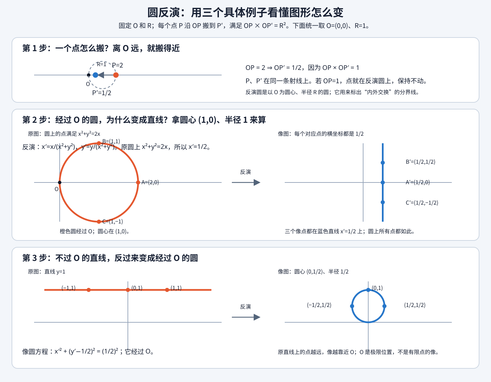

## 二维计算几何反演

### Which 题目反演

题目里若多个圆经过同一点，或多个圆在同一点相切，可以尝试把这个公共点选作反演中心。此时这些圆都经过反演中心，像会变成直线；原题的圆相切关系可能变成平行线或相交直线关系。

反演主要处理**圆、直线、相切和共点关系**。若题目只要求长度，且没有方便的公共点，反演通常不会让问题更简单。

### Why 反演

固定反演中心 $O$ 和半径 $R$。对点 $p\ne O$，沿射线 $OP$ 找像点 $p'$，满足 $OP\cdot OP'=R^2$。因此点的方向不变，距离变成 $R^2/OP$：离 $O$ 远的点搬近，离 $O$ 近的点搬远。



用 $O=(0,0),R=1$ 看最重要的例子。圆心 $(1,0)$、半径 1 的圆经过 $O$，方程是 $x^2+y^2=2x$。反演后

$$x'=\frac{x}{x^2+y^2}=\frac12,$$

所以圆上所有点都落到直线 $x'=1/2$。反过来，直线 $y=1$ 上的点 $(t,1)$ 映到 $(t/(t^2+1),1/(t^2+1))$，它们满足

$$x'^2+(y'-1/2)^2=(1/2)^2,$$

即变成经过 $O$ 的圆。记住这两个方向即可：**过中心的圆变直线；不过中心的直线变过中心的圆。**

### How 反演

反演不是“把整条直线或整个圆上的点逐个搬过去再拟合”。解题时先用下面的公式直接判断像的类型、位置和大小；只有题目需要具体像点，或公式推导不方便时，才挑关键点反演后重构。

以反演中心 $O$ 为原点写坐标，像点满足 $X=R^2x/|x|^2$。将原图形方程中的 $x$ 换成 $R^2X/|X|^2$，即可得到像方程：

- **直线**写成 $n\cdot(x-O)=c$。若 $c=0$，直线经过 $O$，反演后仍是这条直线（去掉 $O$）。若 $c\ne0$，像是经过 $O$ 的圆，圆心为 $O+\frac{R^2}{2c}n$，半径为 $\frac{R^2|n|}{2|c|}$。这里 $n$ 是直线法向量，不要求单位化。
- **圆**圆心为 $C$、半径为 $r$，令 $D=|C-O|^2-r^2$。若 $D=0$，原圆经过 $O$，像是直线 $ (C-O)\cdot(X-O)=R^2/2$；若 $D\ne0$，像圆心为 $O+\frac{R^2}{D}(C-O)$，半径为 $\frac{R^2r}{|D|}$。
- **关键点重构**：直线由两个不同像点确定；圆由三个不共线像点确定。原图形经过 $O$ 时，$O$ 没有有限像，不能把它当成普通关键点；这时直接用上面的直线公式。数值计算中优先用方程变换，避免三点近共线导致重构圆心不稳定。

真实赛题：[CF 744D Hongcow Draws a Circle](https://codeforces.com/contest/744/problem/D)（Codeforces Round 385 (Div. 1) D）

> 给定 $n$ 个红点和 $m$ 个蓝点，求一个至少包含一个红点、且不包含蓝点的最大圆半径；
>
> $1\le n,m\le1000$，坐标为 $[1,10^4]$ 内的整数。

这题只看反演带来的建模变化，不展开完整题解：

1. 选一个可能与最优圆相切的蓝点 $B$ 作反演中心。经过 $B$ 的候选圆整体变成直线。
2. 原圆半径为 $r$、反演半径为 $R$ 时，像直线到 $B$ 的距离为 $d=R^2/(2r)$。最大化原半径，等价于最小化像直线到反演中心的距离。
3. “圆不含蓝点、包含红点”转为像平面上的半平面分隔条件；于是几何核心变成寻找最近的合法分隔线。这里的重点是先找共点，再把圆约束改写成直线约束。

这道题用来说明反演如何改变问题模型即可；候选直线枚举和凸包优化属于具体题解，不在这里展开。

实际做题按这个顺序：找公共点作 $O$；写出每个圆/直线相对 $O$ 的方程；套上面的映射公式；在像图形里解决相交、平行或切线关系；最后只在题目问原图长度时，再用点反演公式换回去。反演不保长度。$O$ 本身没有有限像；经过 $O$ 的曲线在无穷远处的行为要按像直线理解。

### Codes

以下沿用 ACMT 的 `Vec`、`Seg`、`Circle` 和 `dot`。函数直接变换整条直线/圆，不需要选关键点采样重构。`CurveImage` 用 `is_line` 区分返回的是直线还是圆：

> **输入**：反演圆心 `o`、半径 `R>0`；点反演要求 `p != o`；直线用 `Seg::st(A,B)` 表示且 `A != B`；圆要求 `r>0`。
>
> **输出**：点的像点，或直线/圆的像（`is_line == true` 时读 `Line`，否则读 `Cir`）。
>
> **范围**：每次变换 $O(1)$ 时间、$O(1)$ 空间；输出为浮点几何对象，判零沿用 ACMT 的 `sign`。

```cpp
struct CurveImage {
    bool is_line;
    Seg Line;
    Circle Cir;
};

Circle make_circle(Vec o, db r) {
    return Circle::Or(o, r);
}

Vec invert(Vec p, Vec o, db R) {
    Vec d = p - o;
    return o + d * (R * R / dot(d, d)); // p != o
}

CurveImage invert_line(Seg L, Vec o, db R) {
    Vec n(-L.v.y, L.v.x); // 法向量
    db c = dot(n, L.s - o);
    if (sign(c) == 0) return {true, Seg::st(o, o + L.v), Circle()};

    Vec c0 = o + n * (R * R / (2 * c));
    db r = R * R * sqrt(dot(n, n)) / (2 * abs(c));
    return {false, Seg(), make_circle(c0, r)};
}

CurveImage invert_circle(Circle Cir, Vec o, db R) {
    Vec d = Cir.o - o;
    db D = dot(d, d) - Cir.r * Cir.r;
    if (sign(D) == 0) {
        Vec x = o + d * (R * R / (2 * dot(d, d)));
        Vec v(-d.y, d.x);
        return {true, Seg::st(x, x + v), Circle()};
    }

    Vec c = o + d * (R * R / D);
    db r = R * R * Cir.r / abs(D);
    return {false, Seg(), make_circle(c, r)};
}
```

这里直线输入是无限直线的有向表示 `Seg::st(A,B)`，不是只反演线段 `AB`；圆、直线整体按方程变换。若题目只需要验证映射结果，也可挑两个/三个不退化关键点反演后重构，但那是验证或简化手算的办法，不是代码必须采用的算法。
