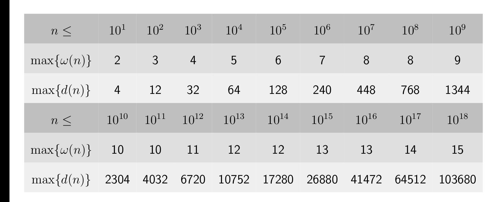

贴一个这个，虽然没什么关系



这一道题，用的其实是

$$
\pi(n) = 小于等于 n 的质数个数
$$

只保留**位宽跳变点**（即 $i$ 为质数、$i^2$ 处 $\pi(i)$ 才增加），合数 $i$ 不单列。这样表从 100 行压到 26 行，信息不丢。

| 当前质数 $p$ | $p^2$（跳变点） | $\pi(p)$ | 状压位宽 $k=\pi(p)$ | 状态数 $2^k$ | 适用 $V$ 区间（位宽保持 $k$）               |
| -------: | ---------: | -------: | --------------: | --------: | --------------------------------- |
|        — |          1 |        0 |               0 |         1 | $1\sim3$                          |
|        2 |          4 |        1 |               1 |         2 | $4\sim8$                          |
|        3 |          9 |        2 |               2 |         4 | $9\sim24$                         |
|        5 |         25 |        3 |               3 |         8 | $25\sim48$                        |
|        7 |         49 |        4 |               4 |        16 | $49\sim120$                       |
|       11 |        121 |        5 |               5 |        32 | $121\sim168$                      |
|       13 |        169 |        6 |               6 |        64 | $169\sim288$                      |
|       17 |        289 |        7 |               7 |       128 | $289\sim360$                      |
|       19 |        361 |        8 |               8 |       256 | $361\sim528$                      |
|       23 |        529 |        9 |               9 |       512 | $529\sim840$                      |
|       29 |        841 |       10 |              10 |      1024 | $841\sim960$                      |
|       31 |        961 |       11 |              11 |      2048 | $961\sim1368$                     |
|       37 |       1369 |       12 |              12 |      4096 | $1369\sim1680$                    |
|       41 |       1681 |       13 |              13 |      8192 | $1681\sim1848$                    |
|       43 |       1849 |       14 |              14 |     16384 | $1849\sim2208$                    |
|       47 |       2209 |       15 |              15 |     32768 | $2209\sim2808$                    |
|   **53** |   **2809** |   **16** |          **16** | **65536** | **$2809\sim3480$（$V=3000$ 落在这里）** |
|       59 |       3481 |       17 |              17 |    131072 | $3481\sim3720$                    |
|       61 |       3721 |       18 |              18 |    262144 | $3721\sim4488$                    |
|       67 |       4489 |       19 |              19 |    524288 | $4489\sim5040$                    |
|       71 |       5041 |       20 |              20 |   1048576 | $5041\sim5328$                    |
|       73 |       5329 |       21 |              21 |   2097152 | $5329\sim6240$                    |
|       79 |       6241 |       22 |              22 |   4194304 | $6241\sim6888$                    |
|       83 |       6889 |       23 |              23 |   8388608 | $6889\sim7920$                    |
|       89 |       7921 |       24 |              24 |  16777216 | $7921\sim9408$                    |
|       97 |       9409 |       25 |              25 |  33554432 | $9409\sim10000$                   |

**读法**：位宽只在质数平方处增加；合数 $i^2$（如 $4^2,6^2,8^2,9^2,10^2$）不会让 $\pi(i)$ 增加，所以不单列。

### Code

```cpp
// BLOG2 卧槽
// 神了
// 看了正解
// 并且 debug 了好久
// 之后
// 一发入魂！！！！
#include<bits/stdc++.h>
using namespace std;
using ll = long long;

const int N = 2e3 + 5, V = 3e3 + 5;
const ll mod = 998244353;

int factor[V], cntP, primes[V];
int S[V], rem[V];

void init() {
    for (int i = 2; i < V; i++) {
        if (!factor[i]) {
            factor[i] = primes[cntP++] = i;
        }
        for (int j = 0; j < cntP; j++) {
            int p = primes[j];
            int pi = p * i;
            if (pi >= V) break;
            factor[pi] = p;
            if (i % p == 0) break;
        }
    }
    // 15 : 53
    // for (int i = 0; i < 20;i++) {
    //     cout << i << ": " << primes[i] << "\n";
    // }
    for (int i = 1; i < V; i++) {
        int num = i;
        for (int j = 0; j < 16; j++) {
            int p = primes[j];
            while (num % p == 0) {
                S[i] |= 1 << j;
                num /= p;
            }
        }
        rem[i] = num;
    }
}

int n;
int a[N];
vector<int> nums[V];

// f_u[s][0/1] 表示
// 当前已经累计乘积来到了 s 状态, 并且这个大质因子 无/有
// 所有这种可能的 累加和
// 转移必然是从小的 s 到 大的 s
// 所以 必然会是 倒序遍历所有的 fs
// 然后 尝试加入这个 a 从而转移
// 注意这个 a 的 s_a 与 rem_a
// 首先, 对于这种的乘积，除了基础的 a 本身，他只会额外乘以这些因子：
// 即 s_a 且 非 s 的那些因子
// 那么就需要乘以这些因素
// 那么，累加和就来到了 s | s_a
// 并且存在 rem_a
// 对了，要额外考虑 rem_a
// 如果有了 1 rem_a 那么就不需要乘以这个因子了
// 如果没有 0 rem_a 那么就需要乘以一次这个因子
// 并且 我们定义 什么也没有的空集 自然是 1
// 但是，这里我们要注意，最初我们给 rem = 1 者初始化的时候

ll f[2][1<<16][2];

void solve() {
    cin >> n;
    for (int i = 1; i <= n; i++) {
        cin >> a[i];
        nums[rem[a[i]]].push_back(a[i]);
    }
    int u = 0;
    f[u][0][0] = 1;

#define v (u^1)
    for (int i = 1; i < V; i++) {
        if (nums[i].size()) {
            for (auto x: nums[i]) {
                // 先拷贝，啥都不用干,表示 x 不选用的情况
                memcpy(f[v], f[u], sizeof(f[v]));
                // 先拷贝一份 因为可以不加
                for (int s = (1<<16)-1; s >= 0; s--) {
                    int ns = s | S[x];
                    int delta = (~s) & S[x];
                    int nx1 = x;
                    for (int j = 0; j < 16; j++) {
                        if (delta >> j & 1) {
                            nx1 /= primes[j];
                            nx1 *= primes[j] - 1;
                        }
                    }
                    int nx0 = nx1;
                    assert(rem[x] == i);
                    if (rem[x] > 1) {
                        // 就是说 不要因为 rem = 1 就不让乘了
                        nx0 /= rem[x];
                        nx0 *= max(1, rem[x]-1);
                    }
                    // 然后，更新一下 x 选用的情况
                    (f[v][ns][1] += f[u][s][0] *  nx0 + f[u][s][1] * nx1) %= mod;
                    // (f[v][s][0] += f[u][s][0]) %= mod; // 啥都不干
                    // (f[v][s][1] += f[u][s][1]) %= mod; //
                }
                // 然后 总结一波
                // x 选用 和 不选用 都总结完毕，那么，这是新的情形
                u = v;
            }
            // 同类 rem 所有的情形 总结完毕
            // 那么 对于后来的情形 直接认为是 0 情形
            for (int s = 0; s < (1<<16);s++) {
                (f[u][s][0] += f[u][s][1]) %= mod;
                f[u][s][1] = 0;
            }
        }
    }
    ll ans = 0;
    for (int s = 0; s < (1<<16); s++) ans = (ans + f[u][s][0]) % mod;
    cout << ans << "\n";
}

int main() {
    init();
    // cout << int(sqrt(3000)) << "\n";
    ios::sync_with_stdio(0); cin.tie(0); cout.tie(0);
    int T = 1;
    // cin >> T;
    while (T--) solve();
}

/*

3
1 2 3

12

*/
```